> 历史研究/验证文档：保留原版本数据。当前1102主线的落盘air-gap、推定归属与重构模型以[现行设计要求](docs/DESIGN_REQUIREMENTS.md)为准，旧通道容量规则不再是当前“宽度分析”。

# DIE-First 芯片偏移重构研究与 GDS 评估 — V21

> 当前软件为V21；Pad随动修复、局部宽度判据及验证见 [V21图文说明](docs/V21_操作与验证说明.md)。原材料型变算法继续采用V20；历史适配统计不等同于本版新增的宽度检查。源码ZIP不含报告图片。

2026-10-26 · Die Shift Analyze V21 · 长度单位：μm

**V20增加原铜材料随动验收、双向动画缓存和实时负载调度。** 原孔盘及连接图形必须实际型变；未通过的接口保留源图并说明原因。GD55六状态的现行逐接口统计、缓存复核和限制见[V20图文说明](docs/V20_操作与验证说明.md)。三方案判据、连续安全盒与模型良率的口径保持原样，下文历史图表按其标明版本和工艺参数解读。

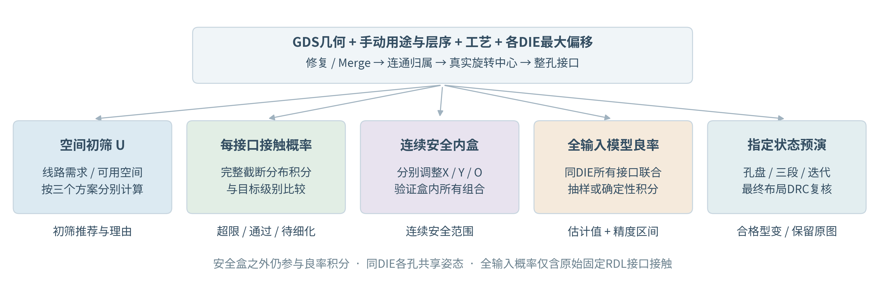

图1｜空间初筛、每接口接触概率、连续安全内盒、全输入模型良率与指定状态型变分别输出。U不混入接触概率；安全范围不能用若干极端点的最大值拼接。所有长度为μm，角度界面用°、内部用rad。

## 1. 三方案的适用性

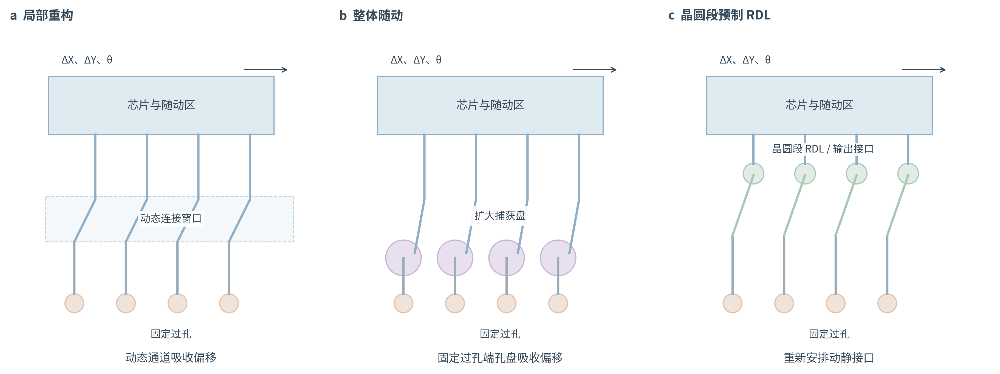

图2｜题设三种方案的概念结构，非比例工艺剖面。图中的晶圆段表示方案3的制造过程；软件图层用途仍只分运动/固定RDL、运动/固定过孔，不从“运动”用途推断实际制造阶段。

| 方案 | 优点 | 主要限制 | 量化初筛 | 合适的情况 |
|---|---|---|---|---|
| 1 动静区局部重构 | 固定端不动；各DIE独立适配 | 需真实连通和局部布线空间 | $U_1=\max(W_{chip}/\ell_{chip})$ | 中间布线带宽有余量；固定端捕获空间不足 |
| 2 整体随动＋固定端捕获 | 随动内部相对几何不变；局部改线较少 | 远端旋转位移较大；跨DIE公共网络不适用 | $U_2=\max(Q_{fixed}/M_{fixed})$ | 固定过孔端可扩展空间大、DIE间电连接独立 |
| 3 预制运动RDL＋接口适配 | 可先扇出，扩大接口边界可用长度 | 需预制工序；扇出也增加旋转半径 | $U_3=\max(W_{fanout}/\ell_{fanout},W_{moving}/\ell_{chip})$ | 芯片边界拥挤，真实扇出后边界较宽裕 |

三者均以U≤1作为**空间初筛候选**，U越小代表该模型下余量越大；并不代表已布通或良率合格。机械净距、归属、跨DIE刚体冲突分别检查。方案1/3若几何资源相同，允许同分；仅同分时按2→1→3减少工序。运动RDL用途不能证明其已在晶圆段预制。

“窗口不足”与连续安全盒仍只检查**真实运动过孔—相邻固定RDL接口对其他网络的接触**；方案2的空间初筛另追溯固定过孔捕获端。本网络不作为障碍。预演只显示通过最终约束检查的型变，其他线路恢复原图并提示。

工业依据：Deca的原始论文摘要区分随动对准、局部自适应路由及多DIE混合方式，并强调同时处理XY与旋转最坏组合；本文U是为本工具提出的可审计工程初筛，**不是论文给出的经验评分或量产良率公式**。[Deca / ECTC 2016，Adaptive Patterning Design Methodologies](https://thinkdeca.com/adaptive-patterning-design-methodologies/)

芯片尺寸、线路数、芯片数必须与真实几何共同考虑：线路数量主要影响通道占用，接口相对所选旋转中心的半径影响旋转位移，多个DIE是否共用网络影响方案2的结构适用性。不能仅按芯片面积给出可靠分类。

## 2. 单位、输入与连接关系

常规芯片长、宽为500～10000 μm，长边/短边为1～3。尺寸趋势图外扩到400～12000 μm。旋转矩形使用局部实物边长，不使用轴对齐包围盒替代尺寸。

| 符号 | 含义、单位及来源 |
|---|---|
| $C_{die}$、$C=(C_x,C_y)^T$ | 芯片名义中心与实际旋转中心，μm；默认相同，四角取真实边框顶点，自定义为 $C=C_{die}+c_{relative}$ |
| $P=C+A$，$A=(A_x,A_y)^T$ | 名义位置与相对所属DIE实际旋转中心坐标，μm，可位于芯片外 |
| $r=\sqrt{A_x^2+A_y^2}$ | 转动半径，μm；由真实连接归属计算 |
| $z=(D_x,D_y,\theta)^T$ | DIE刚体状态，平移为μm，转角为rad |
| $B_x,B_y,B_O$ | 输入单边最大幅度；平移μm，角度°；$B_\theta=B_O\pi/180$ |
| $\mu=(\mu_x,\mu_y,\mu_\theta)^T$ | 系统均值；输入的均值转角同样由°换算rad |
| $k$ | 用户选择的有限目标覆盖级别，整数0～12；0检查所有有界概率；∞是另一个二值模式 |
| $\kappa$ | 母正态尺度除数，非零有限 $k$ 时等于 $k$，$k=0$ 时沿用最近有限非零级别（首次6） |
| $a,s,w$ | 工艺最小包围、线距、线宽，μm；线距/线宽分别设置运动和固定类型 |
| $V_i,F_j$ | 第i个实际运动过孔、第j个固定RDL图形；从修复后的GDS读取 |
| $\mathcal F_i$ | 与接口i相接的固定RDL平面上，排除本网络后的全部图形集合 |
| $M,L,N_b,\ell_b$ | DIE数、对应RDL层数、分配到边b的接口数、该边长度；从GDS提取 |

金属同层接触取连通分量；相邻金属平面按面积交叠连接。跨层判据为：

$$E_{ij}=\mathbf1\{\operatorname{Area}(A_i\cap B_j)>\epsilon_A\},\qquad
\epsilon_A=\max(10^{-12},0.01\delta^2).$$

$A_i,B_j$是上下相邻金属图形，$\delta$为GDS数据库网格，μm；$\epsilon_A$为数值面积容差，μm²。同一物理层号的不同datatype共同组成金属平面。边框、不参与层、禁布层不构成电连接层。

沿下层追溯的芯片集合为 $\mathcal D(A)=\bigcup_{B\in\mathrm{down}(A)}\mathcal D(B)$。V21对每颗DIE分别选择最深的末端金属实际接触作为根；同层连接先合并。空金属行忽略；相邻参与金属平面必须真实面积重叠，即使某颗DIE局部缺少中间层图形也不跨过该参与层补造连接。已有向下连接的载体不因穿过其他DIE而新增根。集合只有一个DIE时允许随动；无根或多根则保留名义位置并明确待确认。跨芯片网络由完整几何连通分量包含的DIE根集合自动判断，删除人工网络选择。根层需要按真实层序设置正确。

## 3. 从平移与转角到任意位置的真实位移

$$R(\theta)=\begin{bmatrix}\cos\theta&-\sin\theta\\\sin\theta&\cos\theta\end{bmatrix},\qquad
P'=C+D+R(\theta)A,\qquad U=P'-P=D+[R(\theta)-I]A.$$

$I$为2×2单位矩阵，$D=(D_x,D_y)^T$，$P'$是实际坐标，$U$是相对名义位置的位移，单位均为μm。分量展开：

$$U_x=D_x+A_x(\cos\theta-1)-A_y\sin\theta,$$
$$U_y=D_y+A_x\sin\theta+A_y(\cos\theta-1).$$

因此，输入DX、DY的最大值为35 μm，并不要求每个过孔的实际位移分量也不超过35 μm：后者叠加了转动。**极端表中的DX/DY是旋转变换外的平移分量；非中心旋转时，芯片中心本身还会因转动发生位移；结果分析的橙线长度是过孔实际位移。** 手动输入可超出配置最大幅度作额外工况检查，该工况仅二值评估，不属于原概率分布。

## 4. 最大幅度与截断正态分布

用户确认输入幅度代表最大偏移量。非退化的未截断正态分布没有有限最大值，故V9显式使用**盒内截断正态**，不把尾部默认为零后继续使用未归一化密度。

有限k（含0）时，先定义母正态尺度：

$$\sigma_x=\frac{B_x}{\kappa},\quad\sigma_y=\frac{B_y}{\kappa},\quad\sigma_\theta=\frac{B_O\pi}{180\kappa},$$

$$\Sigma=\begin{bmatrix}\sigma_x^2&\rho\sigma_x\sigma_y&0\\
\rho\sigma_x\sigma_y&\sigma_y^2&0\\0&0&\sigma_\theta^2\end{bmatrix}.$$

$\rho$为母正态XY相关系数，角度与平移独立。这里的σ是**截断前**标准差；截断后的标准差和XY相关系数一般会变化，不能混同。

定义允许状态盒、归一化质量和实际密度：

$$\mathcal H=\{z:|z_j-\mu_j|\le B_j,\ j=x,y,\theta\},$$
$$Z=\int_{\mathcal H}f_N(z;\mu,\Sigma)\,dz,\qquad
f_T(z)=\frac{f_N(z;\mu,\Sigma)\mathbf1_{\mathcal H}(z)}{Z}.$$

$f_N$为母多元正态密度，$f_T$为软件实际使用的条件密度。零均值时支持范围为±输入最大幅度；非零均值时输入表示相对均值的最大随机偏差，绝对范围为μ±B。零方差维固定在均值；$|\rho|=1$按一维退化平移处理。

归一化过程可复算为 $Z=Z_{xy}Z_\theta$。有角度方差时 $Z_\theta=\Phi(k)-\Phi(-k)$，否则为1。XY方差均非零且$|\rho|<1$时：

$$Z_{xy}=\int_{-k}^{k}\phi(u)\left[
\Phi\!\left(\frac{k-\rho u}{\sqrt{1-\rho^2}}\right)-
\Phi\!\left(\frac{-k-\rho u}{\sqrt{1-\rho^2}}\right)\right]du.$$

$u$为标准化X变量，$\phi(u)=e^{-u^2/2}/\sqrt{2\pi}$为标准正态密度，$\Phi$为其CDF；代码采用确定性一维积分。$\rho=0$时为两个边际质量乘积，$|\rho|=1$时为一个边际质量；只有一维随机平移时也只取该维质量。

### 4.1 任意位置的实际概率分布

令 $g(\theta)=[R(\theta)-I]A$。由于角度与平移独立，截断盒也是平移盒与角度区间的乘积，真实位移密度为：

$$f_U(u_x,u_y)=\int_{\mu_\theta-B_\theta}^{\mu_\theta+B_\theta}
f_{D,T}\!\left(\begin{bmatrix}u_x\\u_y\end{bmatrix}-g(\theta)\right)
f_{\theta,T}(\theta)\,d\theta.$$

$f_{D,T}$是XY母正态在平移盒内除以$Z_{xy}$后的密度，$f_{\theta,T}$是角度母正态在角度区间内除以$Z_\theta$后的密度；超出各自边界时密度为0。$u_x,u_y$是输出位移坐标。给定θ时仅平移概率坐标，Jacobian为1，因此不需要额外比例因子。绝对位置密度为 $f_{P'}(p)=f_U(p-C-A)$。零方差退化情形使用概率质量而非二维普通密度。

一般转角下该积分并非二维正态。程序使用精确刚体变换和数值积分/采样，不用小角度线性正态取代实体覆盖结果。

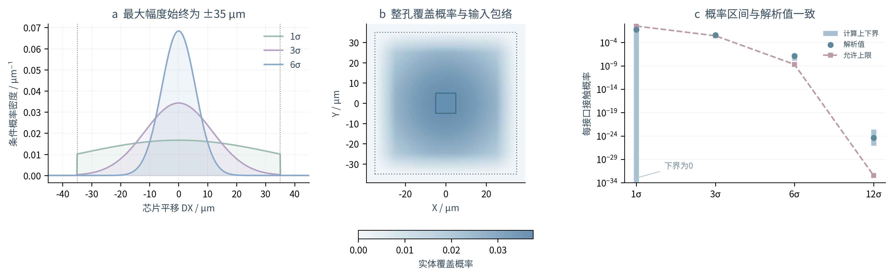

图3｜左：最大35 μm不随目标k变化。中：10×10 μm真实孔，XY最大30 μm，1σ；中心方框为原孔，外虚线为输入包络。右：单轴解析接触事件与程序概率界，示例为软件构造的验证几何，不是工厂实测。阴影和概率界含义分别标明，未用数据点离散程度冒充置信区间。

## 5. 窗口不足：三种界面状态

线距控制区域与接触事件：

$$V_{a,i}=T_z(V_i)\oplus\mathcal B_a,\quad
V_{s,i}=T_z(V_i)\oplus\mathcal B_{a+s},$$
$$I_i(z)=\mathbf1\left\{\min_{F_j\in\mathcal F_i}\operatorname{dist}(T_z(V_i),F_j)\le a+s\right\}.$$

$T_z$是第3节刚体变换，$\oplus$为Minkowski和，$\mathcal B_r$为半径r圆盘，dist为真实图形最短距离。$s$使用相接固定RDL的线距。相切也算接触；包围区/线距区在图上为不同颜色的无填充虚线。

| 界面状态 | 判据 | 图形含义 |
|---|---|---|
| 空白首行，有限k | $p_i=\int I_i(z)f_T(z)dz>\alpha$，$\alpha=2\Phi(-k)$ | 只列已确认超限的随机接触位置 |
| 极端行或手动偏移 | $I_i(z_{current})=1$ | 当前确定状态碰到即不足，与k无关 |
| ∞，空白首行 | $I_i(0)=1$ | 名义图形二值检查，不表示“任意非零尾概率即问题” |

α是**每个接口与全部其他网络的联合接触事件**的允许上限。6σ时约为$1.9731753\times10^{-9}$，12σ时约为$3.5529642\times10^{-33}$；使用生存函数直接计算，避免$1-\Phi(k)$的浮点消减。它不是已验证的整包良率指标；软件未假设各接口独立，也未把重叠事件概率简单相加。

实际侵入区域和面积为 $A_{ij}=V_{s,i}\cap F_j$、$a_{ij}=\operatorname{Area}(A_{ij})$。三个方案均绘制半透明红色交集；相切面积可能为0，此时仍保留红圈。灰色虚线接到当前运动后的过孔中心，无预演时接名义中心。

### 5.1 用概率上下界判断稀有事件

4096次采样零命中，不能证明$10^{-9}$级风险合格。V9默认判定使用独立于显示网格的自适应状态盒积分，**共享同一$f_T$**：

1. 取独立标准正态向量u，构造$z=\mu+Lu$，其中
$L=\begin{bmatrix}\sigma_x&0&0\\\rho\sigma_y&\sigma_y\sqrt{1-\rho^2}&0\\0&0&\sigma_\theta\end{bmatrix}$，满足$LL^T=\Sigma$。
2. 标准状态盒b的各维端点为$l_{bd},h_{bd}$，母质量为$ m_b=\prod_d[\Phi(h_{bd})-\Phi(l_{bd})]$。零方差维删除；物理允许范围与H相交。
3. 物理盒中点图形到其他网络的最短距离为$d_b$，各维半宽为$e_x,e_y,e_\theta$。过孔任意顶点到实际旋转中心的最大距离为$r_V$，整盒运动上界为
$$\Delta_b=\sqrt{e_x^2+e_y^2}+2r_V\sin\left(\frac{\min(\pi,e_\theta)}2\right).$$
4. $d_b>a+s+\Delta_b$证明整盒无接触；整盒在H内且$d_b+\Delta_b\le a+s$证明整盒接触。其余按最大未定质量继续分裂。
5. 必接触盒集合为$\mathcal B_{hit}$，未定盒集合为$\mathcal B_?$，归一化容差为$\epsilon_Z$，积分范围外母概率上界为$\epsilon_t$：
$$p_L=\frac{\sum_{b\in\mathcal B_{hit}}m_b}{Z+\epsilon_Z},\qquad
p_U=\min\left(1,\frac{\sum_{b\in\mathcal B_{hit}\cup\mathcal B_?}m_b+\epsilon_t}{Z-\epsilon_Z}\right).$$

只有$p_L>\alpha$列不足；只有$p_U\le\alpha$通过概率检查；跨过阈值则显示“概率待细化”。增加“接触概率自适应积分预算”可以继续细分，仍不保证任意近阈值案例有限步完成。几何比较有$\max(10^{-9},10^{-6}\delta)$ μm数值容差，概率界是该容差模型下的数值验证，不是形式化精确实数证明。

## 6. 整孔实体概率与极端包络

对于空间点q，实体覆盖概率为
$$p_V(q)=\int\mathbf1\{q\in T_z(V)\}f_T(z)dz.$$

网格G显示格内平均覆盖率；独立采样估计为
$$\widehat p_{V,G}=\frac1N\sum_{n=1}^N\frac{|G\cap T_{z_n}(V)|}{|G|},\qquad
\int p_V(q)dq=|V|.$$

N为设置的$2^{采样指数}$，$|\cdot|$为面积。实体积分应接近过孔面积，不能把格概率和归一化为1。算法包括：

- Monte Carlo：相关母正态采样，联合拒绝超出H的状态，再取所需数量。
- Sobol：同样联合截断的准随机数值近似；拒绝后不声称保留原始Sobol点集的完整平衡保证。
- 确定性积分：相关平移网格概率除以$Z_{xy}$，对角度条件CDF做Gauss–Legendre积分。节点$h_j$和权重$w_j$属于[-1,1]区间：
$$\theta_j=\mu_\theta+\sigma_\theta\Phi^{-1}\left(\Phi(-k)+\frac{h_j+1}{2}[\Phi(k)-\Phi(-k)]\right),\quad\omega_j=\frac{w_j}{2}.$$
  每个角度下，用整孔面积掩模与平移概率格卷积，再按$\omega_j$加权。权重和为1；平移网格覆盖整个硬输入范围。无随机采样不等于穷举不可数的连续状态。

空间栅格、朝向分组及有限积分阶数均有数值误差；报告给出面积积分和可复算设置。极端端点附近可能极低概率，采样未命中或FFT无法分辨时不虚构颜色。V16默认以概率相关透明度显示，不额外描画输入最大幅度外框；**可在设置中启用覆盖级别虚线包络**，覆盖所有连续输入组合；它不是等概率线。手动超界工况可位于该包络之外，这是额外二值检查。

## 7. Space Map 与量化指标

Space Map表示相对固定层的总线距需求，$S(P)=s+Q(P)$，不含孔半径和包围量。

令$b=R(\mu_\theta)A$，$J=\begin{bmatrix}1&0&-b_y\\0&1&b_x\end{bmatrix}$，$V=J\Sigma J^T$，其最大特征值由
$$\lambda_{max}=\frac{V_{11}+V_{22}+\sqrt{(V_{11}-V_{22})^2+4V_{12}^2}}2$$
求得。$J$为位置对状态的一阶导数，$V_{ij}$为二维母线性位移协方差元素。

取$k_M=\sqrt{F^{-1}_{\chi^2_3}(1-\alpha Z/M)}$，$F_{\chi^2_3}$为三自由度卡方CDF；实现使用逆生存函数直接输入$\alpha Z/M$。条件置信界与硬输入界分别为

$$Q_N=\|\mu_{xy}+b-A\|+k_M\sqrt{\lambda_{max}}+\frac{\|A\|(k_M\sigma_\theta)^2}2,$$
$$Q_H=\|\mu_{xy}+b-A\|+\sqrt{B_x^2+B_y^2}+2\|A\|\sin\left(\frac{\min(\pi,B_\theta)}2\right),\quad Q=\min(Q_N,Q_H).$$

角度在式中为rad。$Q_N$末项控制旋转二阶余项，$Q_H$约束硬输入范围；二者取较小仍为有效保守界。∞模式没有统计补偿量，Space Map使用基础线距。

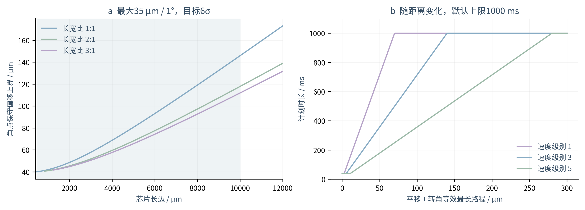

图4｜左：芯片尺寸扩展范围400～12000 μm，阴影为常规长边范围；各长宽比曲线也限制短边≥400 μm（常规值为≥500 μm）。接口实际半径应从GDS取值，图为角点参数扫描。右：计划插值时长随位移路程增长并在默认1000 ms封顶；绘制开销不包含在计划时长中，实际耗时见版本验证说明。

### 7.1 统一判据：空间需求／可用空间

对任一待随动实体，以其全部顶点到实际旋转中心的最远距离为 $R_i$：

$$R_i=\max_{v\in\mathrm{vertices}(V_i)}\|v-C_d\|,$$
$$Q_i=\sqrt{(|\mu_x|+B_x)^2+(|\mu_y|+B_y)^2}+2R_i\sin\left(\frac{\min(\pi,|\mu_\theta|+B_\theta)}{2}\right).$$

$V_i$为真实过孔实体，$C_d$为所属DIE旋转中心。$Q_i$为硬输入盒内相对名义位置的保守位移上界，μm；$\mu$、$B$见第2节，角度必须换成rad。平移项取矩形最远角距离，转动项为圆上最大弦长。这个手算判据在0、有限k、∞下都使用完整输入幅度，概率阈值仍按第5节单独处理。

**方案1：芯片边界的布线带宽。** 将实际接口按最近矩形边分配，同一边上的同几何网络只计一次：

$$n_b=\left\lceil\frac{N_b}{L_f}\right\rceil,\qquad W_b=n_bw_f+(n_b-1)s_f+2Q_d\quad(N_b>0),\qquad U_1=\max_{d,b}\frac{W_b}{\ell_b}.$$

$N_b$为边b的几何网络数，$L_f$为实际固定RDL物理层数（不同datatype不重复计层，亦不超过参数层数）；$n_b$为均分到各层时单层最多轨道数。$w_f,s_f$为固定规则，$Q_d=\max_iQ_i$取该DIE全部真实动孔接口的最大值；$\ell_b$为相应DIE局部边长。$N_b=0$时$W_b=0$。同DIE的线路共同刚体移动，**只在整束两端加2Q，不对每条线加2Q**。最近边分配和均分层是明确的初筛假设，实际障碍与交叉可能降低能力。

**方案2：固定过孔捕获端空间。** 沿几何网络把固定过孔归到单个DIE，并查相邻固定RDL平面。对该固定孔实体$V_i$：

$$M_i=\min\left\{d(V_i,F_{\ne i})-a-s_f,\ d(V_i,\partial P)-a,\ d(V_i,K)-a-s_f,\ \min_{j\ne i}\frac{d(V_i,V_j)-2a-s_f}{2}\right\},\qquad U_2=\max_i\frac{Q_i}{M_i}.$$

$d$为实体最短距离；$F_{\ne i}$为同接收平面其他网络固定RDL，$P$为封装多边形，$K$为禁布区集合，$j$只取同平面的其他网络固定过孔。没有对应障碍的项取∞。孔盘之间的共享净空间各分一半，避免双方都占用整段间隙；$a$为包围量。$M_i\le0$则$U_2=∞$。这里计算**可用于扩大捕获盘的剩余空间**，不再把现有孔盘半径直接当不可改变的能力。$Q_i$使用固定端实体到DIE旋转中心的半径；固定孔与随动图形相对运动的上界相同。全段RDL随动后的全层碰撞、连通和电性能仍需验证。

**方案3：真实扇出空间。** 构造与DIE同方向且包含DIE及全部所属动孔接口的最小矩形。把这四条边代入方案1带宽式得到$W_{fanout,b}/\ell_{fanout,b}$；运动RDL原始端口按实际最下金属网络提取，缺少独立源端口时用已观察接口保守计数，代入运动线宽/线距、运动层数并令Q=0：

$$U_3=\max\left\{\max_b\frac{W_{fanout,b}}{\ell_{fanout,b}},\ \max_b\frac{W_{moving,b}}{\ell_{chip,b}}\right\}.$$

$W_{moving}$用$n=\lceil N/L_m\rceil$和$nw_m+(n-1)s_m$计算；$L_m,w_m,s_m$分别为运动RDL层数及规则。没有运动RDL不适用方案3。若接口没有提供更大的有效边界或共同瓶颈不变，U1与U3可相同，不人为制造区分。

### 7.2 手算与推荐规则

先去除结构、归属或机械空间不满足者，再在U≤1的候选中取最小U；差值≤10⁻⁹视为同分，仅同分按2→1→3。没有候选则不强制推荐。机械条件使用角点偏移包络与芯片/封装净距单独检查，不并入U；接触概率有独立状态和明细。

以下为**构造手算例**，不是GD55实测。取控制边最密的一侧，固定层数1、固定线宽/线距20/20 μm；Q为按上一式得到的已知上界，固定端Q允许因距离不同而与动孔不同。

| 算例 | 芯片控制边ℓ / μm | N | 动孔Q / μm | 固定端Q/M | 扇出边ℓ / μm | U1 | U2 | U3 | 建议 |
|---|---:|---:|---:|---:|---:|---:|---:|---:|---|
| 捕获端宽裕 | 1000 | 10 | 10 | 10/100 | 1000 | 0.400 | 0.100 | 0.400 | 2 |
| 局部空间宽裕 | 3000 | 10 | 100 | 150/50 | 3000 | 0.193 | 3.000 | 0.193 | 1，同分少工序 |
| 需要先扇出 | 500 | 20 | 40 | 150/20 | 2000 | 1.720 | 7.500 | 0.430 | 3 |

最后一行：固定需求为$20\times20+19\times20+2\times40=860$ μm；$860/500=1.72$，扇出后$860/2000=0.43$。若运动层1层、运动线宽/线距3/3 μm，其需求为$20\times3+19\times3=117$ μm，$117/500=0.234$，所以$U_3=\max(0.43,0.234)=0.43$。前两例运动层逃逸比值须不高于所列U3；所有案例仍假设机械条件与网络归属有效。

### 7.3 每个组合都安全的偏移范围

对每颗DIE搜索包含输入均值的闭区间盒：

$$\mathcal B_d=[l_x,h_x]\times[l_y,h_y]\times[l_\theta,h_\theta],\qquad\mu\in\mathcal B_d\subseteq[\mu-B,\mu+B],$$
$$v_d=\prod_{j:B_j>0}\frac{h_j-l_j}{2B_j}.$$

$l_j,h_j$为各轴端点；$v_d$为占原输入盒的体积分数。零幅度轴不参加乘积，全零时取1。先求对称可行起点，再按多个顺序分别扩张六个端点，并用“缩小一轴、扩张其他轴”的体积交换改进。设置给出起点数、交换轮数、端点分辨率和连续验证预算；默认端点分辨率为该轴单边幅度的1%。**输出为找到的较大体积已证安全内盒，不声称全局最大或把分辨率当全局最优误差。**

验证覆盖盒内连续无穷多个状态，不是“遍历几百个极端值”。对一个待验证子盒，以中点m计算真实实体最短距离$d_m$，各轴半宽为$e_x,e_y,e_\theta$：

$$\Delta=\sqrt{e_x^2+e_y^2}+2R_i\sin\left(\frac{\min(\pi,e_\theta)}{2}\right),\qquad d_m>a+s_f+\Delta+\epsilon\Rightarrow\text{整盒安全}.$$

若此界太松，再将整孔旋转弧按n段离散，取各角度节点和XY平移四角的凸包，向外补偿弦高$\epsilon_{arc}=2R_i\sin^2(\Delta\theta/(4n))$及数值保护。$\Delta\theta$是子盒角度全宽，$\epsilon=\max(10^{-9},10^{-3}\delta)$ μm，$\delta$为GDS网格。这个包络包含所有连续运动实体；包络与其他网络的最短距离大于$a+s_f+\epsilon$才放行。未能证明者按空间位移贡献最大的轴分裂；实际接触见证或预算耗尽均拒绝候选。输出端点向盒内取整到10⁻⁶ μm、10⁻⁸°后再次验证，避免显示四舍五入扩大安全范围。

各DIE范围可任意组合的依据是：本项只检查其控制区对**原始且固定的RDL异网**，每个DIE的约束不依赖其他DIE状态。此证书不覆盖型变后RDL、其他运动金属之间的DRC或芯片机械碰撞。若均值已接触或运动归属不完整，表格不输出伪安全数值。被修复失败并忽略的图形不在证书范围，原图仍显示玫红标记。

## 8. 软件、实图和复算证据

[本版操作、实际GDS结果、性能与交付验证](docs/V16_操作与验证说明.md)。附带芯片外扇出示例D、连续型变与约束示例E、逐芯片幅度及迭代窗口示例F和解析概率验证用例。目标覆盖级别改变时，窗口报告、窗口不足及叠加图自动更新，保留当前预演状态和视角。其他工艺输入保留旧评估直到再次点击“方案评估”。

证据来自本地代码、用户确认的GD55层映射和可复算测试，不将合成图当作生产测量。完整概率区间、输入快照与连接问题在软件“报告”内可查看。真实重构方案仍需相应路由、工艺阶段及制造能力验证。

## 9. V11：完整实体概率、逐芯片输入和迭代型变

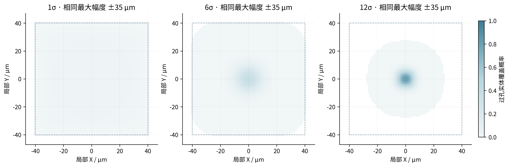

图9｜相同最大幅度下，降低目标σ只改变盒内概率密度，不扩大输入允许的最大偏移。V11采用实体与网格相交面积、零填充线性卷积，自动检查边缘概率、面积守恒及0～1范围；孔洞保留。已删除旧子行面积采样输入。详细公式、符号和实际误差见[本版说明第3节](docs/V11_操作与验证说明.md)。

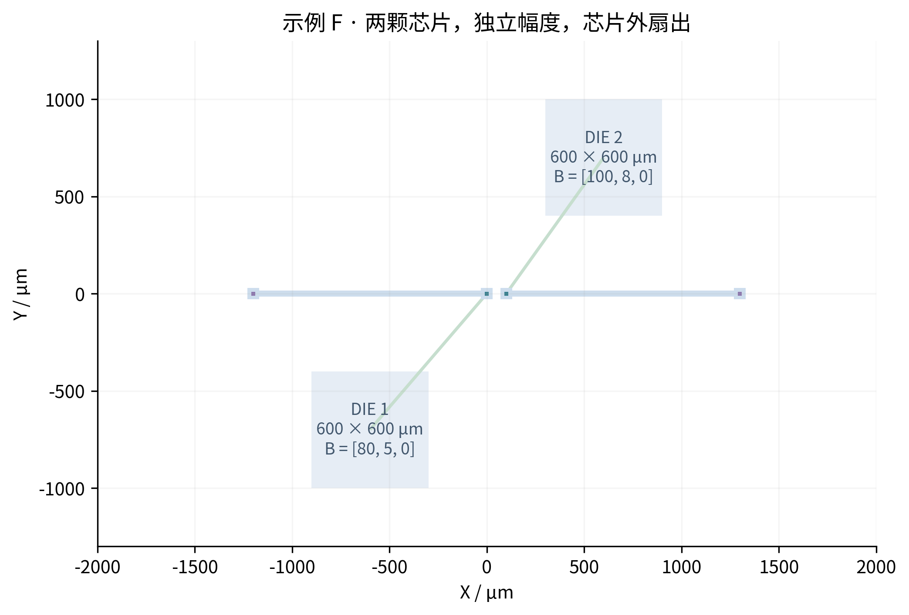

图10｜默认共同幅度，勾选后按GDS识别的每颗DIE分别输入最大幅度。每个接口沿连接追溯使用所属DIE的参数；极端组合、随机接触、Space Map和方案计算一致。每次后台任务使用独立快照，覆盖级别变化会完成并应用最新一轮，运行信息可查看带时间戳的进度和错误。

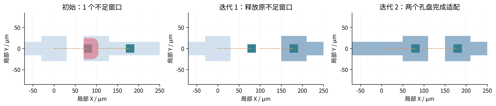

图11｜每轮只接受通过规则的源铜型变，再用更新后的固定RDL重新检查窗口。示例F先适配右孔释放左孔，下一轮完成左孔适配。具体状态以最后的实际几何判定；全局代表状态也分别迭代到结束。有限状态通过不等于连续概率通过，型变后没有概率证书的接口明确显示待细化，不再沿用原图失败下界。

C1/C2、贝塞尔/圆弧、最小内角及粉色违规定位的公式与判据见[本版计算与验证说明](docs/V11_操作与验证说明.md)。线宽、内部及异网线距、孔盘包围、固定端、拓扑、封装与禁布区都参与候选检查；失败保留原图并定位实际违规区域。有限搜索未解不等于证明无解。

型变中间帧算出并校验后立即发布；没有通过的图形不先显示。CPU/内存决定线程及大任务进程限额；有可用CuPy/CUDA时可加速概率卷积，本机实际使用CPU。界面保留视窗外35%冗余绘制范围与静态概率缓存。程序未回写源GDS，本版仅交付源码ZIP，Windows和CUDA实机未验收。

## 10. 历史 V12：小偏移、三段适配与独立DRC（候选显示策略已被V13替代）

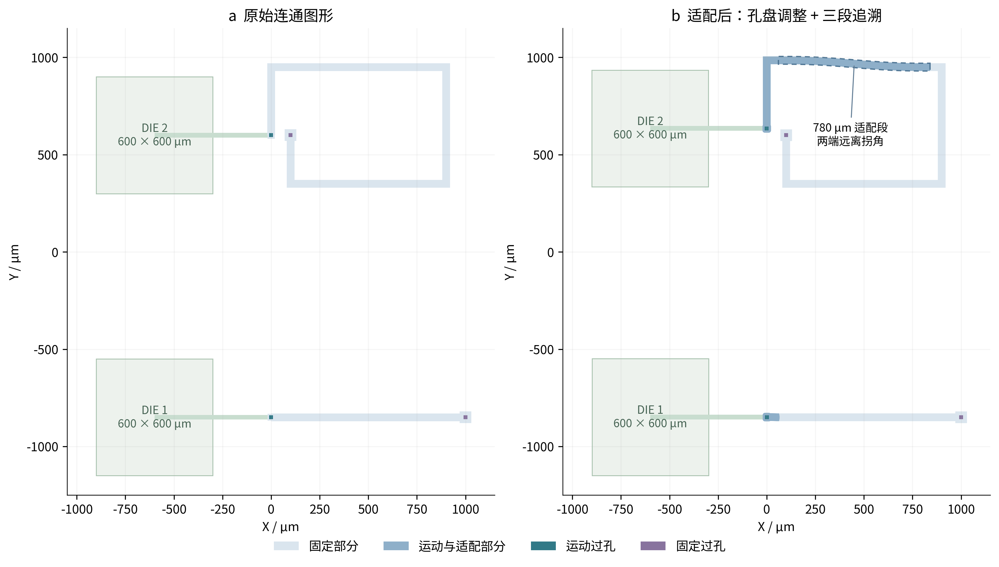

最小包围量改为输出约束；先补足名义孔盘所需铜区，再执行连续适配并复查实际包围距离。即使运动孔仍在原孔盘内也执行适配。局部调整无合格结果时，沿真实铜连通关系寻找长直适配段，将图形分为运动段、适配段、固定段。示例G的600 × 600 μm芯片及芯片外扇出演示这一过程，适配段为780 μm。

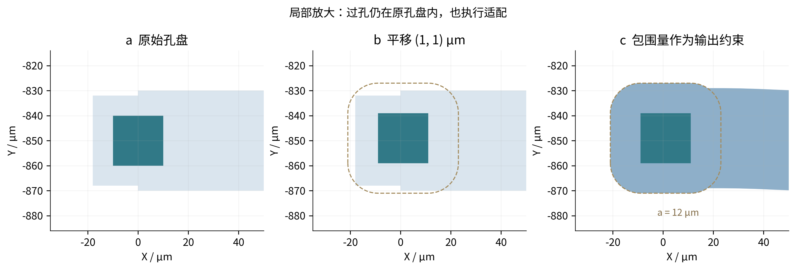

“DRC问题”开关独立于评估和预演分析；宽度/间距只检查近似平行、非相邻边，实际异网重叠始终判短接。合法但不满足DRC的最佳候选可以显示，并标记粉色实际违规区；拓扑非法候选不能显示。此规则替代前述V11历史说明中的“所有未通过候选均保留原图”。图3至图9及V11章节保留其历史结果，不代表V12的性能或候选策略。

图片中F恢复视角，M选择DIE后右键拖动、滚轮旋转，ESC退出。运行信息和表格可正常滚动，输入值与层序不会被滚轮修改。

[完整输入—公式—输出、符号解释与V12验证](docs/V12_操作与验证说明.md)给出包围量计算、拓扑切分、C1/C2场、圆弧路径、DRC边对公式及最佳候选评分。完整搜索、交互复核和全局概率认证分别说明；附件整图终版复测约5.8 s/交互计算帧，尚不满足30 FPS，连续自适应型变的全概率认证仍未实现。

## 11. V13：Windows恢复、最终图形校验及会话缓存

V13不再显示不满足DRC的型变候选。搜索局部孔盘、不同长度的适配段及邻线联合候选后，对最终可见布局重新校验；失败线路恢复原图，再复核受影响邻线，直到回退集合不再变化。原图本身若违反规则，仍显示其真实违规区，不能因回退而视为通过。未适配位置用琥珀色叉号提示，表格列出图层、源图形及原因，不依赖“DRC问题”开关。

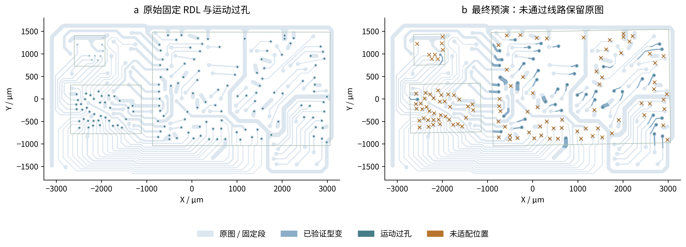

固定RDL按几何网络分别检查，保留异网边界；覆盖未型变与已型变的实际图形。原生边对检查关闭屏蔽，找出近似平行、非相邻边的线宽与线距问题；实际异网重叠/接触始终检查。候选额外检查真实最小异网净距，避免角度过滤放过接近或短接。

Windows日志中的模块缺失发生在源码运行环境；`RUN.bat`改为专用环境并在启动前检查原生DRC。型变初始化失败不再提交配置状态，避免随后概率叠加触发`KeyError: deformation`。

同条件的已完成预演、叠加、参数回切、动画轨迹使用会话缓存；内存有界，结果溢出至私有临时目录。显式重新评估、换GDS及退出清理旧结果。首次搜索与重复显示分别计时，不混用。

[本版输入—公式—输出、实图审计与性能记录](docs/V13_操作与验证说明.md)。历史章节中的最佳候选显示和历史性能仅作为对应版本记录，V13以本节及链接说明为准。

## 12. V14：旋转中心、全部概率及离线后端

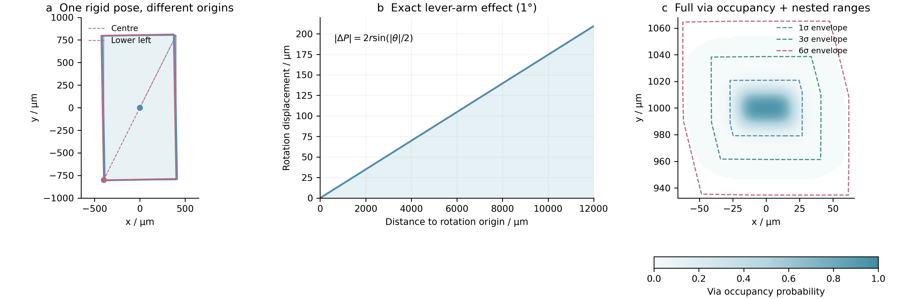

图12｜左：800×1600 μm芯片绕中心或左下角旋转1°；中：精确旋转位移随实际转动半径增长，横轴扩展至12000 μm以覆盖芯片外扇出；右：示例I真实过孔实体覆盖率与共用分布尺度的1、3、6σ扫掠包络。数值和形状由程序计算，PNG为300 dpi，另附可编辑SVG。虚线并非等概率线。

0级采用用户确认口径：保留最近有限非零级别对应的母正态尺度，不做级别筛选；最大输入盒H保持不变。接触阈值改为α=0，积分从完整有界潜变量盒开始，省略尾部上界为0。只有确定正概率才报不足，无法有限步判定者仍显示“概率待细化”；不把数值采样零命中当成无风险。Space Map在0级使用全部输入的确定性位移上界QH。

设参与积分的独立标准正态变量为u，删去零方差列后的矩阵L满足z−μ=Lu。L具有满列秩，以其左逆L⁺获得保守范围：

$$|u|\leq |L^{+}|B.$$

绝对值按元素计算，B为三个物理最大幅度组成的列向量，角度用rad。此盒包含所有满足H的状态；后续仍与物理H相交，不为相关性引入额外概率质量。

覆盖范围开关开启后，概率图使用同一尺度的0级整孔分布。第h级轮廓使用：

$$b_j(h)=\min(B_j,h\sigma_j),\qquad
\mathcal E_h=\operatorname{conv}\left(\bigcup_{|z_j-\mu_j|\le b_j(h)}T_z(V)\right).$$

h为叠加级别，σj由同一κ决定，V为实际孔实体，conv表示凸包。角度离散间距产生的最大弓高外扩保证保守；所以凹形孔或连续旋转的精确支持不一定填满包络。h达到κ后受最大幅度裁切，不再扩大。0圈出全部输入范围，∞表示当前名义孔轮廓。更改附加级别和虚线颜色只更新绘制，复用概率数值缓存。

旋转中心输入、每个符号的计算过程、控件说明、真实桌面后端验证和Windows限制见[本版图文说明](docs/V14_操作与验证说明.md)。历史V13章节中的联网补装流程已取消；V14不执行网络安装。

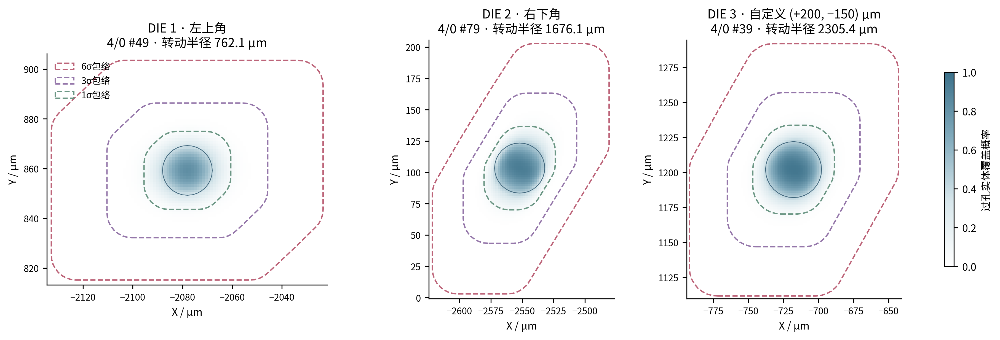

图13｜本次GD55附件复测：3颗DIE、158个接口。5/0带4孔洞的原缺失图形恢复，源GDS不变。158张整孔概率图面积积分最大相对误差2.44×10⁻⁹，所有XY/转角组合角点实体均处于显示域内；不同旋转中心与0级完整分布一致。

图14｜在测试假设线宽/线距20 μm、包围10 μm及(-25,+25,+1°)预演下，118个相关固定RDL图形中46个通过最终型变校验，72个保留原图并列出原因，没有显示违规型变。首次整图计算114.391 s，重复同状态走缓存；缓存时间不代表首次求解或绘制帧率。详细输入、逐接口状态、原图DRC问题与限制见[V14实图验证](docs/V14_操作与验证说明.md)。

## 13. V15：可手算初筛、通用截面与连续安全范围

图15｜用户红圈位置按20/20/15 μm规则，在(-25,+25,+1°)状态通过局部适配。依据真实旋转中心计算局部位移，避免把平移与转动的抵消丢失后误拒绝。其他未通过工况保留原图，并列出具体原因。

图中将每颗DIE的X、Y与转角合并到一个分组区间坐标系；横轴为（当前值−输入均值）／该轴输入单边幅度，灰线表示完整输入边界。彩色线表示已证安全内范围，右侧给出实际μm或°端点，不能将百分比直接当作μm或角度。安全范围表在软件“结果分析”中已由此图替换；零幅度轴显示为点，多芯片可滚动查看。

图16｜GD55每颗DIE的较大体积安全内盒，阴影为原输入边界。只有整盒连续验证通过才输出；所有DIE可独立组合，约束范围为原始固定RDL的真实异网接口接触。精确数值、搜索精度与最优性限制见第7.3节及[V15验证说明](docs/V15_操作与验证说明.md)。

局部场的位移梯度界使用实际孔中心位移 $\Delta_i=T(c_i)-c_i$，并在半径 $r_i+L$ 的支持域内加转动变化上界 $\|R-I\|(r_i+L)$，不再用 $\|D\|+\|R-I\|\|c_i-C\|$ 丢失抵消关系。$c_i$为孔中心、$C$为DIE旋转中心、$r_i$为所需孔盘的包络半径、$L$为候选过渡跨度，$\|R-I\|=2|\sin(\theta/2)|$。

三段搜索增加完整投影截面：选方向单位向量u，取两个截面起点b及间距L，以 $t=((P-b)\cdot u)/L$ 映射到原有C1/C2权重。截面前是刚体运动段、截面后是固定段，截面之间可包含弯曲、宽孔盘或多条分支；所有实际动端必须位于运动侧、固定锚点位于固定侧，再验证位移场、拓扑、固定端、包围与最终全层DRC。没有找到合格解不等于证明物理不可布通。

图17｜相同GD55、包围15 μm、同一极端状态的完整求解对比。工作进程按CPU、内存及图纸坐标量限额；已完成状态/过渡帧继续缓存。具体测量值和未验证的Windows范围见[V15验证说明](docs/V15_操作与验证说明.md)。

## 14. V16：全输入无接触模型良率与显示修复

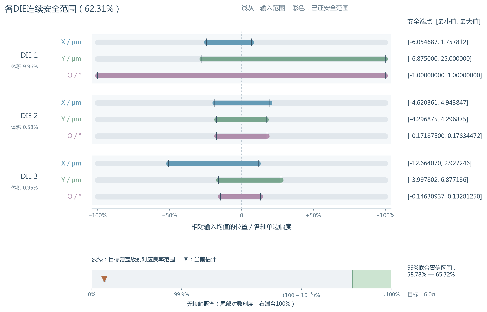

图18｜各DIE连续安全内盒与整个输入范围的联合无接触概率。标题百分比和倒三角表示全输入模型估计，不以安全盒质量代替；区间展示计算精度。浅绿色为当前目标级别的数值参考。不同DIE独立，同DIE所有接口共享同一姿态；只评估原始固定RDL的真实异网接口接触，未包含其他工序失效。

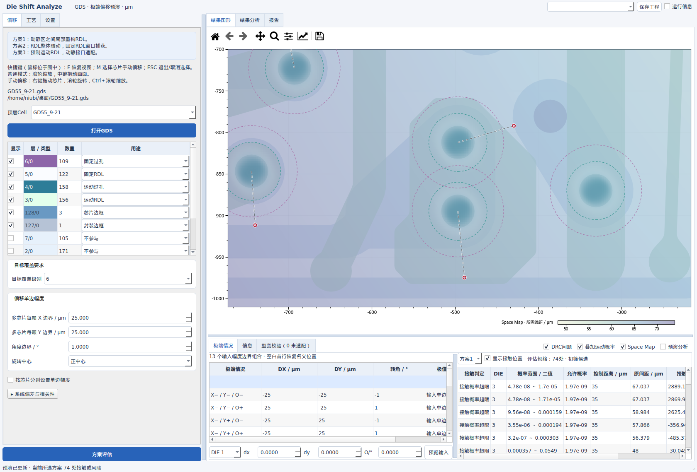

图19｜GD55局部整孔覆盖概率、Space Map和DRC叠加。颜色及透明度随概率变化，默认不将保守凸包画成“概率外轮廓”。计算网格保留完整物理支持及孔面积，不用人为外形蒙版裁切。新GDS不自动指定层用途，勾选即可查看；分析页复用图形，避免反复切换导致分隔条僵硬。

完整积分公式、输入→公式→输出、参数含义、实图结果及性能范围见[V16说明](docs/V16_操作与验证说明.md)和软件“报告”。

## 15. V17：短宽孔盘适配与独立播放时钟

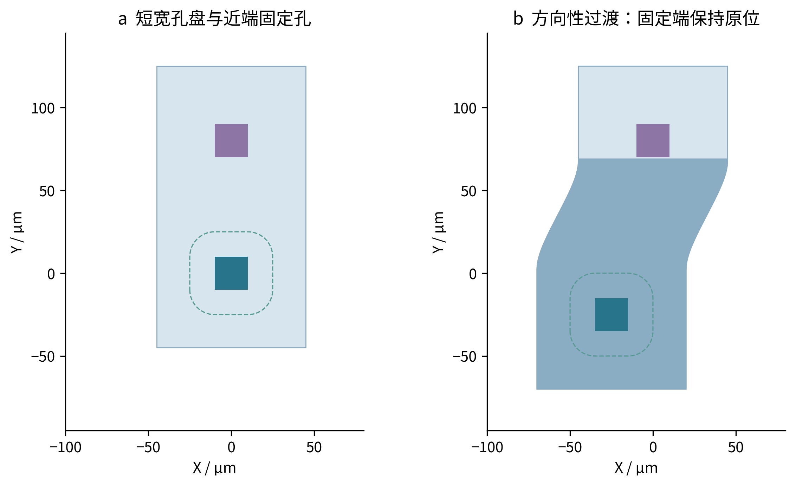

图20｜合成示例J，短宽孔盘的方向性C1/C2过渡。只有通过解析无折叠充分条件与最终DRC才接受；不能把“无接触标记”等同于“整条线路可型变”。

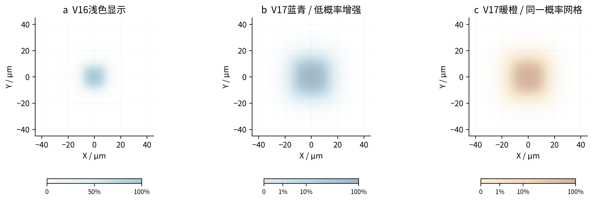

图21｜同一覆盖概率数组的显示对照。增强只作用于颜色及透明度；所有接触计算使用原概率。

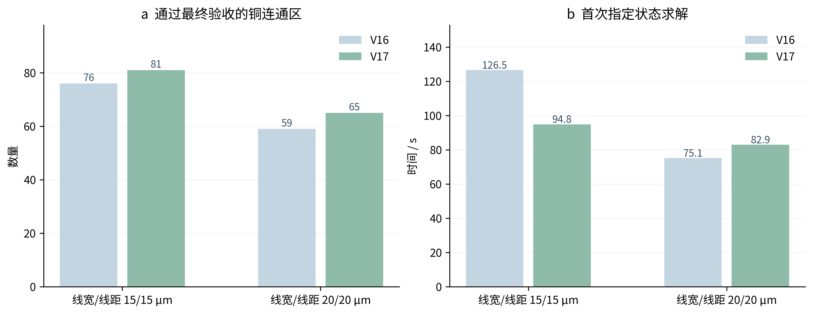

图22｜15/15/15 μm默认工艺的GD55通过适配铜连通区从76增加到81，本机指定状态首次求解约126.5→94.8 s；20/20/15 μm由59增加到65，但该次首次求解略慢。所有新增结果均再次检查，不把候选数量当作成功数。详细输入、公式、误差口径与验证限制见[V17操作与验证](docs/V17_操作与验证说明.md)。

## 16. V18：平滑孔盘、中段连接与候选缓存

按用户指定GD55状态（−35 μm、−35 μm、−1°），工艺15/15/15 μm、容差0，通过铜连通区由66增加到75，保留该状态全部旧通过项。光滑凸包络解决合格短岛的肩部凹陷；整截面平台允许中段孔两侧都有固定连接。

新增轮廓与适配段缓存；有可用CUDA时可加速大型坐标批次，最终拓扑和DRC仍由CPU检查。本机无CUDA实测。十个状态的通过数量、耗时、个别旧通过项未保留的限制、完整公式与符号说明见[V18图文说明](docs/V18_操作与验证说明.md)。此几何改进不改变前文统计模型、良率或三方案初筛定义。

## 17. V21：Pad随动与局部宽度分析

不同DIE可有不同的金属起始高度。新增逐DIE末端根推定，并使极端情况、M键手动运动、每芯片旋转中心与各叠加层共用这一归属。无根或多根的图形不按空间最近DIE猜测；有偏移时显式标记。

对每个通道截面，使用有效线宽 $w=w_0-\tau$、线距 $s=s_0-\tau$、净宽 $g$ 和需要穿越的线路根数 $N$，计算：

$$W_{\mathrm{need}}=Nw+(N+1)s,\qquad N_{\mathrm{cap}}=\max\left(0,\left\lfloor\frac{g-s}{w+s}\right\rfloor\right).$$

$w_0,s_0$ 为该层工艺值，$\tau$ 为共同DRC容差，均为μm，要求 $w,s>0$。$g$ 来自两边界间截面，Pad先外扩最小包围，再保留真实相连铜区；$N$ 来自名义/当前每个铜连通区独立穿越段数的较大值之和，不把同网多次穿越合并为一根。全过程与限制见[V21说明](docs/V21_操作与验证说明.md)。

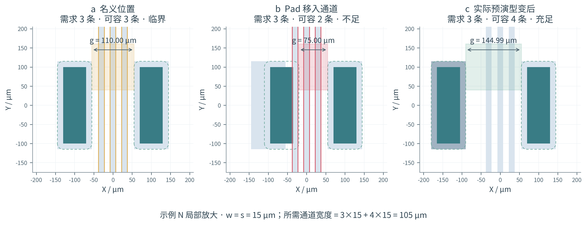

图V21｜示例N，15/15 μm工艺，3条线需要105 μm。名义110 μm可容3条，向内偏移后75 μm只能容2条；实际接受的反向型变使通道约145 μm，可容4条。本图是局部放大，芯片尺寸仍为600 μm；绿色只表示该截面容量宽裕，不等于完整DRC或整图可布通。
