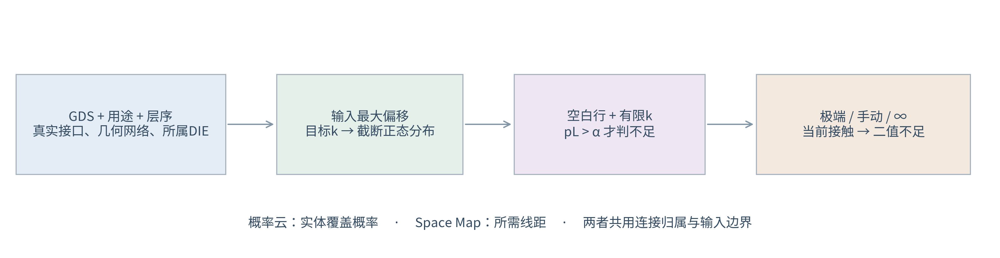

# DIE-First 芯片偏移重构研究与 GDS 评估 — V13

2026-09-28 · Die Shift Analyze V13 · 长度单位：μm

**输入幅度为最大偏移量；V13修复Windows启动与概率叠加异常，增加会话缓存，型变未通过则恢复原图并逐接口提示。** 极端组合、整孔覆盖概率和默认位置的接触概率共用同一输入边界。界面仅保留一个目标覆盖下拉框：1～12、∞。有限 k 使用盒内截断正态分布；∞和具体预演使用当前位置的二值接触判断。芯片外扇出沿金属连接追溯归属，不能按空间距离猜测所属芯片。

图1｜默认行检查随机接触概率；指定状态检查确定性接触。空间覆盖概率、所需线距和当前侵入面积是三个不同物理量。软件中的“报告”逐步列出输入、公式、输出及接口概率上下界。

## 1. 三方案的适用性

图2｜题设三种方案的概念结构，非比例工艺剖面。图中的晶圆段表示方案3的制造过程；软件图层用途仍只分运动/固定RDL、运动/固定过孔，不从“运动”用途推断实际制造阶段。

| 方案 | 优点 | 主要限制 | 可计算的筛选条件 | 合适的案例 |
|---|---|---|---|---|
| 1：动静区局部重构 | 固定端保持位置，支持各DIE独立调整 | 需要真实动态路由，拥挤通道可能无法布通 | 各边接口数量/轨道容量≤1；真实接口接触概率合格；动态路由另验证 | 捕获盘空间不足，但中间可提供路由空间 |
| 2：整体随动＋固定端捕获 | 随动岛内部相对几何不变，减少局部重布线 | 外部接口旋转位移增加；跨DIE公共网络不能用单个刚体运动对齐 | 捕获需求/实际捕获裕量≤1；接触概率合格；自动检查跨DIE网络 | 单DIE或电连接独立的随动岛，固定端空间宽裕 |
| 3：芯片上预制RDL＋接口适配 | 可先安排输出接口位置，缓解原始焊盘密集 | 增加工序；外引过远会增大旋转位移；运动层不等于已确认预制工艺 | 存在运动RDL；输出捕获或容量分支满足必要条件；接触概率合格 | 原始接口难以直接适配，可通过预制RDL重新安排接口 |

三种方案均只对**实际运动过孔—相邻固定RDL**检查窗口；无名义连接处不构造虚拟接口。本网络不视为障碍，其他网络才进入接触事件。V13支持来源固定RDL的迭代型变预演；只显示通过最终约束检查的型变，其他线路恢复原图并提示；统计方案排序仍属于工程初筛，不能把轨道容量上界或单个预演成功当作全部状态布通证明。已删除人工“补偿能力参考”的长度、斜角、残差、边端禁布输入及其隐含放行规则。

芯片尺寸、线路数、芯片数必须与真实几何共同考虑：线路数量主要影响通道占用，接口相对芯片中心的半径影响旋转位移，多个DIE是否共用网络影响方案2的结构适用性。不能仅按芯片面积给出可靠分类。

## 2. 单位、输入与连接关系

常规芯片长、宽为500～10000 μm，长边/短边为1～3。尺寸趋势图外扩到400～12000 μm。旋转矩形使用局部实物边长，不使用轴对齐包围盒替代尺寸。

| 符号 | 含义、单位及来源 |
|---|---|
| $C=(C_x,C_y)^T$ | DIE名义中心，μm，由芯片边框几何中心获得 |
| $P=C+A$，$A=(A_x,A_y)^T$ | 名义位置与相对所属DIE中心坐标，μm，可位于芯片外 |
| $r=\sqrt{A_x^2+A_y^2}$ | 转动半径，μm；由真实连接归属计算 |
| $z=(D_x,D_y,\theta)^T$ | DIE刚体状态，平移为μm，转角为rad |
| $B_x,B_y,B_O$ | 输入单边最大幅度；平移μm，角度°；$B_\theta=B_O\pi/180$ |
| $\mu=(\mu_x,\mu_y,\mu_\theta)^T$ | 系统均值；输入的均值转角同样由°换算rad |
| $k$ | 用户选择的有限目标覆盖级别，整数1～12；∞是另一个二值模式 |
| $a,s,w$ | 工艺最小包围、线距、线宽，μm；线距/线宽分别设置运动和固定类型 |
| $V_i,F_j$ | 第i个实际运动过孔、第j个固定RDL图形；从修复后的GDS读取 |
| $\mathcal F_i$ | 与接口i相接的固定RDL平面上，排除本网络后的全部图形集合 |
| $M,L,N_b,\ell_b$ | DIE数、对应RDL层数、分配到边b的接口数、该边长度；从GDS提取 |

金属同层接触取连通分量；相邻金属平面按面积交叠连接。跨层判据为：

$$E_{ij}=\mathbf1\{\operatorname{Area}(A_i\cap B_j)>\epsilon_A\},\qquad
\epsilon_A=\max(10^{-12},0.01\delta^2).$$

$A_i,B_j$是上下相邻金属图形，$\delta$为GDS数据库网格，μm；$\epsilon_A$为数值面积容差，μm²。同一物理层号的不同datatype共同组成金属平面。边框、不参与层、禁布层不构成电连接层。

沿下层追溯的芯片集合为 $\mathcal D(A)=\bigcup_{B\in\mathrm{down}(A)}\mathcal D(B)$。最下参与金属层与DIE有实际面积交叠者构成接触根；同层连接先合并。集合只有一个DIE时允许随动；无根或多根则保留名义位置并明确待确认。跨芯片网络由完整几何连通分量包含的DIE根集合自动判断，删除人工网络选择。根层需要按真实层序设置正确。

## 3. 从平移与转角到任意位置的真实位移

$$R(\theta)=\begin{bmatrix}\cos\theta&-\sin\theta\\\sin\theta&\cos\theta\end{bmatrix},\qquad
P'=C+D+R(\theta)A,\qquad U=P'-P=D+[R(\theta)-I]A.$$

$I$为2×2单位矩阵，$D=(D_x,D_y)^T$，$P'$是实际坐标，$U$是相对名义位置的位移，单位均为μm。分量展开：

$$U_x=D_x+A_x(\cos\theta-1)-A_y\sin\theta,$$
$$U_y=D_y+A_x\sin\theta+A_y(\cos\theta-1).$$

因此，输入DX、DY的最大值为35 μm，并不要求每个过孔的实际位移分量也不超过35 μm：后者叠加了转动。**极端表中的DX/DY是DIE中心平移；结果分析的橙线长度是过孔实际位移。** 手动输入可超出配置最大幅度作额外工况检查，该工况仅二值评估，不属于原概率分布。

## 4. 最大幅度与截断正态分布

用户确认输入幅度代表最大偏移量。非退化的未截断正态分布没有有限最大值，故V9显式使用**盒内截断正态**，不把尾部默认为零后继续使用未归一化密度。

有限k时，先定义母正态尺度：

$$\sigma_x=\frac{B_x}{k},\quad\sigma_y=\frac{B_y}{k},\quad\sigma_\theta=\frac{B_O\pi}{180k},$$

$$\Sigma=\begin{bmatrix}\sigma_x^2&\rho\sigma_x\sigma_y&0\\
\rho\sigma_x\sigma_y&\sigma_y^2&0\\0&0&\sigma_\theta^2\end{bmatrix}.$$

$\rho$为母正态XY相关系数，角度与平移独立。这里的σ是**截断前**标准差；截断后的标准差和XY相关系数一般会变化，不能混同。

定义允许状态盒、归一化质量和实际密度：

$$\mathcal H=\{z:|z_j-\mu_j|\le B_j,\ j=x,y,\theta\},$$
$$Z=\int_{\mathcal H}f_N(z;\mu,\Sigma)\,dz,\qquad
f_T(z)=\frac{f_N(z;\mu,\Sigma)\mathbf1_{\mathcal H}(z)}{Z}.$$

$f_N$为母多元正态密度，$f_T$为软件实际使用的条件密度。零均值时支持范围为±输入最大幅度；非零均值时输入表示相对均值的最大随机偏差，绝对范围为μ±B。零方差维固定在均值；$|\rho|=1$按一维退化平移处理。

归一化过程可复算为 $Z=Z_{xy}Z_\theta$。有角度方差时 $Z_\theta=\Phi(k)-\Phi(-k)$，否则为1。XY方差均非零且$|\rho|<1$时：

$$Z_{xy}=\int_{-k}^{k}\phi(u)\left[
\Phi\!\left(\frac{k-\rho u}{\sqrt{1-\rho^2}}\right)-
\Phi\!\left(\frac{-k-\rho u}{\sqrt{1-\rho^2}}\right)\right]du.$$

$u$为标准化X变量，$\phi(u)=e^{-u^2/2}/\sqrt{2\pi}$为标准正态密度，$\Phi$为其CDF；代码采用确定性一维积分。$\rho=0$时为两个边际质量乘积，$|\rho|=1$时为一个边际质量；只有一维随机平移时也只取该维质量。

### 4.1 任意位置的实际概率分布

令 $g(\theta)=[R(\theta)-I]A$。由于角度与平移独立，截断盒也是平移盒与角度区间的乘积，真实位移密度为：

$$f_U(u_x,u_y)=\int_{\mu_\theta-B_\theta}^{\mu_\theta+B_\theta}
f_{D,T}\!\left(\begin{bmatrix}u_x\\u_y\end{bmatrix}-g(\theta)\right)
f_{\theta,T}(\theta)\,d\theta.$$

$f_{D,T}$是XY母正态在平移盒内除以$Z_{xy}$后的密度，$f_{\theta,T}$是角度母正态在角度区间内除以$Z_\theta$后的密度；超出各自边界时密度为0。$u_x,u_y$是输出位移坐标。给定θ时仅平移概率坐标，Jacobian为1，因此不需要额外比例因子。绝对位置密度为 $f_{P'}(p)=f_U(p-C-A)$。零方差退化情形使用概率质量而非二维普通密度。

一般转角下该积分并非二维正态。程序使用精确刚体变换和数值积分/采样，不用小角度线性正态取代实体覆盖结果。

图3｜左：最大35 μm不随目标k变化。中：10×10 μm真实孔，XY最大30 μm，1σ；中心方框为原孔，外虚线为输入包络。右：单轴解析接触事件与程序概率界，示例为软件构造的验证几何，不是工厂实测。阴影和概率界含义分别标明，未用数据点离散程度冒充置信区间。

## 5. 窗口不足：三种界面状态

线距控制区域与接触事件：

$$V_{a,i}=T_z(V_i)\oplus\mathcal B_a,\quad
V_{s,i}=T_z(V_i)\oplus\mathcal B_{a+s},$$
$$I_i(z)=\mathbf1\left\{\min_{F_j\in\mathcal F_i}\operatorname{dist}(T_z(V_i),F_j)\le a+s\right\}.$$

$T_z$是第3节刚体变换，$\oplus$为Minkowski和，$\mathcal B_r$为半径r圆盘，dist为真实图形最短距离。$s$使用相接固定RDL的线距。相切也算接触；包围区/线距区在图上为不同颜色的无填充虚线。

| 界面状态 | 判据 | 图形含义 |
|---|---|---|
| 空白首行，有限k | $p_i=\int I_i(z)f_T(z)dz>\alpha$，$\alpha=2\Phi(-k)$ | 只列已确认超限的随机接触位置 |
| 极端行或手动偏移 | $I_i(z_{current})=1$ | 当前确定状态碰到即不足，与k无关 |
| ∞，空白首行 | $I_i(0)=1$ | 名义图形二值检查，不表示“任意非零尾概率即问题” |

α是**每个接口与全部其他网络的联合接触事件**的允许上限。6σ时约为$1.9731753\times10^{-9}$，12σ时约为$3.5529642\times10^{-33}$；使用生存函数直接计算，避免$1-\Phi(k)$的浮点消减。它不是已验证的整包良率指标；软件未假设各接口独立，也未把重叠事件概率简单相加。

实际侵入区域和面积为 $A_{ij}=V_{s,i}\cap F_j$、$a_{ij}=\operatorname{Area}(A_{ij})$。三个方案均绘制半透明红色交集；相切面积可能为0，此时仍保留红圈。灰色虚线接到当前运动后的过孔中心，无预演时接名义中心。

### 5.1 用概率上下界判断稀有事件

4096次采样零命中，不能证明$10^{-9}$级风险合格。V9默认判定使用独立于显示网格的自适应状态盒积分，**共享同一$f_T$**：

1. 取独立标准正态向量u，构造$z=\mu+Lu$，其中
$L=\begin{bmatrix}\sigma_x&0&0\\\rho\sigma_y&\sigma_y\sqrt{1-\rho^2}&0\\0&0&\sigma_\theta\end{bmatrix}$，满足$LL^T=\Sigma$。
2. 标准状态盒b的各维端点为$l_{bd},h_{bd}$，母质量为$ m_b=\prod_d[\Phi(h_{bd})-\Phi(l_{bd})]$。零方差维删除；物理允许范围与H相交。
3. 物理盒中点图形到其他网络的最短距离为$d_b$，各维半宽为$e_x,e_y,e_\theta$。过孔任意顶点到DIE中心的最大距离为$r_V$，整盒运动上界为
$$\Delta_b=\sqrt{e_x^2+e_y^2}+2r_V\sin\left(\frac{\min(\pi,e_\theta)}2\right).$$
4. $d_b>a+s+\Delta_b$证明整盒无接触；整盒在H内且$d_b+\Delta_b\le a+s$证明整盒接触。其余按最大未定质量继续分裂。
5. 必接触盒集合为$\mathcal B_{hit}$，未定盒集合为$\mathcal B_?$，归一化容差为$\epsilon_Z$，积分范围外母概率上界为$\epsilon_t$：
$$p_L=\frac{\sum_{b\in\mathcal B_{hit}}m_b}{Z+\epsilon_Z},\qquad
p_U=\min\left(1,\frac{\sum_{b\in\mathcal B_{hit}\cup\mathcal B_?}m_b+\epsilon_t}{Z-\epsilon_Z}\right).$$

只有$p_L>\alpha$列不足；只有$p_U\le\alpha$通过概率检查；跨过阈值则显示“概率待细化”。增加“接触概率自适应积分预算”可以继续细分，仍不保证任意近阈值案例有限步完成。几何比较有$\max(10^{-9},10^{-6}\delta)$ μm数值容差，概率界是该容差模型下的数值验证，不是形式化精确实数证明。

## 6. 整孔实体概率与极端包络

对于空间点q，实体覆盖概率为
$$p_V(q)=\int\mathbf1\{q\in T_z(V)\}f_T(z)dz.$$

网格G显示格内平均覆盖率；独立采样估计为
$$\widehat p_{V,G}=\frac1N\sum_{n=1}^N\frac{|G\cap T_{z_n}(V)|}{|G|},\qquad
\int p_V(q)dq=|V|.$$

N为设置的$2^{采样指数}$，$|\cdot|$为面积。实体积分应接近过孔面积，不能把格概率和归一化为1。算法包括：

- Monte Carlo：相关母正态采样，联合拒绝超出H的状态，再取所需数量。
- Sobol：同样联合截断的准随机数值近似；拒绝后不声称保留原始Sobol点集的完整平衡保证。
- 确定性积分：相关平移网格概率除以$Z_{xy}$，对角度条件CDF做Gauss–Legendre积分。节点$h_j$和权重$w_j$属于[-1,1]区间：
$$\theta_j=\mu_\theta+\sigma_\theta\Phi^{-1}\left(\Phi(-k)+\frac{h_j+1}{2}[\Phi(k)-\Phi(-k)]\right),\quad\omega_j=\frac{w_j}{2}.$$
  每个角度下，用整孔面积掩模与平移概率格卷积，再按$\omega_j$加权。权重和为1；平移网格覆盖整个硬输入范围。无随机采样不等于穷举不可数的连续状态。

空间栅格、朝向分组及有限积分阶数均有数值误差；报告给出面积积分和可复算设置。极端端点附近可能极低概率，采样未命中或FFT无法分辨时不虚构颜色。**另绘输入最大幅度的淡色虚线包络**，覆盖所有连续输入组合；它不是等概率线。手动超界工况可位于该包络之外，这是额外二值检查。

## 7. Space Map 与量化指标

Space Map表示相对固定层的总线距需求，$S(P)=s+Q(P)$，不含孔半径和包围量。

令$b=R(\mu_\theta)A$，$J=\begin{bmatrix}1&0&-b_y\\0&1&b_x\end{bmatrix}$，$V=J\Sigma J^T$，其最大特征值由
$$\lambda_{max}=\frac{V_{11}+V_{22}+\sqrt{(V_{11}-V_{22})^2+4V_{12}^2}}2$$
求得。$J$为位置对状态的一阶导数，$V_{ij}$为二维母线性位移协方差元素。

取$k_M=\sqrt{F^{-1}_{\chi^2_3}(1-\alpha Z/M)}$，$F_{\chi^2_3}$为三自由度卡方CDF；实现使用逆生存函数直接输入$\alpha Z/M$。条件置信界与硬输入界分别为

$$Q_N=\|\mu_{xy}+b-A\|+k_M\sqrt{\lambda_{max}}+\frac{\|A\|(k_M\sigma_\theta)^2}2,$$
$$Q_H=\|\mu_{xy}+b-A\|+\sqrt{B_x^2+B_y^2}+2\|A\|\sin\left(\frac{\min(\pi,B_\theta)}2\right),\quad Q=\min(Q_N,Q_H).$$

角度在式中为rad。$Q_N$末项控制旋转二阶余项，$Q_H$约束硬输入范围；二者取较小仍为有效保守界。∞模式没有统计补偿量，Space Map使用基础线距。

图4｜左：芯片尺寸扩展范围400～12000 μm，阴影为常规长边范围；各长宽比曲线也限制短边≥400 μm（常规值为≥500 μm）。接口实际半径应从GDS取值，图为角点参数扫描。右：计划插值时长随位移路程增长并在默认1000 ms封顶；绘制开销不包含在计划时长中，实际耗时见版本验证说明。

轨道容量、捕获和机械几何可计算为：

$$C_b=L\max\left(0,\left\lfloor\frac{\ell_b+s}{w+s}\right\rfloor\right),\quad \eta_b=\frac{N_b}{C_b},$$
$$m_i=\operatorname{dist}(c_i,\partial F_i)-r_i-a,\quad\eta_{capture}=\max_i\frac{Q(c_i)}{m_i},$$
$$U_{edge,i}=\frac{Q_{corner,i}}{g_{edge,i}-c_{edge}},\quad
U_{gap,ij}=\frac{Q_{corner,i}+Q_{corner,j}}{g_{ij}-c_{die}}.$$

$c_i$为过孔中心，$r_i$为孔相对自身中心的最大顶点距离，$F_i$为本网络接收图形；中心不在接收图形内则边界距离取0。$g$为名义几何净距，$c_{edge},c_{die}$是设置的机械净距要求。分母非正视为无可用裕量。机械比值最大值记为$U_{mech}$。运动层周长容量按同式使用运动线宽线距并对四边求和。

方案1的工程值取$\max(\max_b\eta_b,U_{mech})$；方案2取$\max(\eta_{capture},U_{mech})$；方案3取输出捕获/输出容量两种完整分支中较小者，再与运动层容量比及$U_{mech}$取最大。动态路由仅有容量必要条件，不能用已删除的固定长度/角度猜测补偿能力。

接触量化值采用$\Gamma_p=\max_i(p_{L,i}/\alpha)$；∞使用确定状态控制距离与实际间距的比值。综合Γ取工程值与接触值的最大值，**若存在概率待细化，Γ≤1也不列通过候选**。结构不适用优先，缺归属/接口次之；接触超限为不足，其余检查容量/捕获条件。候选按减少局部重构与额外预制工序的2→1→3顺序排列，不包含未校准成本或良率评分。

## 8. 软件、实图和复算证据

[本版操作、实际GDS结果、性能与交付验证](docs/V13_操作与验证说明.md)。附带芯片外扇出示例D、连续型变与约束示例E、逐芯片幅度及迭代窗口示例F和解析概率验证用例。目标覆盖级别改变时，窗口报告、窗口不足及叠加图自动更新，保留当前预演状态和视角。其他工艺输入保留旧评估直到再次点击“方案评估”。

证据来自本地代码、用户确认的GD55层映射和可复算测试，不将合成图当作生产测量。完整概率区间、输入快照与连接问题在软件“报告”内可查看。真实重构方案仍需相应路由、工艺阶段及制造能力验证。

## 9. V11：完整实体概率、逐芯片输入和迭代型变

图9｜相同最大幅度下，降低目标σ只改变盒内概率密度，不扩大输入允许的最大偏移。V11采用实体与网格相交面积、零填充线性卷积，自动检查边缘概率、面积守恒及0～1范围；孔洞保留。已删除旧子行面积采样输入。详细公式、符号和实际误差见[本版说明第3节](docs/V11_操作与验证说明.md)。

图10｜默认共同幅度，勾选后按GDS识别的每颗DIE分别输入最大幅度。每个接口沿连接追溯使用所属DIE的参数；极端组合、随机接触、Space Map和方案计算一致。每次后台任务使用独立快照，覆盖级别变化会完成并应用最新一轮，运行信息可查看带时间戳的进度和错误。

图11｜每轮只接受通过规则的源铜型变，再用更新后的固定RDL重新检查窗口。示例F先适配右孔释放左孔，下一轮完成左孔适配。具体状态以最后的实际几何判定；全局代表状态也分别迭代到结束。有限状态通过不等于连续概率通过，型变后没有概率证书的接口明确显示待细化，不再沿用原图失败下界。

C1/C2、贝塞尔/圆弧、最小内角及粉色违规定位的公式与判据见[本版计算与验证说明](docs/V11_操作与验证说明.md)。线宽、内部及异网线距、孔盘包围、固定端、拓扑、封装与禁布区都参与候选检查；失败保留原图并定位实际违规区域。有限搜索未解不等于证明无解。

型变中间帧算出并校验后立即发布；没有通过的图形不先显示。CPU/内存决定线程及大任务进程限额；有可用CuPy/CUDA时可加速概率卷积，本机实际使用CPU。界面保留视窗外35%冗余绘制范围与静态概率缓存。程序未回写源GDS，本版仅交付源码ZIP，Windows和CUDA实机未验收。

## 10. 历史 V12：小偏移、三段适配与独立DRC（候选显示策略已被V13替代）

最小包围量改为输出约束；先补足名义孔盘所需铜区，再执行连续适配并复查实际包围距离。即使运动孔仍在原孔盘内也执行适配。局部调整无合格结果时，沿真实铜连通关系寻找长直适配段，将图形分为运动段、适配段、固定段。示例G的600 × 600 μm芯片及芯片外扇出演示这一过程，适配段为780 μm。

“DRC问题”开关独立于评估和预演分析；宽度/间距只检查近似平行、非相邻边，实际异网重叠始终判短接。合法但不满足DRC的最佳候选可以显示，并标记粉色实际违规区；拓扑非法候选不能显示。此规则替代前述V11历史说明中的“所有未通过候选均保留原图”。图3至图9及V11章节保留其历史结果，不代表V12的性能或候选策略。

图片中F恢复视角，M选择DIE后右键拖动、滚轮旋转，ESC退出。运行信息和表格可正常滚动，输入值与层序不会被滚轮修改。

[完整输入—公式—输出、符号解释与V12验证](docs/V12_操作与验证说明.md)给出包围量计算、拓扑切分、C1/C2场、圆弧路径、DRC边对公式及最佳候选评分。完整搜索、交互复核和全局概率认证分别说明；附件整图终版复测约5.8 s/交互计算帧，尚不满足30 FPS，连续自适应型变的全概率认证仍未实现。

## 11. V13：Windows恢复、最终图形校验及会话缓存

V13不再显示不满足DRC的型变候选。搜索局部孔盘、不同长度的适配段及邻线联合候选后，对最终可见布局重新校验；失败线路恢复原图，再复核受影响邻线，直到回退集合不再变化。原图本身若违反规则，仍显示其真实违规区，不能因回退而视为通过。未适配位置用琥珀色叉号提示，表格列出图层、源图形及原因，不依赖“DRC问题”开关。

固定RDL按几何网络分别检查，保留异网边界；覆盖未型变与已型变的实际图形。原生边对检查关闭屏蔽，找出近似平行、非相邻边的线宽与线距问题；实际异网重叠/接触始终检查。候选额外检查真实最小异网净距，避免角度过滤放过接近或短接。

Windows日志中的模块缺失发生在源码运行环境；`RUN.bat`改为专用环境并在启动前检查原生DRC。型变初始化失败不再提交配置状态，避免随后概率叠加触发`KeyError: deformation`。

同条件的已完成预演、叠加、参数回切、动画轨迹使用会话缓存；内存有界，结果溢出至私有临时目录。显式重新评估、换GDS及退出清理旧结果。首次搜索与重复显示分别计时，不混用。

[本版输入—公式—输出、实图审计与性能记录](docs/V13_操作与验证说明.md)。历史章节中的最佳候选显示和历史性能仅作为对应版本记录，V13以本节及链接说明为准。
