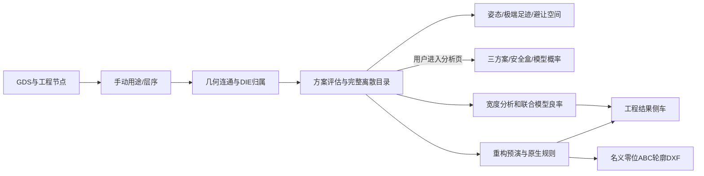

# V85 示例精简、过孔相切限位、XJ88 静止与失败姿态刚体铜

- `RealDataAnalyse/projects.py` 新增 `CASE_INPUTS` 与 `EXAMPLE_CASES=('SH22',)`；`install_case(destination,cases=EXAMPLE_CASES)` 只复制示例，测试按需指定 `GD55_1119`。`BUILD.bat` 无需改动。
- `reconstruction_route.py` 新增 `RoutePlan.via_limits()` 与 `_moving_cover()`：手动 `snap`/`moving_line_partition`/`partition(...,tight=True)` 以实际过孔为硬限位（运动侧 `via_end`、固定侧 `via_start`），可进入孔盘环形区域；`choose()` 显式 `tight=False` 保持自动动区从孔盘外缘开始，连续概率证书与历史行为不变。`PlaneRoute.partition` 同步接受 `tight`。
- XJ88（`Jobs/XJ88_GDM32311`）作为验证案例随源码包提供；`tests/test_v85.py` 逐 27 个极端断言 `5/0 #3`、`#13` 替换铜与源铜一致且 `ignored_following=False`。
- 失败显示：`reconstruction._posed_failure_geometry` 与 `branch_regions` 的 GEOS 异常路径保留 B（固定名义）与 C（随动姿态）铜，`reconstruction_diagnostic.display` 对失败图形以 B∪C 重建替换铜、仅绘制动区虚线；`tests/test_v85.py` 覆盖合成诊断与 GD55_1119 真实失败姿态。

# V84 双侧多过孔聚类、框选隔离、后台良率、无条件概率与单芯片8极端

- `reconstruction.py`：在 `paired` / `paired_clusters` 中推广双侧聚类过孔配对（0 固定过孔、双 DIE 各自成簇时以最近 `(va, vb)` 为主路径并保留全簇 `cluster_moving`/`cluster_fixed`）；单层间距复核共用单个 `STRtree(copper)`；使用模块级 `_PRIORITY_GRID_CACHE` 并复用 `reference.rules._nominal_rows`；将 `MultiPairFrame.nominal_core` 扣除 `serial_between_block` 后按连通部件逐段生成 `between_blocks`。
- `moving_pair.py` & `reconstruction_overlay.py`：`MultiPairFrame` 对 `core` 使用 `mitre` 开运算清除亚 DBU 边缘毛刺；`CutDrag` 使用 4px 拖动门限并在短按点击时调用 `find_subregion`，修复 `GD55_1119 (-999,-822)` 手动框选后新间隔不可点选。
- `reconstruction_zones.py`：`had_only_boxes` 改为 `(ref in ignored_set and ref in r.box_refs and ref not in box_excluded)`，防止已忽略多分支图形在未框支路生成自动动区。
- `risk_scope.py`、`reconstruction_probability.py`、`evaluation_scope.py`、`width_risk_probability.py`：单芯片时 `indices_for` 返回全部 `2^k`（三轴时 8 个）极端角点；`attach` 与 `focused_width` / `enrich` 的单图形/单线失效概率统一改用无条件正态细胞概率 `extreme_weights`，与展示组合数无关。
- `reconstruction_status.py`、`reconstruction_yield.py`、`gui.py`：在 `measure_reconstruction_yield` 内置 `cancel_check()`，保持 `defer_reconstruction` / 取消期间的「计算中…」标签，独立于重构预演主路径执行。
- `RealDataAnalyse/projects.py`、`tools/package_release.py`、`Jobs/XD46_SC9211`、`Jobs/XD46_SC58512`：随 Release 附带两个 XD46 公开测试案例。回归见 `tests/test_v84.py`。
- 测试迁移：`tests/test_v57.py` 的首项断言按 V83 起的合同更新——连接固定过孔的固定 RDL 现在重建为有效过渡区而不整块随动，因此断言改为「忽略块必须无原位红影；重建块必须有效、A 非空且 C 有面积」，其余 GD55_1119 断言不变。`tests/test_v56.py` 的两处 `5/0 #4` 失败为 V81 起的既有失败，与本轮无关。

# V83 端点随动控制、源码免鉴权、限时授权、按 DIE 动区间菜单与多分支重构

- 授权与启动：`main.py`、`RealDataAnalyse/main.py` 与 `gui.launch` 仅在 `getattr(sys, 'frozen', False)` 时执行授权校验，源码模式直接启动；打包后 windowed EXE 补齐空 `stdout/stderr` 守卫且无需同级 `.bat`。`license_core.verify` 与 `LicenseManager/manager.py` 新增可选 `duration_months`/`issued_at`/`expires_at` 签名字段，`duration_months=0` 保持原永久载荷结构。
- 固定过孔防误判与端点子区域：`ignored_motion.fixed_enclosures_safe` / `complex_mode` 改用目标 RDL 的 `rdl_net` 检索 `r.stays`，`reconstruction.py` 在 `die_internal` 排除连接固定过孔的图形。`branch_regions.assemble` 与 `reconstruction.py` 输出 `endpoint_blocks`，新增 `ViewSettings.reconstruction_endpoint_overrides` 与 `between_motion.endpoint_modes`、`MainWindow.change_endpoint_motion`、`GeometrySelection.find_endpoint_block` / 同位点击循环、`shape_menu.py` 端点菜单，并贯通 `region_export` ABC 分类与 `ReconstructionOverlay.endpoint_views`。
- 按 DIE 动区间与滚轮菜单：`between_motion` 支持 `die:<owner>`、`equivalent_pose` 与 `mode_label`，贯穿 `MultiPairFrame`、`serial_poses`、`graph_poses`、`branch_regions`、`region_export`（归入 `_A`）与 `ReconstructionOverlay`；`shape_menu.py` 调整动区间菜单层级并新增 `_configure_scrollable_menu` + `_MenuWheelFilter`（使用 `menu-scrollable: 1` 与滚轮步进）。
- 多分支区创建：`reconstruction.py` 将 `self.box_refs` 计入 `edited`；`reconstruction_edits.change_zone('add')` 检索 `solver._base_plans` 未使用分支并在区间外新增 `'local'` 独立区；`reconstruction_zones.expand` 支持 `local_extras`、全路由 `seed` 局部化与未跨中心线框选的最近路由回退。回归见 `tests/test_v83.py`。

# V82 正态标准差、授权默认目录、性能与重构边界修复

- `Parameters` 新增 `sigma_x_um=3.0`、`sigma_y_um=3.0`、`sigma_angle_deg=0.02`、`per_die_sigma_enabled=False`、`die_sigmas=[]`，与硬范围 `bounds` 及 `target_nsigma` 解耦；`statistics.statistical_state`、`distribution`、`model_yield`、`width_probability`、`width_yield`、`width_sampling`、`contact_probability`、`probability_overlay`、`reconstruction_probability`、`result_analysis` 统一通过 `Parameters.for_die()` 消费该标准差。旧工程默认 `3.0 / 3.0 / 0.02`，均值默认 `0`。
- `LicenseManager/main.py` 将 `home`、`data`、`output`（`licenses/`）、`universal_dir` 及 `default_key_dir()`（`keys/`）全部指向 `admin_directory()`（冻结为 `.exe` 所在目录）；`license_core.build_public_key_path` 新增 `dist_admin/keys/public_key.pem` 与 `dist_admin/public_key.pem` 查找路径，保留 `admin_key_directory()` 兼容既有接口。
- 性能与交互：`fast_preview.compiled_polygons` 缓存源多边形对象并在 `gds_merge.merge_import`、`area_filter.apply`、`stack.Connections` 与 `GeometryCache` 间复用；`stack.Connections` 批量查询固定过孔相交；`project_results.preload` 支持后台预解码；`MainWindow.save_project` 通过 `progress` 回调驱动界面进度条；`gui.py` 将「两侧运动的动区生成数量」更名为「两侧运动动区数量」。
- 重构边界：`reconstruction_incremental.source_settings` 补入 `reconstruction_two_moving_zones`，`ReconstructionOverlay.stage` 同步标记双侧动区数量变化，`moving_pair.frames` 与 `reconstruction_zones` 清理零面积碎片；`reconstruction.py` 在 `paired` 检查目标 RDL 网络 `ref_net`，候选筛选先保留可达锚点路径再筛选对齐路径，`branch_regions.assemble` 吸收跨越窄缝的非端孔微片，并在两侧均存在聚集多过孔簇且满足单侧 MST 铜内直连或短弧长条件时仅保留受最近 `(va, vb)` 制约的单中间动区。回归见 `tests/test_v82.py`。

# V81 共享离线授权

`license_core` 保持 V80 的 Windows UUID 与本机 IPv4 机器码算法。启动按两个 EXE 所在目录扫描 `.lic`，再回退到用户目录。错误许可不会遮盖有效许可。Die Shift Analyze 的 GUI、诊断、CLI 与 RealDataAnalyse 的 GUI、CLI 共用授权验证和内置公钥。独立启动授权窗口即使缺少公钥也会尝试显示 Machine ID。

`LicenseManager_BUILD.bat` 独立构建签发工具，生成密钥后再运行 `BUILD.bat`。两份用户程序 spec 通过 `frozen_public_key_data` 使用相同的公钥查找顺序。当前签发仅使用 Machine ID，验签继续接受既有签名载荷。正式私钥和通用许可均由管理员在部署环境生成。重点回归见 `tests/test_v81_license.py` 和 `tests/test_v80_license.py`。

# V79 永久离线授权与工程切换

授权验证在正常 GUI、实测启动、诊断和命令行入口之前。客户端固定内置 Ed25519 公钥，私钥与签发逻辑仅在独立 LicenseManager。通用证书使用已签名的 `machine_id="*"`，仍需成功读取并验证本机硬件信息。生成正式密钥与通用证书属于管理员首次部署。

DXF 转为工程可保存的 OAS 源与 ABC 轮廓，忽略当前图纸。空白工程命令调用统一的 `reset_project`。旧工程缓存组在最后一个后台任务结束时 park，释放旧引擎与热缓存。双端动孔自动动区数加入重构缓存键，历史设置沿 schema5 读入。

# V78 界面缩放

`ViewSettings.ui_scale_percent` 使用 schema5 可选字段。`interface_scale.InterfaceScale` 从窗口原始 Qt 样式、控件约束和表格行高应用比例，可往返恢复；动态表格列和工具栏图标沿用同一比例。大字号时可滚动访问超出窗口的界面。`settings_changed` 直接处理缩放，不进入数值更新，`project_results.identity` 排除该字段。[V78 使用说明](V78_使用说明.md)

# V77 静止区样式与固定过孔随动

`ReconstructionOverlay` 从最终铜裁剪静止动区间，再用同一轮廓裁剪画布灰色菱形点阵。点距以屏幕尺度生成，跟随图层显隐和姿态更新。导出仍使用名义铜，`region_export.layer_contours` 从运动与过渡掩膜中排除静止区，使原轮廓及补偿后轮廓归 `_B`。`ViewSettings.links_fixed_vias` 统一固定孔联动门禁。保留旧 `global` 值，新增 `global_static`。见 [V77 使用说明](V77_使用说明.md)。

# V76 图纸坐标静止的动区间

`between_motion.STATIONARY` 是全局默认选项与按区段覆盖使用的同一个策略值。中段在图纸坐标中固定。串联求解以零姿态为约束，分叉图的已固定节点不参与随动迭代。若参考端也随 DIE 运动，`PairFrame.local_pose` 先把零姿态换到参考系再求几何。最终电连接修补不得移除该段铜，动静区 DXF 归于 `_B`。旧工程的随动选项保持原值。详见 [V76 使用说明](V76_使用说明.md)。

# V75 串联型变与框选联动

`between_motion.solve_serial_weights` 先以 max/min 与 average 约束确定同动边界，再将端到端差量分配给其余有效过渡，`motion_order` 处理双运动端参考系里的大小侧互换。分叉装配按材料邻接处理，固定过孔和静止归属接缝保留各自的运动约束。

`manual_regions.ordered_boxes_by_source` 为每次框选提供顺序来源。重构区、分支和合并结果保存该来源，`CutDrag` 同时编辑关联控制柄并在后台重算受影响源图形。自由模式保持已有的直线边界方向。计算完成后以实际合并结果作为下一次拖动的起点。拆分绑定记录存于 `reconstruction_unlinked_boxes`，类型为原框选顺序编号列表。旧工程缺省仍绑定，原有 schema 5、撤销和 DXF 元数据均可读取。

`branch_regions.display_blade` 在真实材料接口能支持整条截面时恢复完整控制柄，`fixed_between_owners` 补足两个归属间静止铜的点击区域。针对 SH22 两处坐标、实际联动合并和拆分的 Qt 测试在 `tests/test_v75.py`。

# V74 刚性铜段策略、DXF 接缝和编辑回撤

`between_motion.component_modes` 在同一来源的实际刚性分区中为每条名义锚点选择唯一目标。分叉装配按材料边接触统计相邻动区，保留虽然当前位移权重为零但仍可编辑的中间段。Qt 右键在段内部选择铜段，停在实际截面上仍能访问边界。编辑草稿重新计算受影响的源铜。GUI 通过图纸和重构配置标识确认计算回执，保存最近有效画面、编辑字段和撤销栈以处理异常回撤。

`region_export.partition_ring` 将 ULP 容差内的掩膜端点投影回源边，再对边的参数区间分类。补偿前排除动态区下方重复的随动掩膜，避免延伸不属于真实材料分区的接缝。CAD 输出沿同一环生成接点，不写内部隔断。SH22 回归见 `tests/test_v74.py`，短段菜单及后台回撤见 `tests/test_v73.py`。

# V73 网内独立分支、短段点选与 DXF 分层

`manual_regions.route_box_spans` 保留平行及回绕路线的各次通过选框的区间。自由框在归属接缝或分支缺少完整截面时，用该路段中可用的局部截面补齐。无有效自由或沿线截面时，受影响的动区输出诊断，继续处理同网络的其他路段。 `branch_regions.assemble` 保存真实刚性邻接关系及动区间铜，手工动区的数量不因短间隔自动压缩。连接固定或运动端点的段可以选中，运动仍由端点约束。

`topology_checks.branch_contacts` 在铜合并前检测名义不相邻的支路新接触及超出名义接缝的明显重叠。 `topology_routing.resolve` 延续失败并限制候选修补，`reconstruction_events._compact` 保留实际见证用于逐姿态核验。DXF 只按可用分区分类源轮廓。回归覆盖 SH22 两个实际坐标、同网两支边缘接触、失效诊断与 DXF 回读，以及真实 Qt 短段点选，见 `tests/test_v73.py`。

# V72 动区草稿、姿态选择与 DXF 随动分层

`manual_regions.ordered_boxes_by_source` 按工程记录的框选顺序索引两类选框，`reconstruction_box_starts` 表示单个源图形重新框选后忽略旧框的起点。字段进入源索引映射、撤销、缓存和 DXF 记录。相向追溯同一条路径只给一个入口分配同一个框，分叉保留真正穿过选框的路线。斜线若穿过框角，先扩展至真实接口可由两个直线截面表达。首个手动范围可接管重叠的自动范围。

`ReconstructionOverlay` 以已应用设置为比较基线，草稿与已核验铜分离，异步写入同时匹配画面与设置。动区间高亮使用名义锚点，每次按当前显示铜定位；无选择的渲染缓存不得烘焙选中效果。分区元数据随增量复用，零位 DXF 根据各 DIE 配置幅度判定 `_A` 与 `_B`，继续以 `_C` 表示实际动区。回归入口为 `tests/test_v72.py`。

# V71 框选叠加扩展、动区间随动、层叠自动同步与右键样式

`manual_regions.box_list_by_source` 按源保留不相交的选框连通分量；`reconstruction_zones.expand` 与 `RegionSelect._finish` 将框选改为叠加与重叠扩展，不再清除同图形已有的 `reconstruction_intervals`、`reconstruction_angles` 或其他动区（单图形支持任意数量手动动区，自动规划在单线段区间仍最多 2 个）。

新增 `between_motion.py` 与 `ViewSettings.reconstruction_between_motion`（默认 `'max'`：跟随幅度大的一侧；可选 `'min'`：跟随幅度小的一侧、`'average'`：两侧平均）及 `reconstruction_between_overrides`（按 `(layer, index, ax, ay, mode)` 持久化并参与 `reconstruction_key`、`edit_history`、`area_filter.remap_project`、`reconstruction_incremental`）。`reconstruction_zones.expand`、`moving_pair.MultiPairFrame`（双 DIE 共有刚性核）与 `branch_regions.assemble`（分叉浮动刚体块）统一求解并输出 `between_blocks`。画布 `GeometrySelection` 支持左键单独选中动区间刚性块，`shape_menu.py` 提供右键逐段切换三种随动逻辑；重构预演面板将原「整块随动联动固定过孔」更名为「固定过孔随动逻辑」并置于「动区间随动逻辑」左侧。

`region_import.metadata_for` 保存 `roles` 与 `layer_order`，`region_import.resolve_stackup` 与 `export_ui.import_regions`、`MainWindow.apply_stackup` 在动静区输入时忽略软件当前层叠差异，读取后自动将软件层叠用途、层序与输出补偿更新为 DXF 状态（无注释 DXF 自动将 `_A/_B/_C` 层设为 `固定RDL`）。

`layer_controls.LayerDrag` 保持左键选择/拖行，改用右键单击层叠表格行（含单元格内控件）弹出 `LayerStyleDialog`。性能优化方面，向量化 `stack.Connections.resolve_ownership`（12,000 图形构建提速约 3.2×）、缓存 `RoutePlan.moving_line_partition`、扩大路径缓存并前置 `covers` 检查，同时在 `region_import.assign` 预处理轮廓缓冲。回归见 `tests/test_v71.py`，说明见 [V71 使用说明](V71_使用说明.md)。

# V70 主程序动静区输入与图形 DRC

动静区 DXF 按名义零偏移设计导出。`region_import` 读入平面 ASCII CAD 块与直线实体，区分 `_A` 运动侧、`_B` 固定侧、`_C` 动区。新版导出附加有界 JSON 注释。导入必须核对当前几何和工艺，按记录重建名义铜并比对真实输出轮廓。旧版按端点、真实铜范围及走线路径恢复可编辑切口。带补偿时尝试匹配原铜或补偿后的对应外轮廓。含歧义的输入整笔不应用。

`drc_waivers` 的图形策略绑定源索引，过滤几何时与其他图形编辑共同重映射。目录只在启用自动或图形忽略时采集全层 DRC 的事件归属。新增手工选择使用已有事件证据，仍显示原始位置。恢复图形 DRC 覆盖自动忽略及该图形的旧位置忽略，电连接失败及实际短接继续保留。

大局部姿态集合在 `reconstruction_joint.prepare` 按工作量排序后拆块，重任务的块使用私有路径对象。保持标识、铜与联合作业的确定性汇总。资源预算先使用 Python 整数计算字节数，防止 NumPy 与 Windows C long 混算。运行日志只在显示时由界面定时批量取增量，实测期间停用整个缓冲及文件追加。

# V69 层叠输入与一并导出

`layer_controls.LayerDrag` 只在显示、选中、层号列处理拖动。用途交由 Qt 下拉框处理，补偿始终使用原位数值框，用户单击后可以拖选文字。改变用途依 `output_compensation.default_amount` 赋值，恢复旧工程沿用已有补偿。

`layer_roles.EXPORT_ONLY` 跳过金属连通、随动和分析。动静区 DXF 在名义零位冻结版图，将此类图层逐层补偿后用普通 DXF 的图层编码、合并、实体及孔洞规则写入同一文件。ABC 闭合及重复边检查与附加标准实体回读分别执行。实测 `Session` 直接复用准备阶段的名义 WKB，单姿态 GDS 和原图直出、常规重构批量 OAS 均使用此图形。

# V70 实测 OAS 层级开关

`batch.begin.create_cells` 缺省为 true，图形客户端新任务默认发送 false。平铺模式在打开 TopCell 后直接逐包写 CBLOCK。各要素先在源坐标按原 DBU 量化，再施加整数封装平移，避免半格值重复取整造成铜或边框偏移。诊断层、名义直出、模板和阶段文件均保留。阶段检查点直接封尾，最终输出继续做版本、模式、计数及 CRC 核验。

工程和新计划分别保存输出模式，旧任务和旧计划缺键时保留层级。手动项目路径通过同一个工程验证与联动入口，校验时不误用上一个项目的界面状态。

# V67 DRC 忽略、输出补偿和边界吸附

`drc_waivers` 使用姿态摘要和检查见证指纹存储编辑。只有完整见证均被忽略、分析身份仍匹配且无硬连接失败，极端组合才从 DRC 风险索引中排除。保留底层缓存和实际问题目录。工程恢复、历史撤销和右键菜单使用同一状态。

`output_compensation` 经 `native_ops.size_groups` 调用 KLayout mode 2 偏置。GDS/OAS 与 DXF 冻结后逐层应用；ABC 对名义外轮廓偏置，继续原分界到偏置后的轮廓，再按共享节点分层。实测在冻结工程时预处理源形并复用到各计算进程，新的型变铜单独偏置。同步启动器和 RealDataAnalyse 计时见 [V67 使用说明](V67_使用说明.md)。

`reconstruction_snap` 根据当前路径段沿截面法向投影实际外轮廓节点，排除远端分支，应用衰减吸力。保留原鼠标投影用于下一帧，端孔与拐角几何约束仍由原切口逻辑判定。

# V68 实测工作区与恢复

「信息读取」分为 Excel 文件、Excel 列映射、Mark 信息。显示状态独立于导入，旧的共用/逐文件映射设置仍有效。Mark 预留名称、形状和物理坐标，模板图纸仍走既有输出流程。任务控件与「忽略测量失败」位于「任务运行」。

Runner 按同一来源位移摘要判断两组阈值。名义直出优先。其他包可用协商后的 `skip_drc` 执行实测重构及硬规则核验，回执以空的普通 DRC 通过状态体现。执行阈值写入任务配置，计划沿用创建时的设置。`display_progress` 与逐封装回执在同一事务保存，重放追平后继续更新。重开工程复用未完成任务的 IPC 入口，重启前确认进程已退出。计划实例在 Runner 重启时登记新的 PID 和程序启动时间。

「忽略测量失败」用正向键 `skip_failed_measurements` 表示。默认采用失败行的有效偏移和旋转，勾选时跳过该封装。已有任务和计划读取旧反向键，保留创建时的行为。旧 CLI 参数显式指定时保持原语义。

# V67 进度条常驻计时

RealDataAnalyse 的进度条同时显示开始时间、总耗时与完成数量。独立的 Qt 定时器在任务开始后每秒刷新文字，计时以单调时钟为准。任务结束时停止定时器并保留最终耗时，结束时刻可悬停查看。

# V66 动静区图层/JOIN、延迟删除、实测高并发与多动区性能

`dxf_document._write_blocks` 将动静区 CAD 块内部实体写入块对应的 `_A` / `_B` / `_C` 图层，`region_contract.verify_written_contours` 核对块内所有实体图层与块 INSERT 图层一致。`DxfSettings.region_auto_join`（默认 `False`）在 `dxf_controls.py` 暴露为「动静区自动JOIN」，勾选时 `region_export._join_block_paths` 合并块内首尾相接的多段线并允许闭合环通过回读校验。

`ViewSettings.space_export_interval_um` 默认值调整为 `100.0`。新建/未显式指定 `expanded_process` 的工程默认展开「工艺」全部 5 个栏目。

关闭「自动计算」且处于重构预演时，`MainWindow.delete_selected_shapes` 与 `EditHistory.step` 对删除及撤销删除操作仅记录有序暂存队列（`pending_layout_ops`、`_staged_deletions`）并绘制「待算：删除图形 / 待算：撤销删除」标记，不触发几何重建或计算，直至「重构计算」按顺序应用。`export_ui.py` 与 `layout_export.py` 在存在待算修改时阻止导出旧图；GDS/OAS、DXF、动静区导出及工程保存/重开均完整反映节点编辑与图形删除且保持原 GDS 只读。

实测输出方面，`measured_core.Session.model` 在每封装变化的 `rotation_center_um` 下复用线程内 `ContactModel`、`Reconstructor` 与 `GlobalDRC`，`Session._fast_snapshot` 缓存名义静态多边形 WKB，`current_drc.frame` 缓存同归属孔盘缓冲与名义包围校验；对平移和旋转均为 0 的 DIE 跳过静止源重构（附异网碰撞回退保护），实测对比 GD55/GD55_1119/SH22 提速 3.6×～6.2×（全零位 >12×）且几何 XOR 为 0、DRC 目录完全一致。`measured_ui.py` 在实测模式下停用无关界面定时器、按状态节流锁定刷新并扩大多进程并发上限（`requested_count>=4` 即支持多进程，兼顾 `strict` 与 `omit_failed_regions`）。

大型图纸与多动区单金属编辑：`area_filter.apply` 采用批量 C 多边形构建与向量化短边检测（6000 图形提速约 9×）；`region_export.partition_ring` 与 `region_contract.overlapping_edges` 跳过纯静态边与非共线邻边；`branch_regions` 复用单次外框缓冲并以 `STRtree` 替换二次循环；`reconstruction_zones.live_serial` 复用 `geometry_pool` 与 `plan.cache` 并避免单图形线程池开销；`ReconstructionOverlay.stage` 按脏源增量刷新，对多动区（>8 区）采用后台 `Worker` 异步更新草稿防止主线程卡死。

修复 `reconstruction_route._warp_geometry` 与 `plane_route.partition` 中布尔运算返回 `GeometryCollection` 导致 `reconstruction_angles.measure` 在 SH22 拐角一阶连接拖动时抛出 `AttributeError: 'NoneType' object has no attribute 'difference'` 弹窗的问题，以及 `reconstruction_joint.prepare` 在替换表缺层时抛出 `KeyError` 的问题。回归见 `tests/test_v66.py`，操作见 [V66 使用说明](V66_使用说明.md)。

# V65 实测阈值开关、进度与命令显示

项目设置分别保存 `bypass_enabled` 和 `bypass_limits`。缺少开关的旧项目默认关闭，已冻结的旧计划和无界面配置沿用各自原有阈值。未启用的项目或计划向 Runner 传入全零阈值。数值先按三位小数呈现，再保存或执行。

Runner 保留一次运行中最高的封装完成数。重试仍按原事务规则完整重放，追平后才推进计数。CRC、摘要和原子提交都沿用统一计数，进度填满以成功发布回执为准。计划表继续显示每行进度，主进度显示本轮执行队列的完成数。IPC 会话的显示队列由标签页 Show/Hide 事件控制，磁盘持续记录。

# V64 运动孔盘圆点许可

`ViewSettings.reconstruction_allow_moving_pad` 控制运动端整孔盘模式，旧工程缺项取关闭。名义路径的 `pad_modes` 同时检查该设置和路径端点的过孔归属。`RoutePlan.moving_line_partition` 将零弧长切口移至孔盘外最近可用截面。二维铜面、手动框选和多分支共享同一限制。预演缓存、逐源复用和动静区 DXF 按新设置区分。改变许可会刷新当前姿态，同时保留已暂存的其他重构编辑。

`apd_export` 先按固定 RDL 和线距分档合并有效区域，输出与 23.100 样例一致的 Region 线距覆盖及创建同名几何的 SKILL。导出不复制样例的 Net、Stackup 或全局开关。

`area_filter` 在源图形进入计算前应用工程删除记录，并重新映射活动图形索引。`edit_history` 保存待恢复的源绑定状态，工艺参数不进入历史。几何删除和撤销走同一个异步几何提交流程，重构暂存标记与已删除的实际铜分开。

# V63 实测阈值与输入发现

`measurements.package_rows` 在分组完整后记录所有 DIE 源偏移绝对值的逐轴最大值，避免分组拟合余差跨过阈值。`Runner` 在批次提交前比较阈值，发送 `use_nominal`，同时核对该回执及最终数量。共享 OAS Cell 在第一个直出封装提交时冻结，后续仅写参考。正常任务保留实际铜 DRC、局部失败裁剪和所有诊断层。既有发布和重试逻辑仍保护旧 OAS。

`projects.load_folder` 查找 Excel 的 DIE 目录所在层级。项目保存仅排除用户明确从表格删除的文件，不将尚未扫描的新文件误删。工作区及 Windows 构建沿用 V62。详见 [V63 使用说明](V63_使用说明.md) 和 [IPC约定](MEASURED_OUTPUT_API.md)。

生产导入的 `ignore_measurement_failure` 默认关闭。仅在启用时按机台失败行填报的偏移和角度恢复姿态，优先保留同一芯片的有效成功行。任务库记录选项和实际采用的失败行，普通继续任务比对选项，计划任务从冻结设置导入。

# V63 工艺参数、实测模式与重构预演

三项几何阈值由 `MainWindow.build_settings` 挂载到「工艺 → 其他」。工程继续用原设置键保存。「设置 → DRC」仍由 `drc_policy.build` 生成。

`MeasuredOutput.submit` 及进程池调用 `Session.run` 时不传进度回调。底层按需传递回调，避免计算百分比、拼接进度字符串和跨线程发送进度信号。内存监控通过独立检查点执行，取消和 DRC 目录仍通过 IPC 返回。

名义动区在同一重构计划内按条目复用。切口分区按弧长与角度精确缓存，边缘切向量复用原图形的线段数组。计划或设置变化时重新准备，实际铜仍按当前姿态做规则与连通检查。

动静区 DXF 恢复 V61 分段规则。ABC 块中的实体都是开放多段线，整圈属于同层时由两段拼出原轮廓。重复轮廓仍去重，边框作为独立闭合实体输出。

# V62 启动入口、工程目录和 DXF 轮廓拼接

根目录 `BUILD.bat` 一次构建两个 EXE，复制两份独立启动脚本到 `dist`。启动脚本检查同目录和 `dist` 的可执行文件，再检查源码和解释器。项目目录继续通过 `jobs.provision_project` 管理，首次保存工程并预置实测目录。Windows 验收用源码、只有 EXE 的目录和含 `dist` 的源码目录分别调用两个脚本。

`drc_policy.build` 返回 DRC 栏目的表单，接触标记显示参数复用现有设置键。`shape_menu.py` 依据选中用途提供菜单，运动过孔的增加动区按固定 RDL 接口选择目标。`region_export.py` 在重复区间去除后按源图形及输出层拼接，相接端点按精确坐标连接，分叉保持独立，完整环通过 DXF 闭合位记录。封装参考层为 `PKG_REF`。详见 [V62 使用说明](V62_使用说明.md)。

# V61 动静区 DXF 和 SH22 运动归属

`stack.py` 保留完整电气连接与原有深层根，并优先采用固定 RDL 之前可追溯的运动侧芯片端口。没有更深运动端口时，完整落入单颗 DIE 内的运动过孔提供本地证据。`ContactModel`、预演、重构及实测共用该归属，跨 DIE 网络只根据运动侧的端口归属识别，不把远端固定孔计为运动端。测试覆盖 SH22 三个命中实体和旧例中的跨 DIE 扇出。

`region_export.py` 以原始外轮廓边的参数分割名义区域，并按源图形、输出层组成块。重叠检测及实际文件核验在 `region_contract.py`，内部键到 DXF 后缀只在此映射。参考边框以完整闭合折线输出。共边时复用最先保留的线段，部分重叠仅去掉共有区间，回读核对插入、原点、块内节点、闭合、重合。两套输出必须继续区分普通 DXF 的当前几何与动静区 DXF 的零位轮廓。详见 [V61 使用说明](V61_使用说明.md)。

# V59 双运动端孔、孔盘保留与联合输出

`moving_pair.py` 将单动区的近端位姿转换至对端真实刚体坐标系，求解后的铜、控制柄与失败见证再统一转回全局。`reconstruction.py` 保留真实端孔对应的两个源路由身份。`routing_quality.py` 从源铜提取可识别孔盘，并在已通过连通核验的活跃区域内尝试扩宽和修整内角。`topology_routing.py` 以完整孔盘、完整包围、局部覆盖为候选顺序，并用实际异网铜和端孔复核。概率目录同时记录两端的 DIE 依赖，必要时联合计算最终铜。`gui.py` 只在后台任务仍在运行时显示任务状态。

验证与配合 RealDataAnalyse 输出见 [V59 使用说明](V59_使用说明.md)。

# V57 随动诊断、复杂铜面动区、低概率低亮与层叠选中列

`reconstruction.py` 与 `reconstruction_events.py` 修复整块随动图形失联时的 `missing_region`（改用移动后的 `regions['C']` 而非原位 `source`），并在离散扫描中接入 `ignored_motion.linked_owners`。`ignored_motion.entries` 与 `gui.py` 确保被忽略的图形自动清除全部动区并覆盖旧选框，同时在 `die_internal` 保留所属 DIE 与显式静止/随动优先级。

`branch_regions.py` 吸收被同一 DIE 相邻动区夹住的狭窄无端孔刚体条，并在 `transition_domains` 检出跨成员相交斜切时自动回退垂直切口；`plane_route.live_part` 按跨度与切口高度比例限制最大倾角，避免宽面边界横竖交错及虚假内角 DRC；`reconstruction_route.choose` 在无安全余量段时优先长度达到 `max_travel` 的直段而非亚位移窄条。

`reconstruction_probability.pose_probability` 计算离散极端姿态物理概率质量，`gui.is_low_probability_pose`、`reconstruction_overlay.py`（`LOW_PALETTE`、`low_problems`）与 `drc_overlay.py` 对低于 `2Φ(-k)` 的极端工况进行低亮弱化处理。`ReconstructionOverlay.stage` 记录逐图形累计待算操作（`actions`）并用分类虚线色与画布 `staged_tags` 标注；随动填充提升至 `#c9b3eb`（alpha `0.45`）。`gui.py` 层叠表扩展为 4 列（`显示 / 选中 / 层·类型 / 用途`），`selectable_boxes` 默认仅勾选固定 RDL，由 `selection.py` 过滤并随工程持久化 `selectability`。`reconstruction.frame` 跳过仅含忽略图形硬失败的冗余 `quick` 回退。回归见 `tests/test_v57.py`，操作说明见 [V57 使用说明](V57_使用说明.md)。

# V56 GD55_1119 交互、反馈与性能

`Jobs/GD55_1119`（`GD55_1119.gds`、`GD55_1119.dshift.json`）纳入 `.gitattributes`、`RealDataAnalyse/projects.py` 与 `tools/package_release.py` 随包白名单。

`reconstruction.py` 为双 DIE 无固定过孔线路保留整条源路径，以 `default_fixed_start` 约束自动初始分区、以 `ownership_domain` 归属手动框选，`CutDrag` 按对端 DIE 实际 `A∪C` 支承限位，支持跨 50% 名义缝拖动。`reaches_anchor` 同时覆盖实体固定过孔与归属缝/对端锚点，防止 `inward_routes` 短弦在拐角前截断路径。`reconstruction_zones.expand` 与 `change_zone('delete')` 同步处理 `box_refs` 的删除与重框选。

`RegionSelect` 新增十字落点标记与起点标记，由 `render_cache.SceneRenderer.draw_feedback` 多图元局部增量重绘。`ReconstructionOverlay.stage` 覆盖全部重构字段（含 `fixed_via_follows` 与新增选框），关闭自动计算时通过 `staged_overlay` 与 `defer_reconstruction -> render_scene` 即时高亮标记受影响图形、过孔与选框，`shape_menu` 读取叠加草稿状态。

`ReconstructionOverlay.draw_labels` 先剔除视野外动区并按严重度排序，多动区时不强行叠加；`width_labels.LabelLayout` 对轴对齐矩形采用 NumPy 向量化 AABB 碰撞与面积计算。`RoutePlan.section` 改用向量化射线-边求交（顶点/共线退回 exact shapely），`partition` 先做面积守恒快速验证，`choose` 跳过已等宽段的 25 点重采样，`FixedRules` 按物理层共享 `STRtree` 并按 `active` 邻域过滤异网查询，`native_backend.compute` LRU 增至 1024。回归见 `tests/test_v56.py`，操作说明见 [V56 使用说明](V56_使用说明.md)。

# V55 导入、分叉与固定孔联动

gds_merge.merge_import 分层处理、以有界查询块识别同层实体接触并维护稳定源索引。geometry_errors.sanitize_data 批量校验规则多边形，逐形状保留孔洞修复和错误见证。stack.Connections 复用已编译的图层几何。大批量实测进程上限来自 CPU、可用内存、工程上限与预计任务数量。

branch_regions.assemble 排除固定侧之间的等势区域和没有相对控制截面的残余铜。parallel_zones.coordinate 给相邻等宽长直段协调切口，只更新当前预演中的路线副本。固定侧禁用圆点，旧端点通过 RoutePlan.fixed_side 转成实际截面。

manual_regions 分别持久化自由框及符合角度框。右键删除全部动区移除该源的手动区间、角度和添加记录，并记录对该源的框覆盖例外，避免误删其他图形的框。ignored_motion.linked_fixed_vias 按连接追踪，联动位姿单独加入最终铜替换列表。topology_routing 在补偿前已按最终过孔位置校核端孔。

extreme_validation.catalogue_status 从未分页的计算范围及事件目录折叠零位行状态。开发回归见 tests/test_v55.py，GD55_1119 使用用户原始工程，交接说明见[V55使用说明](V55_使用说明.md)。

# V54 外轮廓与重构分叉

`geometry_rules.corner_angles` 只测已合并铜形的外环，`current_drc` 按物理网络共享角度见证。候选布局的边界横截面仍用于切口样式评分，二者输入不同。

`branch_regions` 将 `reconstruction_ownership` 的归属接缝保留为名义锚点。去掉数值毛边的控制柄只负责显示和命中；连线选用匹配的完整原始截面。串联和分叉动区按各自刚体边界求位移。零位不重新构造连线形状。

`topology_checks.same_connections` 按原材料分量核对孔洞及端孔分组。`topology_routing` 在近邻接缝可以补实际铜并重新验收。最终最近线距按物理层建索引、按网复用，避免每个动区都重建树。

# V53 重构预演交接

`reconstruction_overlay.display_material` 从 `replacements` 获取画布底图，和当前全层 DRC、GDS/OAS 出口使用同一份实际铜。A 区着色裁到实际铜；诊断断口单独绘制。ABC 导出仍使用各区定义。

`CutDrag` 按下时作废旧视图代次，立即更新移动端控制柄并从静态绘图移除该柄。局部计算只使用本源名义线路、端孔和当前姿态。鼠标松开时提交设置，手动模式的最后一帧可异步补画。禁止把拖动草稿用于电连接通过判定或制造输出。`reconstruction_events` / `reconstruction_joint` 在当前目录内聚合 A 区最严重状态，共用同一规则指纹。`FixedRules.check` 按物理层分批查询空间索引，独立求解器复用只读名义规则数据和端孔定义。

V50续检优化：extreme_validation把大重点目录按真实DIE依赖分解，只投影所选行；不构造729份带表格量测的显示帧。检查类别也用于旧机械/接口状态计数，不能仅从新DRC表隐藏。实际值量测仅交互显示，measured_core批量保留全部规则/见证但不量表格尺寸。完整删空铜的boundary可为None，partial_output先判断差集为空。

nul7123复现入口：tools/verify_v50_nul.py与tools/verify_v50_nul_mouse.py，均传入用户外部工程JSON；不附私人图纸。具体本轮证据和首次失败保留于V50_VALIDATION，不为发布而循环扩大检查。

# V50 增量交接

本轮以V50_使用说明为准，旧版同步重点组合已替代。focus_cover.py使用GF(3^m)覆盖完整DIE状态配对；不是仅两条轴的覆盖。branch_regions.transition_domains按全截面分割实体，再依据真实端孔分类；避免包围掩膜亚格点重叠吞并分支。topology_checks.py只并行私有WKB解码后的只读核验，联合改线仍确定性串行；不可再共享原生prepared查询对象并发修改。local_failures.py按真实断口/接触见证定位失败动区，正常动区不连带染色。

layout_export.py负责GUI当前姿态GDS/OAS（参数保存、ERROR、原子提交）；名义ABC保持原出口。drc_policy.py控制分类检查/显示，drc_actual.py只在真实见证附近量值。ruler_snap.py按当前实际铜查询几何，方向锁定优先。Settings.reconstruction_auto是调度开关，不是几何参数；pending时保留上个完成帧并拒绝输出待应用状态。新缓存键含检查类别，显示类别不影响数值身份。

实测ERROR四角已含真实姿态，OAS不能再重复施加DIE旋转；legacy bounds保留。客户端相关代码由协作窗口提交后merge，不能复制工作树。V50验收按用户只做一轮集中检查；失败修复仅重跑相关项。下方历史代码地图供定位，冲突以V50合同为准。

# V49 软件交接

新增入口：`ruler.py/measurement_data.py`测量和纯数据持久化；`manual_regions.py`严格旋转框；`parallel_zones.py`自动方向与相邻截面；`drc_rules.py`有效规则/生成余量/冲突严重度；`reconstruction_diagnostic.py`失败局部及双侧虚线；`measured_issues.py`完整SQLite问题目录；`partial_output.py`明确局部删铜及量化核验；`oas_errors.py`逐DIE ERROR矩形。`current_drc.locations`是画布、表格和IPC的统一问题组件目录。

最新规范见[V49说明](V49_使用说明.md)。本轮不再适用旧版“实测不检查尺寸DRC”和“缓存次数决定行颜色”；测量与框选字段缺省兼容旧工程。安全范围是仍存活的懒计算功能，不应删除。

V48客户端调度/输出与最终验收见[V48验证](V48_VALIDATION.md)和[V48说明](V48_使用说明.md)。以下V47预演合同完整保留；本轮没有重写其几何算法。

measured_ui在空闲启用/忙时pending、冻结工程及单指令之间区分状态；不能从tick调用run_evaluation。set_data在requested_measured/remote_locked时不恢复结果侧车或自动叠加。Session.ensure_plans只首任务追溯，线程私有求解器共享克隆的名义plan_pool；measured_only路径规划不调用概率candidate_mass。普通交互仍执行完整选定范围。

representatives只生成max(n_i)条同步非零状态，不引入静止活动DIE；零位由调用方加一次。不要把该条件良率说成全输入良率。新增layout高度schema5可选字段layer_table_height；实测设置展开状态用expanded_settings。

GD55两处根因：近重合固定/运动端产生0.37μm虚短路径；多运动孔的逐对候选缺少共用刚体侧偏好。重叠端孔仅从运动学锚点过滤（有其他分离锚点时），不删实际via/FixedRules/topology终端；RoutePlan.choose临时优先共同land，之后恢复单路径land及弧长边界，保持手工跨叉自由。topology_routing最终铜必须避开禁布区，允许共边。

当前验收见[V47验证](V47_VALIDATION.md)。下文保留V46基础代码地图；冲突以V47及最新用户要求为准。

# V46 开发交接

V46最新范围合同：extreme_view.mode经GUI同步到ViewSettings.evaluation_scope；重点不是纯显示。evaluation_scope.py统一所选目录、代表单元权重与条件概率，零位包含在内。focused_reconstruction绕过全联合网格准备，复用直接姿态求解；width的汇总和两项良率共享focus bundle；原铜DRC保存显式已检查姿态，未访问状态必须checked=False。范围加入评估/重构/宽度缓存；切换触发代次更新。全部模式仍是原完整输入算法。

当前分支修复用户新增的nul17123两处问题：首行(8914,5497)真实鼠标圆点触发过GEOS prepared STRtree原生崩溃；(8633,2284)部分姿态把源外周误画成分叉边界。`topology_routing.resolve`用调用私有的查询几何，不能改回跨工作线程共享prepared对象；`branch_regions.interior_interfaces`只提取内部材料分界，裁掉数DBU外周带只影响控制柄，不修改实际铜。混合分叉的线与整孔盘圆点同时保留；点击圆点从真实端点弧长开始。`CutDrag._live`相同吸附状态复用，发布前运行外部案例工具并确认进程退出码。

V46入口变化：`jobs.py`兼容平铺JSON和项目目录；保存图纸副本+相对引用，结果在`Cache/`，运行缓存随项目迁移。`oas_stream.Store`支持阶段专属partial OAS，首次/每64项/内存阶段耐久刷新；最终目标仍全成功后原子替换。阶段文件可独立读取，客户端暂不从几何检查点自动续算，未提交批次仍重放。`ignored_motion.complex_mode`只在整个输入盒得到空间/端孔约束证明后自动选择复杂铜刚体模式；不可证明时保留局部求解。

RealDataAnalyse在另一窗口协作，合并其已提交历史，不能复制未提交工作树或单独丢掉客户端发布。最终说明见V46使用说明，验证见V46_VALIDATION；以下V45基础合同继续适用。

# V45基础行为（V46覆盖项除外）

V45基础UI与计算合同见[V45说明](V45_使用说明.md)，验收见[V45验证](V45_VALIDATION.md)。V44已独立发布，不能回改标签。

新增模块：current_drc.py统一实际铜规则/电连接依赖，drc_overlay.py画布定位，analysis_ui.py延迟任务控制，result_analysis.py概率与安全盒，manual_preview.py逐DIE弹窗。GlobalDRC缓存静态/同刚体检查，extreme_validation加入跨DIE规则因子；改变容差须改变零位帧缓存键。旧report.py/formula_render.py/width_yield_report.py已删除。

注意：A颜色只反映A自身违规，当前DRC表检查全层，两者不相等；V49批量和交互IPC均按指令检查完整实际铜DRC/连接，跳过无关姿态和良率。不要重新加入报告、图形数量扫描或表格专用统计。

# Die Shift Analyze：项目与算法交接

## 项目来由和用途

Die-first封装中，贴片、塑封模流和材料热变形使DIE平移/旋转。软件从GDS/OAS建立几何连接，比较三种重构路径，并预览偏移造成的接触、布线通道风险及固定RDL的适配假设。长度μm、界面角度°、内部rad。它不是签核布线器，也不能以模型良率替代生产数据。

V22导入1102附件形成规范主线；历史版本在Git tag保留。后续逐步增加实体概率、全组合、通道分析、工程节点、离线Windows后端、精确DXF、源绑定动区。V38删除旧预演分析，V42进一步删除“修复补块”；**重构预演**是当前独立功能，不要把已退役算法重新接回来。

## 用户工作流

源文件只读。边框、用途、层序由用户设置；显示checkbox只影响画布。金属为运动/固定RDL与运动/固定过孔；非参与和边框不进入金属电连接。Q菜单工程节点改变名义几何，保存指纹，所有计算入口共用编辑后的快照。

## 核心代码地图

| 责任 | 主要文件 |
|---|---|
| 参数/导入/三方案初筛 | core.py、screening.py、gds_merge.py、geometry_errors.py |
| 相邻金属连通与真实DIE归属 | stack.py、contact.py、preview.py |
| 偏移分布/离散目录/积分 | statistics.py、distribution.py、model_yield.py、width_grid.py |
| 条件事件并集与混合进制分页 | extreme_filter.py、reconstruction_events.py |
| 通道、刚性孔盘、原线宽需求 | width_analysis.py、width_summary.py、landing_geometry.py |
| 边距/禁布区 | edge_clearance.py、width_keepout.py、width_yield_geometry.py |
| 路径/名义动静区/分叉合并 | reconstruction.py、reconstruction_route.py、plane_route.py、branch_regions.py、reconstruction_zones.py |
| 边界角度/手动编辑/忽略随动 | reconstruction_angles.py、reconstruction_edits.py、ignored_motion.py、reconstruction_ownership.py |
| 最终原生规则与良率 | reconstruction_rules.py、reconstruction_yield.py、native_backend.py、native_ops.py |
| 工程参数、结果恢复 | project.py、settings.py、project_results.py、gds_merge.py |
| GUI、后台调度、取消 | gui.py、reconstruction_status.py、task_control.py、scheduling.py |
| 交互叠加与缓存 | reconstruction_overlay.py、width_overlay.py、render_cache.py、session_cache.py |
| 导出 | export_ui.py、dxf_export.py、region_export.py、region_contract.py |
| CPU/GPU资源与Windows | resources.py、acceleration.py及CUDA模块、RUN.bat、BUILD.bat、Die_Shift_Analyze.spec |

文件路径均相对die_shift_studio，BAT/spec在根目录。先用rg确认现有入口；不要另建第二份主窗口、模型或导出算法。

## 数学与统计口径

点P相对实际旋转中心C的姿态变换是 `T(P)=C+R(θ)(P−C)+D`，D为XY平移，θ为rad。旋转中心可为DIE中心、四角或用户相对中心偏移，不能用它代替物理DIE边框。

输入幅度B为最大单边随机范围，有限k级使用母尺度σ=B/k，并在输入范围截断。0沿用最近有限尺度且不做级别筛选；∞接触显示为当前实体二值，新联合良率仍用最近有限尺度。零幅度轴锁在0，即使另有系统均值。每个活动轴取0、均值−B、均值+B；所有DIE用混合进制组合，不把对角几组当成全组合。

有限k低概率门限为 `2Φ(−k)`；只有事件上界已证低于门限才淡显/灰显。有限网格零失败不是连续安全证明。连续证明仅覆盖被证明的特殊几何/变换，其他情况保留未知。

三方案初筛以空间需求/可用空间的无量纲指标比较，详见screening与result_analysis；初筛可行不等于布线/DRC可行。只在主动访问结果分析时计算，报告模块已删除。

宽度通道保留实际过孔孔盘及固定障碍，忽略运动网络的普通线作为障碍，但保留其名义贯穿需求。孔盘尺寸刚性；线宽可收窄部分不能跨过孔。通道两端普通壁需线距，封装壁用独立边距c，禁布壁允许共边但不允许正面积侵入。按原宽可通过、仅收窄可通过、最小线宽仍不足分绿/黄/红。两个宽度良率是全修正未忽略红黄和完全不修正，按整包关联事件并集积分，不按问题数量乘独立概率。

## 重构数据模型

名义源路径和端点跨全部姿态共享。内部旧键B是固定、C是移动；公共输出映射恰好相反，统一在region_contract中转换。A始终为适配区。

普通路径按弧长两端切分，短线/拐角/孔盘需有效拓扑。串联区按有效长度分摊位移，不能每段都重复移动完整前缀。碰接区合并，已吸收的身份保存删除记录以免后续编辑复活。所有控制柄为蓝色；整孔盘模式只允许真实相连端孔且需要触发余量。

分叉构造运动端到固定端的路径集合。大网络用覆盖全部端点的集合减少重复路径；从铜中去除候选A域后，剩余连通分量按运动/固定端归属。若一个分量仍同时含运动和固定端，将其纳入A，从而不能有运动—固定路径绕过适配域。相接A域合并；多DIE先做源连通分界，各分支仍使用各自DIE姿态。

多端合并域采用连续位移场连接刚性端，单端普通路径保留四种原有曲线候选。分叉域先把刚性连通块视为节点，以相邻域的间距倒数为权重求解Laplace位移势；运动端为1、固定端为0，中间悬浮块的平移与转角按势值分配。域内部用到相邻刚体的距离倒数权重插值，直线/C1/C2分别使用1/2/3次幂；这不是任意多端区域的精确圆弧布线证明。原生线宽、线距、包围量、连接、封装边距与禁布区检查实际最终铜，失败须保留原因，不能只检查控制点。

A颜色仅由A自身型变前/后的见证决定。两侧铜默认图层颜色；独立违规不污染A，但仍影响全局规则。V43忽略铜默认整块静止，右键显式选择整块随动；同块多DIE刚体矩阵不一致则保留原铜并失败，不再默认按分支运动。这条最新用户合同覆盖V42默认。两端包围量仍检查。

默认边界角度为重构区优先；两侧平均同时考虑两边切向。拖动先给实时几何反馈、后台补完整角度与规则，代次不符不能发布。用户手动角度是源坐标中的绝对方向；移动端点后保持，右键可撤销。

## 缓存和持久状态

运行缓存是有限LRU，读取不增加计数，零位保留，动画可正反复用；控制项、几何、工艺、姿态要进入对应缓存身份。单源编辑复用其他源的型变；全离散目录也按源设置、工艺及局部姿态缓存每源几何，邻网规则仍以更新后的完整布局验证。拖动中的分叉只展开当前源路径，快速显示不运行完整原生候选搜索，后台检查完成前保持constraints_complete=False。原生检查缓存按实际几何和规则，邻网变动仍须验证。

工程JSON为schema5。`.dsresults`保存已完成的评估、当前帧、宽度统计、重构证据和路径数据，绑定源码版本、几何、参数并校验摘要。使用有限类型的JSON+Zlib/WKB/数组编码，不执行用户pickle。未完成任务不写成完成快照。过期/损坏缓存只丢弃结果，工程设置仍恢复；没有有效历史时先评估再分析。

## 导出与开发要点

普通 DXF 冻结当前完成姿态。动静区 DXF 固定使用名义零位，输出完整边框及固定 RDL 的 _A 运动侧、_B 固定侧、_C 动区。三层共享坐标源，开放轮廓按原图形和输出层各自组块。实际临时文件回读通过后原子替换。

线程仅处理数据快照；Qt与Matplotlib在主线程。拖动后台任务在请求时捕获对应求解器；不得等防抖计时器触发后再读取可能已被前台清空的engine。共享几何键必须含实际旋转中心。原生KLayout访问有锁，增加线程不一定提速，须实测相同输入/规则/缓存状态。大量只读GEOS与数组批次可以并行；候选和缓存有界，循环检查取消。保留离线模块/桌面后端与CPU回退。

## 后续计划和验收优先级

每轮先复现用户图纸对应工况，再做合成独立期望。重点：多端合并域的实际宽度与局部可逆性、跨叉反向拆分、真实端孔与A工程指定坐标、增删/保存的稳定身份、仅单源重算的计数、结果跨程序恢复、全部离散因子与完整帧一致、零位DXF字节及拓扑。性能记录冷规划、局部编辑、缓存命中、显示耗时分别列出。

尚未完成的内容必须写KNOWN_ISSUES和轮次记录。正式发布仍按Agent.md的Windows、源码包回下载、GitHub合并规则执行；测试代码和报告不构成工厂签认。

## V43 IPC / 大批量实现入口

- `measured_ui.py`：输出栏目、自动保存/评估、GUI锁定、任务注册表、命令调度、批次资源门控；Qt对象只由主线程操作。
- `local_ipc.py` / `ipc_client.py`：HMAC本地UnixSocket/WindowsPipe、JSON bytes（不recv pickle）、生命周期文件锁、CLI启动器及任务等待。入口含密钥，默认用户私有目录，不能入Git。
- `measured_core.py`：冻结工程Session，统一实际中心，线程私有求解器/缓存及共用名义计划。等价中心必须归一为同一身份，防止每条命令重新规划。快批明确diagnostics=False，不等于全DRC签核。
- `oas_stream.py`：显式OAS基本记录、通用点列、CBLOCK、CRC；量化后平移等价图形复用Cell。SQLite仅存去重索引/实例位置，几何按块直接写同一临时OAS，end补TopCell与尾记录，验证后原子替换。不能为方便把几万Cell重新全部读入内存。
- `area_filter.py`：显示索引↔未过滤合并源索引，统一实体/孔洞阈值；Q节点回写工程必须先canonical_project，不能把过滤后的编号错绑定到原图。
- 接口合同/限额/错误见[MEASURED_OUTPUT_API](MEASURED_OUTPUT_API.md)，独立[GD55脚本](../tools/verify_measured_gd55.py)只用标准库调用。

资源上限是增量工作预算，原生调用只能安全点取消，不能宣传操作系统硬隔离；记录队列Busy、错误项不替换旧文件、整个批次失败后重开。批次期间其他工程变更禁止。后续优先用相同图纸/状态测量准备与稳态吞吐，区分首次规划、每姿态几何、流式I/O，而非只报总时长。既有分析/普通DXF不因为IPC开关而改变算法。

## V44 RealDataAnalyse

独立客户端目录：excel.py只读解析/磁盘join及可替换列映射；storage.py SQLite WAL/FULL日志与OS文件锁；transport.py有界认证/响应截止、同目录进程启动与PID出生时间检查；runner.py批次回执、冻结身份、整批重放与write-ahead发布；gui.py后台QThread和200行分页；main.py图形/自动化入口。新本地接口字段为info.session_identity、instance_id、batch_owner及batch.begin.client_id，协议1向后兼容，可靠客户端要求这些字段。Busy不缓存为最终回执，同request_id通信重试不重复接受命令。

发布白名单增RealDataAnalyse全部运行必需文件与Jobs/GD55六文件；GD55公开授权来自本轮用户后续明确指令，其余私人数据仍禁止发布。新回归test_v44/gui_v44/gui_v44_process；Windows验收实际两个相邻EXE及从非安装cwd启动。未提交批次必须整批重放，单项computed不是成品。日志不写IPC密钥。真实Excel模板尚待提供；在excel适配层扩展而不是更改姿态/几何内核。

## V44重构内核增量

`topology_routing.py`检查最终整面铜而非单条候选：同网组件/孔洞数量、真实端孔正面积相接、异网铜/过孔隔离。先共享窄口切分，再有界收窄/自由空间绕接；真实尺寸违规仍由原生DRC标记。无法满足硬约束时GUI显示局部断连诊断，严格制造输出拒绝；显式实测部分输出删除失败局部并保留失败记录，不能把断线/警示画成铜。`continuous_warp.py`逐步推移复杂多端域，防止一步位移场折叠。

`branch_regions.terminal_tree`为新自动方案构造连通端点树；有旧手工位置的图形保留完整旧路径身份。动区标识区分同一源的多个域；共享端柄同步对应分支，弧长沿本地指针步进，不跳到相邻回头段。整孔盘圆点按真实端孔中心而非中间权重变换。

`reconstruction_joint.py`在跨网络补偿会耦合几何时，复用局部原始形状并联合执行与画布相同的补偿/检查。扫描和良率复用完成判定；不能继续乘单网边际概率。无耦合时保留原有因子分解。可用`tools/verify_reconstruction_continuity.py <工程> --all --output <JSON>`验证完整离散目录，`tools/verify_nu_handles.py <nu17123工程>`复验真实鼠标。外部图纸不会写入报告。

V45用户清单单独排期：必须先完成V44双方联合发布，再做新的UI精简/统一当前态DRC/按需结果分析等改动。不得提前更改V44缺省值。

## V48 RealDataAnalyse后续入口

计划持久化/捕获/执行见plans.py，独立面板plan_ui.py；实例匹配instances.py，传输身份/追踪transport.py，脱敏有界会话conversation.py，可调表格widgets.py。Runner将批次定向Cache，发布前CRC/SHA与旧目标保护，Output唯一最终文件。发布后恢复使用write-ahead记录；旧结果归档映射同步计划行。新单元测试test_realdata_plans、Qt测试gui_realdata_plans与真实进程gui_realdata_plans_process进入聚合/Windows双EXE验收。
V47最终资产和测试证据见V47_RELEASE_VERIFICATION与V47_VALIDATION。正式tag e51df6e不可改写；PR34后续分页草稿未纳入，保留来源历史。下一轮从最新main同步，勿因Release补文档而重打同名tag。

V48已发布：PR39、标签8536446；实际资产验证见V48_RELEASE_VERIFICATION.json。PR34分页草稿完整历史已纳入V48，不再单独发布该草稿。V48后续改动须从最新main递增版本，不能重写V48标签；运行代码/测试/构建与已通过双Windows的7be169d一致。
V49最终发布范围：b0299ad功能头包含目录并发/完整分页修复；485核心（2外部另验）、38GUI/进程、两后端、17工程/58命令通过。用户要求停止追加复核并直接发布，最终Windows44045057121已请求取消，不冒称完成，不做发布后回下载。后续维护从main/V49继续，双方历史及既有V48标签保持，详细范围见V49_VALIDATION。

V51：[当前使用说明](V51_使用说明.md)。方向键仅在版图画布内平移，K 标尺与中键平移共存。手工框选的直线边界优先，草稿与已核验铜分开；旧工程布尔筛选迁移到三态筛选。

V58实测生产路径在RealDataAnalyse/measurements.py与excel.py。按表读取的理论锚点匹配重复行列号及芯片目录，任务绑定预演工程的名义几何。几何由经认证的同目录预演服务提供，客户端冻结包无需装载KLayout/Scipy。SH22例题通过tools/generate_sh22_measurements.py从授权工程生成；任何真实附件测量都不能入Git。ERROR/ERROR2的严重度来源为实铜短接与重构连接失败，最小外包Polygon由measured_issues记录，oas_stream按当前姿态与层写入。测试覆盖生产规模导入、真实两程序读回和两层诊断。

V60按机台理论中心匹配图纸DIE。在 `RealDataAnalyse/measurements.py` 按重复行列号提取完整候选匹配，多组一致证据确定目录到图纸的物理映射，在局部分组选取可靠记录。目录及旧顺序不控制摆放。警告持久保存于 SQLite events。仅用本机临时副本核对真实机台附件，随包测试用合成数据。用户确认其 KLayout 报错来自环境变量缺失并停止故障复现，本轮不改几何后端。
