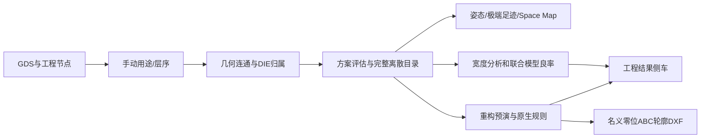

# Die Shift Analyze：项目与算法交接

## 项目来由和用途

Die-first封装中，贴片、塑封模流和材料热变形使DIE平移/旋转。软件从GDS建立几何连接，比较三种重构路径，并预览偏移造成的接触、布线通道风险及固定RDL的适配假设。长度μm、界面角度°、内部rad。它不是签核布线器，也不能以模型良率替代生产数据。

V22导入1102附件形成规范主线；历史版本在Git tag保留。后续逐步增加实体概率、全组合、通道分析、工程节点、离线Windows后端、精确DXF、源绑定动区。V38删除旧预演分析，V42进一步删除“修复补块”；**重构预演**是当前独立功能，不要把已退役算法重新接回来。

## 用户工作流

源文件只读。边框、用途、层序由用户设置；显示checkbox只影响画布。金属为运动/固定RDL与运动/固定过孔；非参与和边框不进入金属电连接。Q菜单工程节点改变名义几何，保存指纹，所有计算入口共用编辑后的快照。

## 核心代码地图

| 责任 | 主要文件 |
|---|---|
| 参数/导入/三方案初筛 | core.py、screening.py、gds_merge.py、geometry_errors.py |
| 相邻金属连通与真实DIE归属 | stack.py、contact.py、preview.py |
| 偏移分布/离散目录/积分 | statistics.py、distribution.py、model_yield.py、width_grid.py |
| 条件事件并集与混合进制分页 | extreme_filter.py、reconstruction_events.py |
| 通道、刚性孔盘、原线宽需求 | width_analysis.py、width_summary.py、landing_geometry.py |
| 边距/禁布区 | edge_clearance.py、width_keepout.py、width_yield_geometry.py |
| 路径/名义动静区/分叉合并 | reconstruction.py、reconstruction_route.py、plane_route.py、branch_regions.py、reconstruction_zones.py |
| 边界角度/手动编辑/忽略随动 | reconstruction_angles.py、reconstruction_edits.py、ignored_motion.py、reconstruction_ownership.py |
| 最终原生规则与良率 | reconstruction_rules.py、reconstruction_yield.py、native_backend.py、native_ops.py |
| 工程参数、结果恢复 | project.py、settings.py、project_results.py、gds_merge.py |
| GUI、后台调度、取消 | gui.py、reconstruction_status.py、task_control.py、scheduling.py |
| 交互叠加与缓存 | reconstruction_overlay.py、width_overlay.py、render_cache.py、session_cache.py |
| 导出 | export_ui.py、dxf_export.py、region_export.py、region_contract.py |
| CPU/GPU资源与Windows | resources.py、acceleration.py及CUDA模块、RUN.bat、BUILD.bat、Die_Shift_Analyze.spec |

文件路径均相对die_shift_studio，BAT/spec在根目录。先用rg确认现有入口；不要另建第二份主窗口、模型或导出算法。

## 数学与统计口径

点P相对实际旋转中心C的姿态变换是 `T(P)=C+R(θ)(P−C)+D`，D为XY平移，θ为rad。旋转中心可为DIE中心、四角或用户相对中心偏移，不能用它代替物理DIE边框。

输入幅度B为最大单边随机范围，有限k级使用母尺度σ=B/k，并在输入范围截断。0沿用最近有限尺度且不做级别筛选；∞接触显示为当前实体二值，新联合良率仍用最近有限尺度。零幅度轴锁在0，即使另有系统均值。每个活动轴取0、均值−B、均值+B；所有DIE用混合进制组合，不把对角几组当成全组合。

有限k低概率门限为 `2Φ(−k)`；只有事件上界已证低于门限才淡显/灰显。有限网格零失败不是连续安全证明。连续证明仅覆盖被证明的特殊几何/变换，其他情况保留未知。

三方案初筛以空间需求/可用空间的无量纲指标比较，详见screening与报告；初筛可行不等于布线/DRC可行。报告必须逐步给输入、公式、输出和符号来源。

宽度通道保留实际过孔孔盘及固定障碍，忽略运动网络的普通线作为障碍，但保留其名义贯穿需求。孔盘尺寸刚性；线宽可收窄部分不能跨过孔。通道两端普通壁需线距，封装壁用独立边距c，禁布壁允许共边但不允许正面积侵入。按原宽可通过、仅收窄可通过、最小线宽仍不足分绿/黄/红。两个宽度良率是全修正未忽略红黄和完全不修正，按整包关联事件并集积分，不按问题数量乘独立概率。

## 重构数据模型

名义源路径和端点跨全部姿态共享。内部旧键B是固定、C是移动；公共输出映射恰好相反，统一在region_contract中转换。A始终为适配区。

普通路径按弧长两端切分，短线/拐角/孔盘需有效拓扑。串联区按有效长度分摊位移，不能每段都重复移动完整前缀。碰接区合并，已吸收的身份保存删除记录以免后续编辑复活。所有控制柄为蓝色；整孔盘模式只允许真实相连端孔且需要触发余量。

分叉构造运动端到固定端的路径集合。大网络用覆盖全部端点的集合减少重复路径；从铜中去除候选A域后，剩余连通分量按运动/固定端归属。若一个分量仍同时含运动和固定端，将其纳入A，从而不能有运动—固定路径绕过适配域。相接A域合并；多DIE先做源连通分界，各分支仍使用各自DIE姿态。

多端合并域采用连续位移场连接刚性端，单端普通路径保留四种原有曲线候选。分叉场在到运动/固定刚体支撑的距离之间归一化，用直线/端部C1/C2权重光顺；这不是任意多端区域的精确圆弧布线证明。原生线宽、线距、包围量、连接、封装边距与禁布区检查实际最终铜，失败须保留原因，不能只检查控制点。

A颜色仅由A自身型变前/后的见证决定。两侧铜默认图层颜色；独立违规不污染A，但仍影响全局规则。忽略铜按连接分支刚体移动，固定孔包围量可能成为约束。不同DIE无法分离时保留源铜并明确提示，不能任意平均偏移。

默认边界角度为重构区优先；两侧平均同时考虑两边切向。拖动先给实时几何反馈、后台补完整角度与规则，代次不符不能发布。用户手动角度是源坐标中的绝对方向；移动端点后保持，右键可撤销。

## 缓存和持久状态

运行缓存是有限LRU，读取不增加计数，零位保留，动画可正反复用；控制项、几何、工艺、姿态要进入对应缓存身份。单源编辑复用其他源的型变；原生检查缓存按实际几何和规则，邻网变动仍须验证。

工程JSON为schema5。`.dsresults`保存已完成的评估、当前帧、宽度统计、重构证据和路径数据，绑定源码版本、几何、参数并校验摘要。使用有限类型的JSON+Zlib/WKB/数组编码，不执行用户pickle。未完成任务不写成完成快照。过期/损坏缓存只丢弃结果，工程设置仍恢复；没有有效历史时先评估再分析。

## 导出与开发要点

普通DXF冻结当前完成姿态；动静区DXF固定使用原始名义零位及名义分区，只输出两种边框与固定RDL的ABC。三层共享相同坐标源，开放轮廓联合闭合，禁止内部切面、HATCH、重复或正长度重叠。实际临时文件回读通过后原子替换，失败保留旧目标。

线程仅处理数据快照；Qt与Matplotlib在主线程。原生KLayout访问有锁，增加线程不一定提速，须实测相同输入/规则/缓存状态。大量只读GEOS与数组批次可以并行；候选和缓存有界，循环检查取消。保留离线模块/桌面后端与CPU回退。

## 后续计划和验收优先级

每轮先复现用户图纸对应工况，再做合成独立期望。重点：多端合并域的实际宽度与局部可逆性、跨叉反向拆分、真实端孔与A工程指定坐标、增删/保存的稳定身份、仅单源重算的计数、结果跨程序恢复、全部离散因子与完整帧一致、零位DXF字节及拓扑。性能记录冷规划、局部编辑、缓存命中、显示耗时分别列出。

尚未完成的内容必须写KNOWN_ISSUES和轮次记录。正式发布仍按Agent.md的Windows、源码包回下载、GitHub合并规则执行；测试代码和报告不构成工厂签认。
