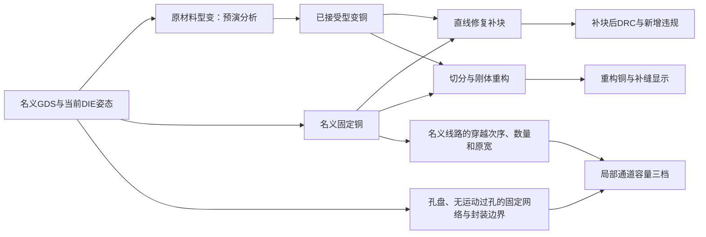

# 设计要求与当前模型合同

维护日期：2026-11-06。适用：V35 / `main`。本文将本对话的长期要求与1102附件的现行实现分开记录；不得把历史要求不加判断地覆盖当前功能。

## V35 尾部积分、完整有限网格与原样DXF

两项改名为“全修正良率”“不修正良率”，与坐标同一行固定居中，不增加图形高度。忽略集合扩大时全修正良率单调不增；相同／包含事件可提前相等，不能按忽略条数人为拉开。修复旧直接采样遗漏尾部，用有界混合密度加权，独立累计失效和差值。宽度分析独立保存采样方法、数量、种子、网格节点数。全情况模式不随机抽样，按全部有限网格的区间质量及依赖决策图积分；不得宣称连续空间被有限精确穷举。

“输出 → DXF输出”使用默认系统保存框，写已导入的当前完成几何（含工程节点／姿态／替换铜），保存所有图层。独立ASCII AC1015写出，无圆弧恢复，不依赖整套KLayout。临时文件验证后原子替换。风险标签在图内跟随视野，图外线路的箭头位于最近边缘；删除上方独立文本面板。[V35 公式、精度及边界](V35_使用说明.md)

## V34 两项良率、参数位置与禁布区

良率1假设修正所有未忽略红黄问题，忽略线路保持原图；良率2假设完全不修正。V35改为与坐标同一行居中，鼠标坐标不会改变其位置。两项均按所有输入姿态的联合概率计算，保持同DIE共享运动及不同DIE联合，不把选中极端当作总体。系统偏差与相关性移到设置，保存字段不变。

禁布区为各固定RDL平面的共同固定障碍，忽略显隐、无电连接。其侧边距为0，其他壁/封装侧为有效线距；原宽需求改为 Σmax(wᵢ,w)+(N−1)s+mₐ+mᵦ。孔洞保留，正面积侵入标红，共边共点允许。预览替换铜、零位汇总、极端筛选和原图联合良率均检查此规则。[V34 完整公式和示例](V34_使用说明.md)

## 右键与整包宽度良率

普通右键单击优先作用于已有选集，空选集时命中最上层可选图形后弹出简略菜单，空白无命中时保持视图。宽度问题线路可按源图形忽略或取消忽略，按 GDS 指纹与顶层 Cell 保存。忽略风险使用浅绿色并隐藏对应文字。共享通道仍显示其余问题线路。

绘图区上方同一行居中显示全修正良率、不修正良率。每个整包状态先合并红、黄与忽略线路事件，再对全部输入范围求概率。用户确认只计宽度问题，∞ 下两项数字沿用最近有限级别的概率尺度。结果独立于当前预览姿态与显示过滤。数值估计附方法和精度信息，忽略集合变化复用逐线路事件记录。独立累计微小失效质量，接近100%用科学计数法显示余量；样本未分辨尾部时用置信下限或待细化状态。良率小数位数0–12、默认6，属于工程显示设置。[V35 使用说明与完整公式](V35_使用说明.md)

## V32 GPU 与构建合同

Windows EXE 直接加载系统 NVIDIA 驱动与内置双精度 PTX，不收集 CuPy 或 CUDA Toolkit DLL。枚举 CUDA 设备并优先选择自检项目完整的适用设备。四类运算独立自检，可回退至 CPU；Windows 系统显卡列表与实际计算设备分别记录。自动与手选 CUDA 均遵循工作量和显存边界。CUDA C 与 PTX 均为源码交付中的文本；只在目标电脑生成 EXE。[V32 使用说明](V32_使用说明.md)

## V31 源码交付

正式 ZIP 仅包含源码、RUN.bat、BUILD.bat、依赖清单和 PyInstaller 规范。用户将源码解压到目标 Windows 电脑，双击 BUILD.bat 构建。程序启动与打包是两个独立操作。EXE 与图标在目标电脑生成，Windows 验证的临时 EXE 不上传。[V31 操作说明](V31_使用说明.md)

## V30 Windows 构建与过孔范围

Windows 源码使用一个 `RUN.bat`。在 Windows 中用 PyInstaller 构建带多分辨率图标的 GUI 单文件 EXE，V30 验证单文件构建，分发方式由 V31 的源码交付要求接替。首次启动或目录缺失时在实际 EXE 旁创建 Jobs、logs，保留既有文件。程序不锁定解释器和依赖版本，不执行联网安装。两个过孔范围虚线独立可见，保存到工程；默认分别为浅青色和浅紫色半透明。切换显示不改变材料几何、接触、概率、评估、动画或数值缓存。视野裁剪仅服务绘制，连续输入需及时刷新最新位置。[V30 使用说明](V30_使用说明.md)

## V29 零位风险详情

零位用浅色描边和高透明度同色填充标出风险线路。只为实际选中的可见风险线路绘制详情，Shift/Ctrl 与定向框选保持现有合同；取消选择立即隐藏标记。显示零位的原始图形，标签引用触发风险的完整离散工况，包括第三方障碍物的所属 DIE，不能用单轴极值拼凑。多线选中时分别显示。按等级、证据、缺口选择同一线路的代表位置，包边距显示实际净距和要求。图例、标注字号/小数和图层显隐沿用工程既有设置。选中行有独立连续边框，浅色缓存底色保留原来的计数关系。[V29 使用说明](V29_使用说明.md)

## V28 极端工况与交互

- 极端表的“过滤无问题情况”位于页码右侧，默认开启并保存到工程。接触模式按具体姿态的几何接触，宽度模式按红色宽度风险。空白首行永久保留，按“复原”不滚动。筛选结论与轨迹缓存着色独立。
- 首行宽度描边使用完整离散目录，每个原始线路取最重等级，区分已证超限和概率待定，省略已证低概率。0 和 ∞ 用几何判定，不绘文字或区域。具体姿态保留逐处标记。勾选改变铜形的叠加项后，接触和板边距须按实际型变几何核实。
- Shift 加选，Ctrl 减选。方向框选、重叠选取、边框排除、Q 与 Esc 继承同一个真实选集。∞ 级显示真实姿态的过孔实体 0/100%，跳过概率积分、随机采样及统计覆盖包络。见[本版使用说明](V28_使用说明.md)。

## 1. 产品范围与证据口径

产品名称 **Die Shift Analyze**。分析DIE-First封装中平移、旋转对运动过孔、RDL连接、间距和重构的影响。源 GDS 保持只读。Q 可编辑所选顶层实例的名义节点并随工程保存。

三方案的物理含义保持：

1. 在一层RDL划分动/静区，芯片侧随动、外侧固定，中间适配。
2. RDL及过孔整体随DIE运动，用固定端接收空间容纳偏移。
3. 芯片上预制运动RDL，再在运动与固定接口处做空间/型变适配。

UI只使用“运动RDL / 固定RDL / 运动过孔 / 固定过孔”；不能从“运动RDL”这个用途标签推断它必定经过某种晶圆工序。三方案评分属于空间初筛，结构条件、接触概率、机械空间、实际DRC分别检查。没有候选时不得强制推荐。

不得把下列结果混写：一个确定姿态的二值接触、每接口接触概率、全输入模型无接触概率、已验证安全内盒、局部通道容量、可行型变候选、真实量产良率。其各自边界必须保留。

## 2. 长期交互与文件要求

| 项目 | 必须保持的行为 |
|---|---|
| 输入 | 必须从GDS导入，不恢复手绘几何；不自动指定芯片/封装边框；新层默认“不参与” |
| 图层 | checkbox独立显隐；显隐和图形始终一致；用户手动拖动排序，不自动按层号重排；datatype同物理层关系保留 |
| 几何兼容 | 支持层次、PATH、合并和修复，保留孔洞；无法恢复的图形用玫红细虚线定位、随图层显隐，排除数值计算并报告 |
| 自动识别 | GDS能提供的尺寸、数量、形状、层数等自动取得，避免重复参数控件 |
| 工程 | 安装目录Jobs下拉，首行空白；已有工程保存覆盖，新工程保存询问名称；保留工程格式/旧用途迁移 |
| 图形 | 窗口变化充分利用绘图区，X/Y等比例；运动孔/固定孔为较深实心，RDL浅色；标记与实际显示姿态一致 |
| 标记 | 接触位置、侵入区、孔包围/线距控制区、橙色位移线均按当前姿态；图例与DIE文字同步按默认视角显隐 |
| 导航 | 滚轮缩放、中键平移，普通右键单击打开图形菜单、拖框缩放。F 恢复视角，Q 检查选中图形，M 选 DIE 后右键平移、普通滚轮旋转、Ctrl+滚轮缩放、ESC退出 |
| 选择 | 边框不参与选中；同点反复单击逐层轮换；空白/ESC取消；左→右框选全包含，右→左框选相交 |
| 滚轮 | 表格和日志窗口可滚行；数字、下拉选择、层序不能被滚轮意外修改 |
| 结果 | 修改普通工艺参数保留上次评估快照；良率级别按现行流程实时更新；后台状态有进度与带时间戳日志 |
| 报告 | 输入→完整公式→输出，符号/角标/上下分式清楚；说明每个量的单位与如何得到；不恢复已删除的说明/导出研究报告按钮 |
| 视图标签 | 保留“结果图形”“结果分析”“报告”“极端情况”“信息”；三方案推荐行浅橙高亮；数值和标签页切换不能破坏分隔条拖动 |
| 交付 | 后续研究结论用MD；浅色、清晰、可复算图表；Release ZIP 只含运行与打包所需的源码文件，报告图片在线保留 |

输入长度统一 **μm**，角度界面用 **°**，计算用 **rad**。常规DIE长宽500–10000 μm，长边/短边1–3，研究尺寸图可扩到400–12000 μm；局部放大图另标清范围，不能伪装成整颗DIE尺寸。

单点有宽 PATH 用直径等于实际宽度的圆形轮廓导入。零宽 PATH 不进入图形，按层输出展开数警告。Q 的类别和图形菜单展示名义节点、当前预览轮廓及单位，允许批量暂存节点编辑并一次应用。缓存键须区分源图指纹与工程几何指纹。左侧层显隐和宽度元素的显示、隐藏、低亮只影响画布，报告、宽度表、统计和场数值始终使用全部参与层。

## 3. 几何、连通与运动归属

主要入口：[stack.py](../die_shift_studio/stack.py)、[core.py](../die_shift_studio/core.py)、[fast_preview.py](../die_shift_studio/fast_preview.py)。

1. 用户层序是上→下顺序。边框、不参与、禁布图层不建立金属电连接。参与但没有图形的空行忽略。
2. 同物理层号的datatype共享一个金属平面；同层接触形成连通区。一般跨层边使用相邻参与平面的正面积交叠，面积容差为 `max(1e-12, 0.01×dbu²)` μm²。
3. 每颗DIE分别从其最深实际末端接触得到根，不强迫多颗芯片共用一个全局底层。已有唯一连通归属的外部扇出仍跟原DIE，不因经过另一DIE而变更。
4. **1102变更：** `fixed_interfaces`可沿实际固定过孔连接查找固定RDL；无直接目标时 `_fixed_below`沿用户层序找过孔投影下第一处真正重叠的金属。该处是固定RDL才返回目标；其他真正重叠金属会阻断搜索。局部没有铜的参与行可被略过。这是1102的接口查找规则，不是允许任意跨越有铜层。
5. **1102变更：** 无根或多根的运动金属按多边形到DIE的最短距离选择最近DIE，记录 `positional_ownership`，其中`mode`区分`unconnected`/`shared`。距离并列时当前实现取DIE排序靠前的一项。它是运动预览的推定，不是新增真实电连接，也不是跨DIE单刚体的物理证明。不得把它描述成已由网表确认。
6. 此推定行为替代旧版“无根/多根一律静止”的策略。要更改推定方法，必须是明确的新任务，并同步报告、测试、概率/安全范围的适用条件；不能仅凭历史V21文字恢复旧策略。

旋转中心由每颗DIE配置：中心、四角、自定义相对芯片中心坐标。实际名义点为 $P=C+A$，$C$为所选旋转中心，$A$为相对坐标：

$$P'=C+D+R(\theta)A,\qquad U=P'-P=D+[R(\theta)-I]A.$$

$D=(D_x,D_y)^T$为平移μm；$\theta=O\pi/180$为弧度；$R$为二维旋转矩阵；$U$为实际点位移μm。孔中心、实体、外部扇出、叠加图及评估必须共用这一变换。芯片物理边框与旋转中心是不同概念；当前重构边框选择的缺陷见[已知问题](KNOWN_ISSUES.md)。

## 4. 最大幅度、良率级别与概率

主要模块：[statistics.py](../die_shift_studio/statistics.py)、[distribution.py](../die_shift_studio/distribution.py)、[contact_probability.py](../die_shift_studio/contact_probability.py)、[model_yield.py](../die_shift_studio/model_yield.py)。

- 偏移单边幅度是最大随机偏差：单芯片默认25/25 μm，多芯片默认35/35 μm，转角默认1°；支持逐DIE独立幅度和旋转中心。输入不是天然的标准差。
- 仅保留UI“良率要求 / 良率级别”；下拉0–12与∞，不可自由文本输入。不恢复独立“输入幅度统计口径”控件。
- 有限正整数 $k$：母标准差 $\sigma_x=B_x/k$、$\sigma_y=B_y/k$、$\sigma_\theta=B_O\pi/(180k)$；在输入最大幅度盒内截断归一化。母正态尺度和截断后的实际方差不是同一个量。
- $k=0$：保留最大输入边界内全部概率，不做级别筛选；尺度沿用最近有限非零级别，首次6。不能除以0。
- $k=\infty$，或选定/手动预演具体姿态：按当前几何接触作二值判断，不意味着无限标准差或无限偏移。
- 默认无具体预演的有限级别：每接口接触概率与 $2\Phi(-k)$ 比较；0级检查任何非零接触概率。边界判定使用概率上下界/待细化状态，不把零次采样命中当成高σ保证。
- 同一DIE的所有孔共享同一随机姿态；不能把其孔良率当独立事件相乘。输入中的XY相关性按现有模型实现，不能随意扩成未经实现的任意协方差假设。
- 极端轴取集合 {0, μ−B, μ+B} 的唯一值。B=0 时该轴及其系统偏差都锁在物理零位，适用于自动评估、足迹和概率。全零 DIE 仍参与静态几何规则。按混合进制分页显示完整笛卡尔积，首行是唯一的全包名义位置。原图离散校验合成单 DIE 因子和经安全预筛的芯片对净距表。非线性型变使用明确计数的重点组合，连续概率保持独立积分。
- 运动概率显示孔**实体覆盖概率**，包含孔面积，不只画点；显示级别边界与概率密度是两个概念。云图网格须覆盖真实支持，不用矩形蒙版裁剪真实概率形状。
- 安全范围是原始固定RDL下、范围内任意组合通过的连续内盒；是搜索得到的较大体积已证内盒，不声明全局最大。
- “各DIE连续安全范围”标题中的百分比来自**整个输入范围**的模型无接触概率，不是只落入内盒的概率；保留积分/采样误差和统计范围。它不包含所有生产缺陷。

Space Map显示基础线距加上满足当前级别的额外补偿要求，支持运动范围和整封装范围；非运动区用基础线距，图例在图形区域外。不能拿Space Map颜色替代真实接触或DRC。

## 5. 四类几何预览必须分开

| UI功能 | 计算对象与生成方式 | DRC / 后续测量 | 成功的含义 |
|---|---|---|---|
| 预演分析 | 原始固定RDL材料的局部连续型变；孔盘级、轴向、三段/通用带、联合迭代等候选 | 最终布局检查，未接受保留原图并列出原因 | 该候选在所检查规则/模型下被接受，非量产签认 |
| 宽度分析 | 固定 RDL 原始穿越需求和孔盘运动后的空隙 | 对照原宽与工艺最小线宽 | 局部截面分为宽度足够、需局部收窄、宽度不足 |
| 修复补块 | 与固定RDL失去接触时，从实际原铜最近点直线补到移动孔中心 | 对补块后固定RDL复用全局DRC，新增/原有分开 | 可以暴露补块导致的违规；不是自动接受的型变 |
| 重构预演 | 自动猜移动/固定分区，刚体移动后用切口端点多边形补缝 | 展示自动划分的重构铜与补缝 | 自动划分假设供人工核对，不是完整布线或DRC结论 |

这些checkbox独立，不能简单地串成“所有结果都采用同一份最终铜”。当前依赖关系：

## 6. 固定 RDL 通道容量

宽度分析以名义连通性识别过孔孔盘、整块固定障碍和原始穿越线路。工艺最小包围量用于确定孔盘外形，受运动影响的孔盘与预览使用同一 DIE 归属及旋转中心。原宽与最小线宽分别校验。第三个孔盘进入评估矩形后须预留完整投影，孔和孔盘尺寸固定。相邻两壁间才可安排无孔线路，禁止把多个开口合计为一个可用容量。普通金属侧和封装边线保留线距，禁布区侧为0但不得进入其内部。当前铜到外框、内孔及禁布区另做逐层几何检查。宽度结果须有同一名义铜穿过实际窄口的前后两端。空通道跳过。同对实体和同束线路的连续等距截面合并，保留最紧的实际测点，第三实体分段不得沿用远处截面的坐标和角度。

工程 `overlays.width` 和 `overlays.width_sufficient` 默认均为 false。绿色区段仅在主动显示时出现。该显示开关不触发通道重新计算。风险轨迹描边在矩形下方，交集用同色半透明斜纹。两行标签给出原可通/需求/现可通根数及所有自由线路需减少的总宽度。返回零位可独立切换动画，默认开启，缓存同条件的中间帧及准确终态。M 与数值输入共用双向动画包，命中只更新最近使用顺序。介于已缓存姿态之间的新动画不占普通结果名额。宽度标签在当前视窗内避开可见截面和其他文字，字号 6–24 pt，默认 8 pt。设置分组默认折叠，工程可还原布局。完整极端足迹计算各运动孔的本地姿态并集。极端表色深按可复用缓存项目数，绿色保留安全判定；检查颜色不得读缓存文件或刷新最近使用顺序。工程可还原目录范围、页码与足迹开关。[V26 离散目录](V26_使用说明.md)。

V27 默认重点组合，每页 256 个非零姿态。首行和“复原”走同一条回零、动画和缓存路径。缓存色限于浅绿、浅蓝，工程还原已有目录模式与页码所在区间。宽度标签默认两位小数，修改 0–6 位只重绘。有限 k 级按每个源孔与目标异网图形、相邻两壁的局部宽度事件分别认证上界。只有上界不超过 2Φ(−k) 的位置可淡显或单独隐藏。0、∞、连续型变概率未验证和其他未定位置保持正常显示。原始规则、缺陷数、具体姿态二值结果保留。[V27 使用说明](V27_使用说明.md)。

## 7. 修复补块

主要模块：[repair_patch.py](../die_shift_studio/repair_patch.py)、[repair_overlay.py](../die_shift_studio/repair_overlay.py)、GUI独立repair缓存。

- 仅有名义固定RDL接口、且移动后孔与实际铜失去接触时补块；仍接触时不制造额外铜。
- 起点是当前铜上离移动孔中心最近的点，终点是移动孔中心；圆头直线胶囊几何。
- `repair_patch_width_um=0`默认按孔的最小旋转外接矩形短边取直径；正值用统一指定直径。它不是默认固定RDL线宽。
- `repair_landing_pad=False`默认不在端点额外加包围盘。不得把这个可选设备模型写成必须的制造规则。
- 复用 `GlobalDRC` 检查补块后图形，不另写一套宽度/线距规则。基准为同姿态未补块的铜（可以是已接受型变铜）。
- 新增违规按种类对区域取并集做差；每个新增区域面积大于 `max(1 μm², 同类原有面积×1%)` 才列为新增，避免把微小形状改变全算新违规。这是当前统计阈值，不改变真实DRC规则。
- 琥珀补块、斜纹红新增违规，标注/表格共用归因，点击能定位。动画中间帧不画旧姿态的补块，终态显示自己的补块。
- 基准标记数与新增区域数的统计粒度不同；当前“原有数量”负值问题以及repair缓存依赖缺口必须在后续修复，不把统计误差归给物理工艺。

## 8. 固定RDL重构预演

主要模块：[reconstruction.py](../die_shift_studio/reconstruction.py)、[reconstruction_overlay.py](../die_shift_studio/reconstruction_overlay.py)、`ViewSettings.reconstruction_key()`。

1. 对落在固定RDL上的运动孔，按同一DIE、同一固定RDL图形/网络分组；近邻落盘聚成一条串。
2. `reconstruction_length_um=0`时，自动切口距离 $D=2.5d$，其中 $d=2\sqrt{A_L/\pi}$ 是落盘面积等效直径；一组使用相应落盘最大直径。正数输入直接作为D。不是2.5个半径。
3. 切口在串的外端再向网络侧量D，取估计走向的垂线；多落盘用最远中心连线方向，单落盘用局部铜最小旋转矩形估计。45°直线对应135°切线。它是走向估计，不能保证任意弯曲/凹形铜边都严格正交。
4. 含整条串的一侧成为移动区；同DIE重叠分区取并集。移位/旋转必须与孔使用同一刚体变换。
5. 共享多DIE铜区按各DIE物理边框裁剪，落盘完整保留；芯片边缘也可成为切口。统计真正不动的铜时排除别的DIE会移走的区域。外部扇出、特殊旋转中心的边界需特别复核。
6. 补线由未移与已移切口面的端点围成的多边形构造；`reconstruction_width_um`为补线外扩，默认0。不是中心线。裂隙为0也可能需要补线，仅完全重合或已有铜已覆盖时不重复添加。
7. 状态区分已补线、贴合（直接/补线覆盖）、整块随动（无不动铜可接）。没有真实切口时，配置D不代表测得了该距离。
8. 冷色显示移动区原位参考，暖色显示移动铜，浅暖黄补线，暗红虚线切口；原位参考不代表该处仍存在实际铜。显示与测量引用同一套重构结果。
9. 重构结果用于显示移动区、切口和补线。宽度分析沿用名义穿越需求。

自动划分与人工真实生产分区可能不同。输入附件中GD55段数、面积等是特定状态下的历史实验记录，换图、参数、归属或版本后必须重新计算，不能作为常数/通用保证。

## 9. 规则、默认值与兼容

| 参数 | 默认 / 约定 |
|---|---|
| 运动/固定线宽、线距 | 各15 μm，分别设置 |
| 最小包围量 | 15 μm，用于孔盘外形 |
| 共同DRC容差τ | 0 μm；正放宽、负收紧；有效宽/距=工艺值−τ，必须为正 |
| 动画 | 开启；时长上限1000 ms，30 FPS，速度等级控制刷新/行进；视角跳转速度独立 |
| 缓存 | 每工程最大2000项；无位移固定保留；会话内跨项目保留，可清当前/全部 |
| 概率 | 默认Sobol，固定随机种子；支持蒙特卡洛/确定性角度积分，不能称连续变量“有限穷举全部” |
| 加速 | auto，CPU始终可用；大型刚体、型变坐标和概率卷积可在显存预算及 CUDA 自检通过后使用 GPU；GEOS 谓词的并行工作器须使用独立的准备几何与索引 |

JSON中的 `wafer_*` / `panel_*` 和旧用途别名可为兼容保留，不能因此重新添加已经删除的晶圆段/板段UI列或BGA说法。新增字段必须有旧工程默认值，保存/恢复不得破坏已有Jobs。

## 10. 模块与修改配套

| 模块 | 职责 | 必须同步核查 |
|---|---|---|
| `core.py` / `recognition.py` | GDS读取、自动参数、方案入口 | 单位、修复图形、角色手动选择 |
| `stack.py` / `contact.py` | 几何网络、归属、实际接口 | 推定标识、目标层、每DIE中心 |
| `settings.py` / `project.py` | 参数校验、持久化 | UI、旧工程、各类缓存键 |
| `deformation.py`等 | 原材料型变与最终验收 | 邻网上下文、源铜保留、全局规则 |
| `repair_patch.py` | 直线补块、补后DRC、归因 | 宽度/端点设置、缓存、统计粒度 |
| `reconstruction.py` | 自动切口、移动分区、补缝 | 物理DIE边框、旋转、共享铜 |
| `width_analysis.py` / `width_keepout.py` | 固定 RDL 孔盘与禁布区通道 | 穿越根数、实测原宽、分段容量、绿色开关、工程还原 |
| `fast_preview.py` / `prepared_motion.py` | 帧、引擎、动画缓存 | 完整/快速状态、参数依赖、终态 |
| `gui.py` / `*_overlay.py` | 控件、绘制、表格、异步发布 | 可见层、视窗、失效代次、滚轮行为 |
| `resources.py` / `scheduling.py` / `session_cache.py` | 资源、队列、缓存 | 并发租用、锁、上限、清理 |
| `native_backend.py` / `frozen_support.py` | 离线KLayout与打包入口 | Windows路径、spawn、自检、错误日志 |
| `report.py` / `formula_render.py` | 完整公式与解释 | 和实际选用几何/概率口径一致 |

## 11. 历史要求的取舍表

| 旧要求/旧实现 | 现行基线 |
|---|---|
| 宽度分析算窄口通道根数 | V25 在有名义线路贯穿的实际相邻孔盘窄口分别按原宽、最小宽判定，固定专属网络整块保留 |
| 无根/多根运动铜保持不动 | 改为最近DIE位置推定，并在报告中登记 |
| 只允许运动孔直接相邻固定RDL | 可沿固定过孔连接查找；另有首个投影铜回退 |
| 晶圆/板段用途、BGA、接口阶段列 | 不恢复；UI用运动/固定，用途与层序决定 |
| 分开的输入σ口径和目标σ | 不恢复；只保留良率级别与最大输入幅度 |
| 输入σ的∞表示零标准差 | 已废弃；当前∞为当前几何二值判定 |
| 图中图例全部删掉 | 现行与DIE编号一起按缩放显隐 |
| 所有预览都必须先DRC才能显示 | 原材料“预演分析”保持验收；补块/切分重构属于显式风险假设，按各自验证范围显示 |
| 旧版本测试日志可以证明最新版 | 不可以；每次交付验证实际提交与实际解压包 |

未列出的行为若与新用户明确指令冲突，以新指令为准，并更新本文、测试与交接记录。
