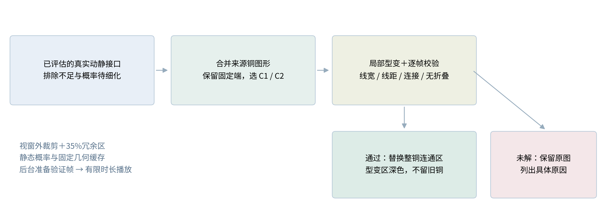
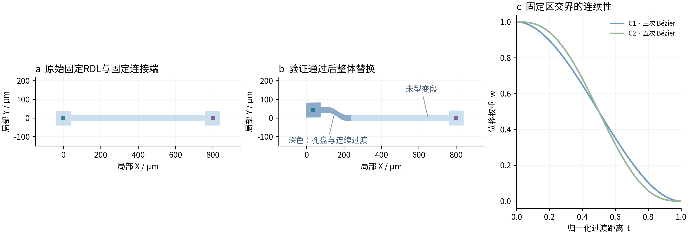
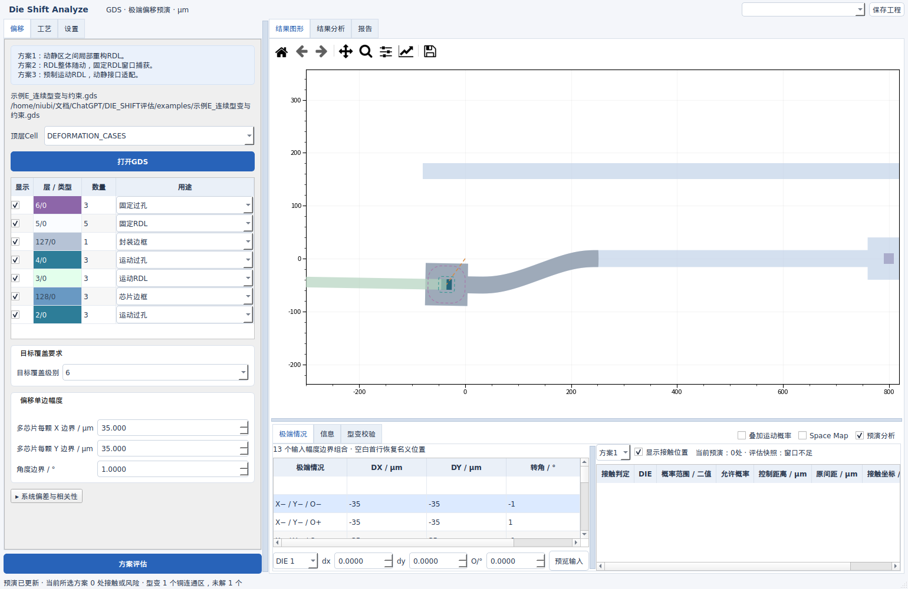
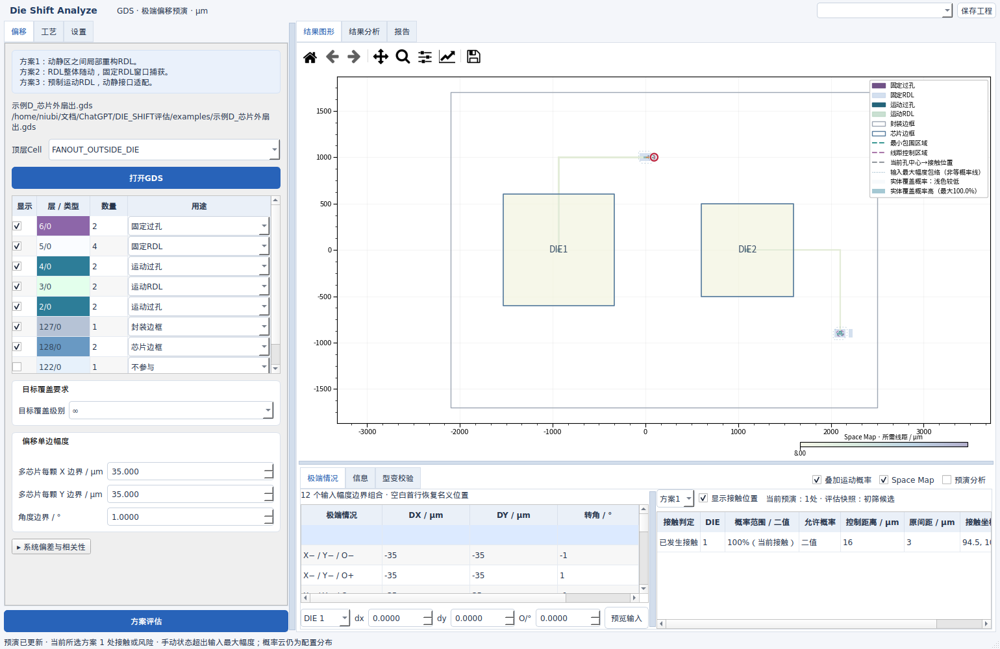
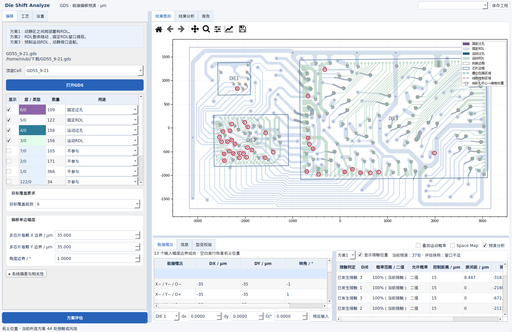

# Die Shift Analyze V10：连续型变预演与实时更新

2026-09-24 · 仅交付源码包 · 长度统一为 μm

本版落实手动层序、目标覆盖自动重算、方向键定位和实时动画设置，新增 **预演分析**。窗口判定仍针对原始版图；通过当前工况校验的局部型变在结果图形中替换原铜图形，不回写GDS，不将预演成功当作量产良率结论。

## 1. 操作变化

| 位置 | 本版行为 |
|---|---|
| 层叠表格 | 新GDS按读取顺序列出；工程按保存顺序恢复。改用途、计算、切换覆盖级别均不排序，边框插在金属行之间也保留。只有用户拖动改变层序。连接运算忽略非金属行。 |
| 底部按钮 | 名称为“方案评估”。 |
| 目标覆盖要求 | 选择1～12或∞后，180 ms合并连续修改，后台自动更新方案、窗口不足、概率云、Space Map和报告。保留预览偏移及视角，过期任务结果不覆盖新设置。 |
| 窗口不足表 | 鼠标和键盘↑/↓切换行均定位；重复点击同一行也能重新定位。填表时不会误触定位。 |
| 动画设置 | 关闭立即到达当前请求的终点；时长、速度、FPS改变后从已显示状态继续，定位速度单独生效。默认上限1000 ms、30 FPS。 |
| Space Map右侧 | “预演分析”，默认不勾选。评估后启用，先筛出不足与未定接口，再选择极端行或手动状态。 |
| 设置页 | 选择C1/C2、贝塞尔权重/圆弧路径、圆弧圆心角（默认30°）、曲线细分误差（默认0.05 μm）。 |
| 型变校验页 | 显示保留原图的层、源图形编号与具体未解原因。已确认的窗口不足仍在“极端情况”右表。 |

旧工程的用途名称继续迁移，但不反转、归并或重排其保存的层序。首次导入无层序信息的GDS时，需要核对实际工艺上下关系；文件中的层号本身不能证明层叠顺序。

## 2. 来源几何、连续性与校验

图1｜示例E的实际几何输出。左为原铜图形，中为通过校验的型变，右为两种连续性权重。线路和孔盘来自原始固定RDL的坐标型变；固定连接端保持原位。原铜连通区被整体替换，深色显示孔盘及过渡部分，不叠放多余的旧铜。

先按真实金属连接定位运动孔相接的固定RDL，合并其同层铜连通片段。统计不足、概率待细化及当前二值接触的运动孔排除；不把“概率待细化”当作窗口充足。固定过孔及不适配接口作为固定锚点。芯片外接口使用连接追溯得到的所属DIE，距离按真实外引位置计算。

设原固定RDL点为 $P$，接口孔原中心为 $c_i$，孔顶点集合为 $V_i$，固定线宽为 $w$，最小包围量为 $a$。刚体保护半径与归一化过渡距离为：

$$r_i=\max_{v\in V_i}\|v-c_i\|+a+2w,\qquad
 t_i(P)=\operatorname{clip}\left(\frac{\|P-c_i\|-r_i}{L},0,1\right).$$

$L$是保护区外的过渡宽度。$t=0$对应刚体随动区，$t=1$对应固定区。两种贝塞尔权重为：

$$w_{C1}(t)=1-3t^2+2t^3,\qquad
w_{C2}(t)=1-10t^3+15t^4-6t^5.$$

两者端点一阶导数为0；C2端点二阶导数也为0。同一DIE的多个孔通过

$$W_d(P)=1-\prod_{i\in d}[1-w_i(P)]$$

光滑合并，其中 $d$是DIE编号，乘积遍历该DIE在当前铜连通区内的适配孔。$T_d(P)=C_d+D_d+R(\theta_d)(P-C_d)$ 是该DIE的刚体目标点；$C_d$为DIE中心，$D_d$为二维平移，$\theta_d$为弧度转角，$R$为旋转矩阵。

**贝塞尔权重方式**：令 $\Delta_d(P)=T_d(P)-P$，则

$$\Psi_B(P)=P+\sum_d W_d(P)\Delta_d(P).$$

**圆弧路径方式**：用设置的圆心角换算 $\gamma=\gamma_{deg}\pi/180$，转角为负时取负号，零转角时取正号。定义

$$A(u)=\frac{1-\cos(\gamma u)+\cot(\gamma/2)\sin(\gamma u)}2,$$
$$B(u)=\frac{\cot(\gamma/2)[1-\cos(\gamma u)]-\sin(\gamma u)}2,$$
$$\Psi_A(P)=P+\sum_d[A(W_d)\Delta_d+B(W_d)J_{90}\Delta_d].$$

$J_{90}(x,y)=(-y,x)$ 将弦向量旋转90°。$A(0)=B(0)=B(1)=0$、$A(1)=1$，所以点沿连接原位置与刚体目标的圆弧运动，固定区、刚体区精确衔接；无转角的平移也有不同于贝塞尔方式的过渡。这里是**点的圆弧路径混合**，不宣称整个引线中心线是单一圆弧。

以所有适配孔当前中心的最大行程 $d_{max}=\max_i\|T_{d(i)}(c_i)-c_i\|$ 计算 $L_0=\max(2d_{max},2w,5)$，按 $L/L_0\in\{1,1.6,2.6,4.2,6.8,11\}$ 从小到大搜索。选择首个全部通过的最短候选，尽量限制型变范围；这是有限候选搜索，不是全局最小型变量证明。

另以位移场导数范数上界控制折叠。令 $g=1.5$（C1）或 $1.875$（C2），$\beta_d=2|\sin(\theta_d/2)|$，$h_i=\|c_i-C_d\|+r_i+L$，$q=1$（贝塞尔）或 $|\gamma|/[2|\sin(\gamma/2)|]$（圆弧），使用充分界：

$$\kappa=\sum_d\left[\beta_d+\sum_{i\in d}\frac{qg}{L}(\|D_d\|+\beta_d h_i)\right]<0.98.$$

这使 $\Psi(P)=P+u(P)$ 的位移导数范数严格小于1，排除连续场中的折叠；多DIE支撑域重叠会保守拒绝。该界可能拒绝实际上可行的图形，拒绝不等于不存在布线解。

每个候选还检查：

- 原始与型变后的固定RDL最小线宽；原图细颈也不能绕过。
- 对原有异网、同时型变异网和其他运动孔控制区的线距。
- 运动孔最小包围、固定连接端不动及覆盖、封装边界和禁布区。
- 铜图形有效性、连通分量及孔洞数量；不得把折叠图形通过Merge修补成“成功”。

曲线边界先分段，在每段1/4、1/2、3/4位置检查映射曲线与弦的偏差，超过误差设置即细分，随后按源GDS的DBU量化。**C1/C2是连续位移场的性质**；源图原有折角保留，离散多边形不具有严格的连续曲率。边界细分采用数值误差检查，而非任意点的形式化误差证明。

线宽检查调用KLayout 0.30.8的合并Region边对DRC，阈值取 $\lceil w/\delta\rceil$ 个DBU，$\delta$为源网格。为避免量化后的直角变成微小锐角而误报零宽尖端，`ignore_angle=89°`，即直角容差1°；**线宽长度阈值未降低**。这项角度约定及离散精度需纳入工厂DRC规则核对。API依据：[KLayout Region参考](https://www.klayout.de/doc/code/class_Region.html)。

## 3. 动画与大图性能

普通预演每个显示帧同步更新运动孔、控制区和红色交集。启用型变时，后台先准备并校验插值帧，再按设置播放；显示的芯片、RDL和标记取自**同一个已验证状态**；启用型变时，二值接触标记针对替换后的实际铜图形重新求交，不标在已隐藏的旧铜上。旧画面在准备期间可操作，新请求取消过期准备。播放用时与后台准备时间分别计算，1000 ms上限不包含后台几何求解。

帧数量由FPS和距离相关时长确定，并受自动内存预算限制：预备帧估算预算不超过可用内存8%或192 MiB中的较小值。预算容不下至少两个插值区间时直接显示已验证终点并提示；达不到请求帧率时会跳过过期显示帧；不能保证复杂全图在所有电脑上稳定30 FPS。

空间索引只把视窗及每边35%冗余区内的图形交给绘制器，位移图层先将视窗反变换到所属芯片坐标查询。原始全量几何和计算仍保留，裁剪不改变统计结论、图形编号或选取结果。移动视角会增删绘制内容，避免露出空洞。固定铜和无条件运动概率按原叠加顺序缓存；Space Map与变化的接触区域继续更新。刚体运动下圆角包围区复用名义拓扑，减少重复buffer计算。

| 同机工作负载 | V9中位耗时 | V10中位耗时 | 耗时改善 |
|---|---:|---:|---:|
| GD55全图：概率＋Space Map，单帧绘制 | 192.9 ms | 72.8 ms | 2.65倍 |
| GD55局部视窗：概率＋Space Map，单帧绘制 | 127.8 ms | 75.4 ms | 1.69倍 |
| 10万个图形：局部视窗切换并绘制 | 187.7 ms | 50.1 ms | 3.74倍 |

本表两版本依次运行，均用进程级 `taskset -c 3` 固定在同一逻辑CPU，未修改系统CPU策略；软件日常启动仍自动使用合理资源。GD55的全量当前状态几何计算另计，中位 19.7 ms。大图视窗实际绘制由 100,002 个降至 300 个（含边框），不是删除源数据。稳态中位数不含前两次预热；概率生成、评估和型变求解另计。

性能数字来自同机明确工作负载，含系统负载变化；合成大图用于定位绘图开销，不代表生产图纸吞吐量。源文件、测量脚本和记录可复算：`tools/benchmark_v10.py`、`results/baseline_V10.json`、`results/performance_V10.json`。

## 4. 工程与界面证据

图2｜示例E，中间接口随动、固定端保持位置。只绘制替换后的完整铜图形，原位置不留下额外孔盘或旧引线。

图3｜示例D外部扇出接口的运动叠加，图层显隐与所属芯片一致。缓存与完整重绘的像素比较在Qt测试中执行。

新增Jobs工程 **示例E_连续型变与约束**：三颗600×600 μm芯片分别演示原始12 μm细颈（要求20 μm）、可适配的32 μm引线，以及受邻网限制的窗口。过孔均通过下层RDL扇出到芯片外，固定端为真实固定过孔。

附件GD55按用户确认层映射复算：127/0封装，128/0芯片，3/0运动RDL、4/0运动过孔、5/0固定RDL、6/0固定过孔，金属顺序6→5→4→3。通用源码包不包含用户图纸，示例E可独立复现型变。

图4｜GD55复算使用明确的演示工艺：固定线宽/线距5/5 μm、最小包围10 μm、目标6σ、平移最大幅度35 μm、转角最大幅度1°。在三颗DIE同时DX=35、DY=−35 μm、θ=0.01 rad的指定状态下，44个铜连通区通过型变校验，40个保留原图并列出原因，63个运动接口因统计不足、待细化或当前接触排除。接口与铜连通区是不同计数口径。该状态型变计算约1.38 s，单次计时，详见JSON；不是把该工艺参数当作工厂实际规则。

## 5. 源码交付与验证范围

本版版本号V10。本地Git保留V9基线并提交更新，未推送远端。增加`klayout==0.30.8`作为边对线宽校验依赖，已加入Windows PyInstaller依赖收集；仍保留`RUN.bat`和`BUILD_WINDOWS.bat`。本次只输出源码ZIP，未构建Linux二进制，未执行Windows实机验收。

99项数值与几何回归、三组Qt界面测试，以及源码启动和CLI复算纳入发布校验。测试覆盖原图不被改写、C1/C2端点导数、两类型变、逐帧线宽线距、固定锚点、孔洞与细颈、多芯片外扇出、层序保存、连续改覆盖级别、键盘定位、动画即时设置、选择图形与视窗裁剪、渲染像素一致性。最终通过情况见随包验证记录。

发布脚本会对ZIP重新解压、逐项核对SHA256，执行数值测试、Qt界面测试、源码启动和五个随包Jobs复算。实际记录随包提供于`docs/package_verification.json`。初始软件自动识别资源，复杂型变是有限搜索；未解保留原图，不宣称已经完成全部生产可布通性验证。
