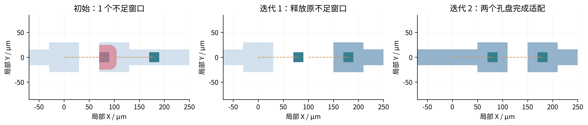
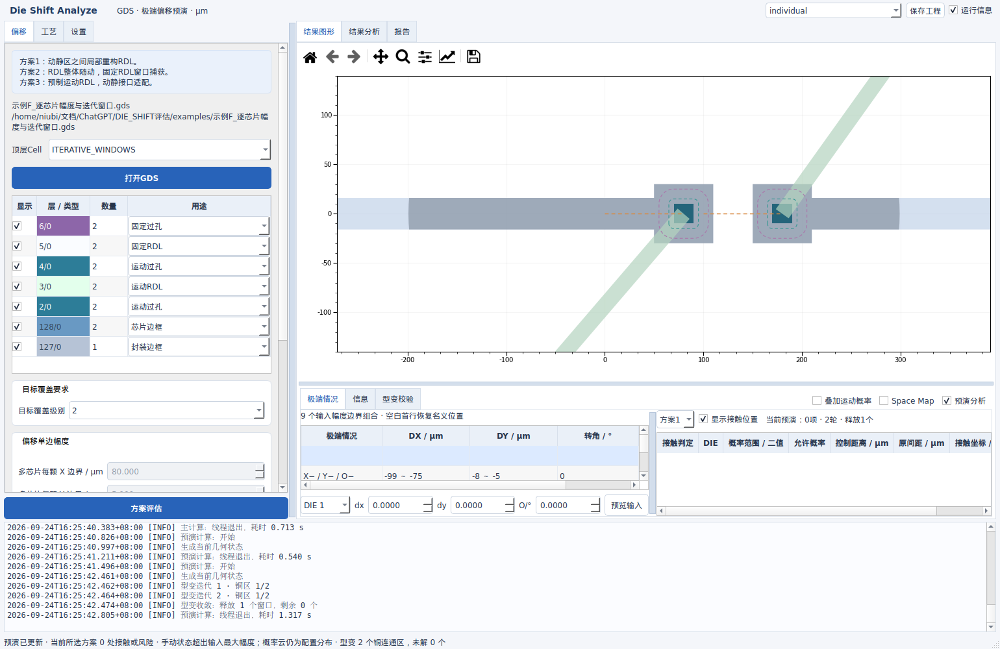
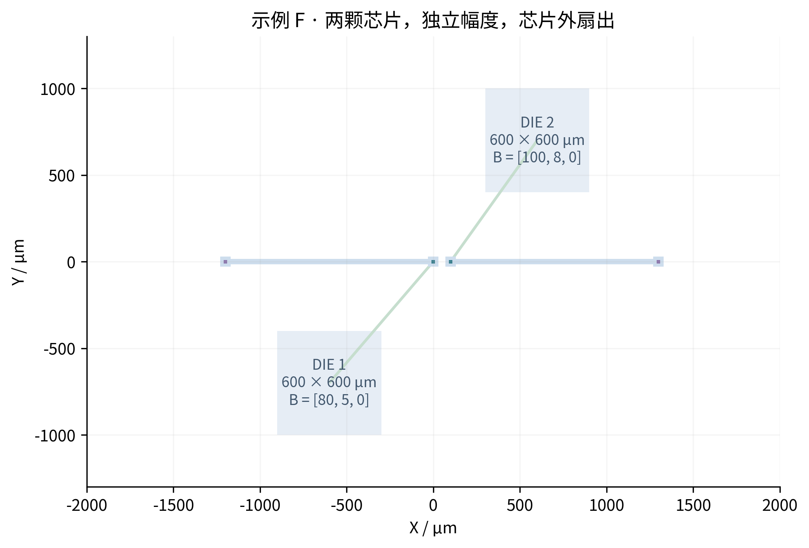
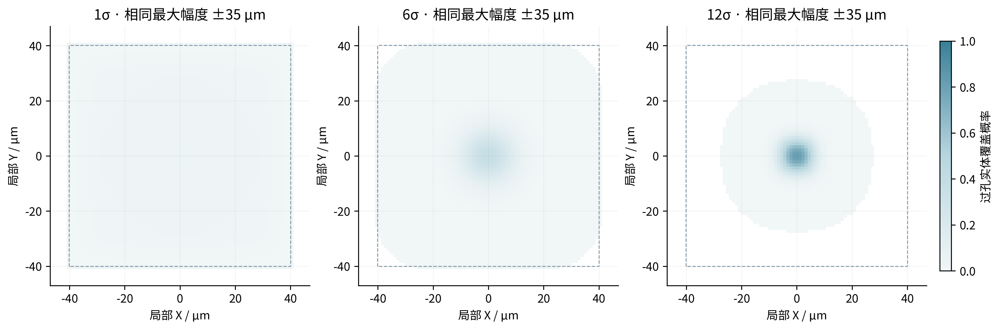
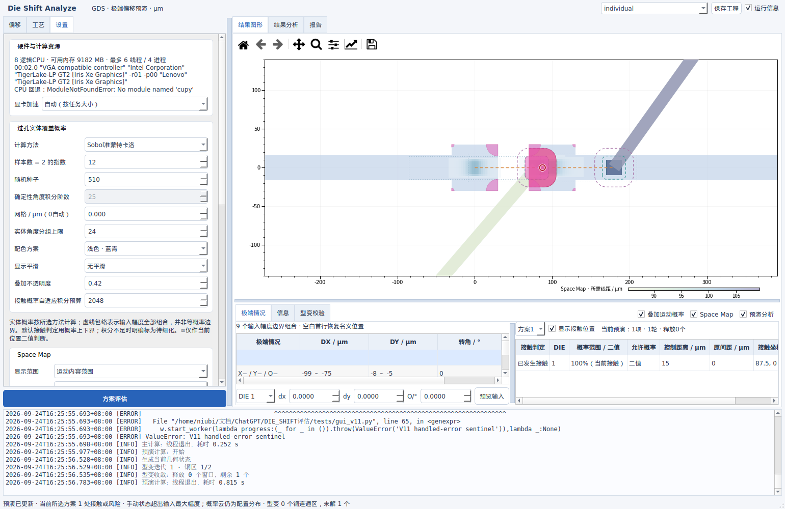

# Die Shift Analyze V11：逐芯片输入、完整概率云与迭代型变

2026-09-24 · 仅交付源码 ZIP · 长度 μm，用户转角 °，计算转角 rad

本版修复概率云栅格随 σ 改变而变粗、卷积缺少质量检查、后台参数共享和过期结果静默丢弃的问题。预演分析改为迭代释放窗口、立即发布已验证的中间帧，并标出最终可见图形的规则违反区域。



图1｜由随包工程 F 计算得到：两个芯片都向右移动80 μm时，左孔最初接触右侧原孔盘；右孔盘先合法移动后释放左孔窗口；第二轮完成左孔盘型变。最终两个铜连通区均通过校验，没有留下多余旧铜。

## 1. 操作变化

| 位置 | 操作与结果 |
|---|---|
| 偏移单边幅度 | 默认沿用所有DIE共同参数。勾选“按芯片分别设置单边幅度”，出现GDS识别的DIE表，分别设置X、Y、O。首次开启按当前共同幅度初始化。保存工程会保存每颗DIE的数值。 |
| 目标覆盖要求 | 仍只有1～12、∞。连续切换合并为最新请求；后台任务拿到独立输入快照。运行中的过期结果不会清空或覆盖新结果，必要时继续排队计算。 |
| 右上角“运行信息” | 默认关闭；勾选后在进度条下方显示带时区、毫秒时间戳的日志，包括后台进度、Python标准输出、标准错误、异常堆栈及硬件回退原因。界面保留10000行，完整记录写入 `logs/runtime.log`。 |
| 设置 → 硬件与计算资源 | 后台识别CPU、可用内存、操作系统显卡信息。下拉选择“自动”或“CPU”；检测到可用CuPy/CUDA并通过卷积数值自检时才出现CUDA选项。 |
| 设置 → 最小铜图形内角 | 默认90°，允许1～179°。指铜图形内部的凸角，**不是引线中心线的偏转角**。离散角度容差0.2°；扩大圆角后仍不通过则保留原图，标出实际违规区域。 |
| “预演分析” | 每轮使用上一轮最终固定RDL重新检查接口，再适配新增充足窗口，直到没有新增充足窗口。具体状态按最终几何二值判定。 |
| 粉色半透明区域 | 最终显示图形的线宽、内部线距、异网线距、最小内角、孔盘包围或控制区侵入违反位置。图层隐藏时一起隐藏。原红色接触面积、圆圈和灰色连接线保留。 |
| 渐变插值运动 | 已通过校验的中间帧算出即发布，后台不再准备整段动画后才刷新。过期帧合并、取消失效请求；对应DIE、RDL、控制区及接触标记采用同一帧。 |
| 进度 | 读取、几何准备、方案评估、接触积分、概率云、型变、全局预演、硬件检测和报告公式生成均显示进度。 |



图2｜实际Qt界面回归截图，左侧输入、右侧最终型变与下方时间戳日志。界面默认隐藏日志，不占绘图空间。

## 2. 最大幅度与每颗DIE的概率模型

对第 $d$ 颗DIE，输入为 $B_{x,d},B_{y,d}$（μm）及 $B_{O,d}$（°），先换算

$$B_{\theta,d}=\frac{\pi B_{O,d}}{180},\qquad
\sigma_{x,d}=\frac{B_{x,d}}{k},\quad
\sigma_{y,d}=\frac{B_{y,d}}{k},\quad
\sigma_{\theta,d}=\frac{B_{\theta,d}}{k}.$$

$k$ 是所选有限σ级别。$\sigma$ 是**截断前母正态**的标准差，不是截断后的实际标准差。X/Y协方差为 $\rho\sigma_{x,d}\sigma_{y,d}$，$\rho$ 来自系统相关性设置；角度与平移独立。实际联合分布限制在 $|z_j-\mu_j|\le B_{j,d}$ 内，再除以盒内概率归一化。$z=(D_x,D_y,\theta)$ 是刚体状态，$\mu$ 是系统均值，$j$ 遍历X、Y、角度。∞模式采用名义几何二值判定，不把有限幅度除以∞后再宣称随机良率。

每个运动过孔通过金属连接找到 $d$。同一组逐芯片参数用于接触概率、极端组合、孔实体覆盖、Space Map、芯片间隙和方案评估。极端状态为每颗DIE自己的 $\mu+(\pm B_{x,d},\pm B_{y,d},\pm B_{\theta,d})$，不因选择低σ而扩大最大平移。



图3｜工程F的两颗DIE均为600×600 μm，符合常规芯片尺寸范围；接口已扇出到芯片外，但仍按连通关系随原DIE运动。

## 3. 概率云：范围、完整实体与守恒



图4｜三个面板都使用X/Y最大幅度35 μm、角度1°、10×10 μm过孔；相同物理范围与自动网格。低σ概率更分散，高σ更集中。灰色虚线是最大幅度扫掠包络，**不是等概率线**。联合X/Y硬边界本来就可能产生近矩形支撑，不能仅凭外观认定裁切；需要检查边缘概率和质量守恒。极低尾部在有限数值精度或采样下不显色，也不表示极端状态不可达。

对网格单元 $C_j$（面积 $h^2$）、运动后孔实体 $T_d(z)V_i$，绘制的是单元平均覆盖率：

$$q_{i,j}=\mathbb E\!\left[\frac{\operatorname{Area}(C_j\cap T_d(z)V_i)}{h^2}\right].$$

$i$ 为接口编号，$j$ 为像素单元编号，$h$ 为网格边长μm，$V_i$ 是GDS孔多边形（含孔洞），$T_d$ 是绕所属DIE中心旋转再平移的刚体变换。角度采用所选积分节点或样本分组，平移使用相同截断分布。孔轮廓边界格通过多边形与网格**精确面积相交**得到；内部格为1、外部格为0，已删除无用的子行面积采样输入。

$$\sum_j q_{i,j}h^2\approx\operatorname{Area}(V_i).$$

完整实体刚体运动不改变面积。平移沉积使用双线性分配并检查权重和；卷积改为零填充**线性卷积**，不允许周期回卷。图域覆盖整个输入扫掠包络、实体大小和额外数值边界；每图检查边缘最大概率、卷积前后面积、输出0～1范围，违反检查则给出具体层/图形错误并保留旧结果，不显示截断图。

自动网格按输入最大幅度和实体尺寸选择，和 $k$ 无关。令 $R$ 为所有接口中心到各自DIE中心的最大距离，$D_{min},D_{max}$ 为所评估孔外接直径的最小/最大值，$\delta$ 为GDS网格，先算 $H=\max(B_x,B_y,R\min(\pi,B_\theta))$，再取

$$h=\max\!\left(\delta,\min\!\left(\max\!\left(\frac{H}{32},0.05\right),\frac{D_{min}}{12}\right),\frac{D_{max}}{128},0.05\right).$$

逐芯片模式分别计算每个DIE的这组量；设置中非零网格值直接覆盖自动值。空间、角度和样本近似仍存在，面积守恒本身不证明每个像素概率已经收敛。接触概率判定使用独立的状态盒积分，不用热图色值判定极小失效率。

本图数值：$h=1.09375$ μm；真实孔面积100 μm²。1、6、12σ的面积积分均与100相差不到 $4\times10^{-7}$ μm²；边缘概率小于 $3\times10^{-17}$；线性卷积质量误差小于 $3\times10^{-14}$ μm²。详见[可复算结果](../results/figure_checks_V11.json)。

## 4. 迭代、最小内角及违规标记

每一轮以当前固定RDL布局 $F^{(n)}$ 计算接触集合

$$U^{(n)}=\{i:\operatorname{dist}(T_d(z)V_i,\mathcal F_i^{(n)})\le a+s\}.$$

$n$ 是迭代轮次，$\mathcal F_i^{(n)}$ 是此时排除本网络后的固定RDL集合，$a$ 是最小包围量，$s$ 是固定线距。适配当前不在 $U^{(n)}$ 的接口，验证后的布局进入 $F^{(n+1)}$，再计算 $U^{(n+1)}$。新增充足集合是 $U^{(n)}\setminus U^{(n+1)}$。每轮禁止新增接触，若完整复查发现则整轮回退；当没有新增充足接口时结束。循环上限由接口数加铜连通区数加1自动确定，避免无限重试。

候选仍由原始铜的C1/C2局部位移场得到。保护半径、贝塞尔/圆弧权重、过渡范围及无折叠公式与[V10数学推导第2节](V10_操作与验证说明.md)一致；V11额外把此前验证过的过渡宽度放入排序候选中复用。**V10的冻结统计风险规则和整段预备动画已被本版替代。** 所有候选按过渡宽度从小到大验证，不宣称取得全局最小型变量。

对铜外边界逆时针、孔洞顺时针统一定向后，顶点两侧向量是 $e_-=P_i-P_{i-1}$、$e_+=P_{i+1}-P_i$，铜内角为

$$\beta_i=180^\circ-\frac{180}{\pi}\operatorname{atan2}(e_{-,x}e_{+,y}-e_{-,y}e_{+,x},e_-\cdot e_+).$$

$P_i$ 是轮廓顶点。当 $\beta_i<\beta_{min}-0.2^\circ$ 时视为角度不满足，$\beta_{min}$ 是设置值。尝试半径 $w/4,w/2,w,2w$ 的局部圆角，$w$ 为固定最小线宽；原场过渡范围也逐级扩大。圆角变化必须在型变支撑区域内，然后再次检查拓扑、角度、线宽、内部线距、异网线距、其他运动孔控制区、孔盘包围、固定端和封装/禁布区。未通过的候选不显示，原图继续显示并标出其实际违规区。

宽度和内部线距由KLayout原生边对检查；长度阈值向上取整到DBU，直角边对判断沿用1°量化容差。不同网络使用最终多边形的实际间距。粉色来自最终可见几何的DRC边对区、角点邻域或控制区交集；不把被丢弃候选的错误画到原图上。有限搜索未解与“数学上根本不可行”严格区分。



图5｜故意把最小内角设置为170°的验证案例；粉色定位最终保留图形中不满足的内角、包围/接触区域。日志里的 `handled-error sentinel` 是自动测试主动注入的异常，用来验证错误处理，不是未修复的运行故障。

**默认全局状态的限制：** 软件对各代表状态都迭代到最终布局并汇总。对于型变后的连续随机布线事件，仅凭这些有限状态不能证明极小接触概率。原本合格的概率上界可因“不新增接触”约束继续作为保守上界；原失败下界不能继续沿用。有关接口显示“型变后概率待细化”，并在报告列出各状态的初始/最终不足数量，绝不把代表状态全部通过写成全局6σ通过。因此，本版实现了具体状态的迭代释放和全局代表状态汇总，**尚未实现连续自适应型变策略的全概率认证**。

## 5. 性能、硬件和验证边界

热点审查发现逐铜区重复重建深色型变面、重复变换全体控制区、对所有其他孔计算距离，是型变阶段的主要可去除开销。现在缓存每个已接受铜区的显示几何；每轮统一复查全局接触；按平面建立运动孔空间索引，只查邻近控制区；保持视窗加35%冗余范围绘制与静态栅格缓存。源码附带可复跑的 `tools/benchmark_v11.py`。

CPU线程数由逻辑CPU、亲和性、cgroup限额和可用RAM决定：最多12，通常保留2逻辑CPU，按35%可用RAM/每线程384 MiB进一步限制。同进程共享线程准入，避免多个后台线程池叠加。达到至少8铜区且总顶点20万的大型独立原图DRC才使用spawn进程，最多4个、每进程按768 MiB预算；小任务不付进程启动成本。Windows入口保留 `freeze_support`，进程任务只传WKB和规则数值，不传Qt对象。

CUDA仅用于较大的概率线性卷积，自动模式低于262144输入格仍用CPU；手动CUDA可用于较小网格。显存预算不超过可用显存一半，异常记录日志并完整CPU重算。当前电脑识别到Intel Iris Xe，未安装CuPy，实际使用CPU；**不声称Intel显卡、OpenGL显示、Windows或CUDA实机已经验证**。可选CuPy需要匹配的NVIDIA驱动/运行时，依据[CuPy安装文档](https://docs.cupy.dev/en/stable/install.html)和[FFT卷积接口](https://docs.cupy.dev/en/stable/reference/generated/cupyx.scipy.signal.fftconvolve.html)。几何判定仍使用CPU原生库。

动画时长决定希望显示的时间节点；若一个完整几何验证已超过这个时间，程序跳过过期中间帧并发布经验证的终点，不虚构30 FPS，也不先显示未验证形变。源代码跨Windows/Linux组织，交付验证在本机Linux完成，Windows EXE与可选GPU路径仍需目标硬件验收。

本次本机测量（8逻辑CPU，CPU路径；固定输入，单次记录，不能视为跨机器保证）：

| 任务 | 耗时 / 结果 |
|---|---|
| 工程E的25个已验证型变帧 | 约212 ms总计算；中位6.63 ms/帧（不含GUI绘制） |
| GD55读取 | 约155 ms |
| GD55方案及接口概率评估 | 约2.84 s |
| GD55指定状态的完整迭代型变 | 约1.53 s；接受51个铜区，释放6个接口，剩余35个接触接口 |
| GD55的158个整孔概率图（1024样本） | 约417 ms；面积相对误差最大约1.80×10⁻⁹，边缘概率最大约2.81×10⁻¹⁶ |

GD55使用用户确认的3/0运动RDL、4/0运动过孔、5/0固定RDL、6/0固定过孔，以及127/0、128/0边框；物理层序6→5→4→3。指定状态为每DIE DX=35 μm、DY=−35 μm、θ=0.01 rad，固定w/s=5/5 μm、包围10 μm。以上是当前场景的数值和性能证据，不外推为所有手动状态或全概率认证。

[实图和计算性能记录](../results/performance_V11.json) · [Qt交互与流式帧记录](../results/gui_V11.json) · [发布包独立验证](package_verification.json)

代码清理：删除未被调用、沿用旧捕获窗口定义的 `diagnostics.py`；删除GUI旧随动回调与整段预备动画播放分支；移除实体面积子行采样输入，旧工程里的该字段只用于兼容加载，已不参与计算。旧 `tail_sigma` 和 `animation_steps` 同样不再影响数值缓存键，界面不提供这些旧输入。未知/废弃用途继续只在工程迁移层转换，不重新加入用户控件。

## 6. 交付与复算

新增工程 **示例F_逐芯片幅度与迭代窗口**，位于Jobs下拉菜单。保留A～E案例。工程F可以将两颗DIE手动DX均设为80 μm，再启用预演分析，观察两轮释放过程；开启“按芯片分别设置单边幅度”查看独立输入。所有示例由GDS导入，不使用手绘边框。

```bash
python3 -m unittest discover -s tests -p 'test_*.py' -v
QT_QPA_PLATFORM=offscreen python3 tests/gui_smoke.py
QT_QPA_PLATFORM=offscreen python3 tests/gui_v9.py
QT_QPA_PLATFORM=offscreen python3 tests/gui_v10.py
QT_QPA_PLATFORM=offscreen python3 tests/gui_v11.py
python3 tools/v11_figures.py
python3 tools/benchmark_v11.py --output results/performance_V11.json
python3 tools/package_release.py
```

本版只发布源码压缩包。Linux不打包；Windows上仍可双击 `RUN.bat` 启动，或用 `BUILD_WINDOWS.bat` 在目标系统构建EXE。可选CuPy在打包环境存在时会收集对应资源，CUDA驱动由目标系统提供。源GDS不被修改。
