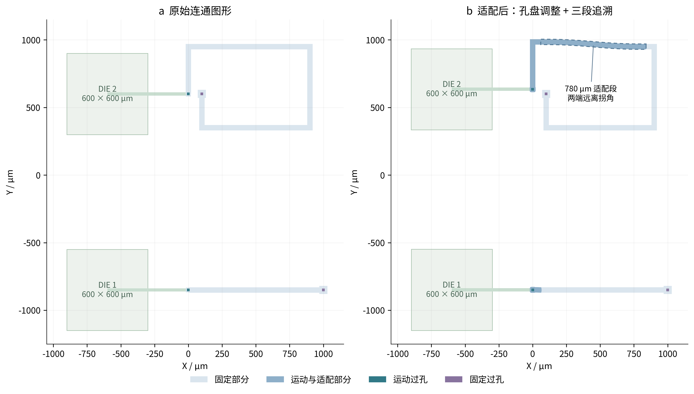
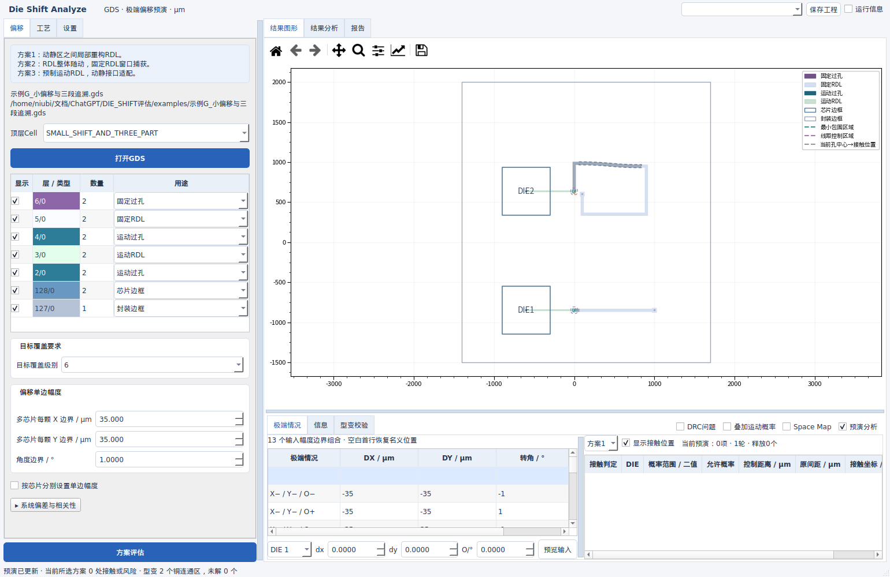
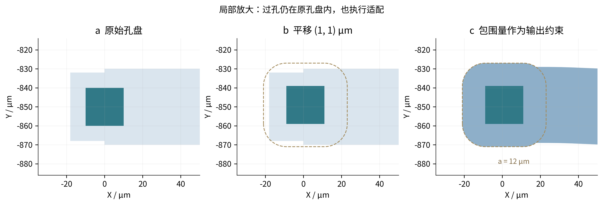
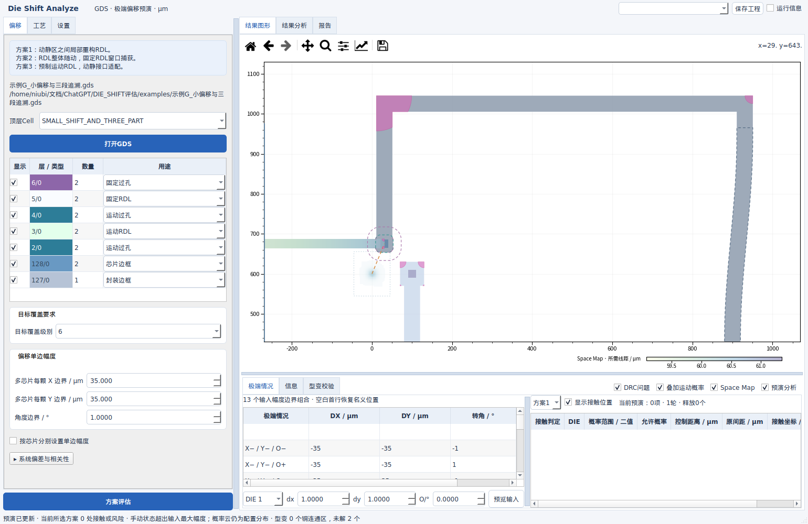

# Die Shift Analyze V12 · 交互适配与全局 DRC

2026-09-28 · 所有长度为 μm，角度输入为 °，三角函数内部使用 rad。原始 GDS 只读。

**本版修复小偏移被最小包围量拦截的问题，增加沿真实连通铜图形的三段适配、独立 DRC 开关和鼠标直接移动芯片。** 结果分为通过当前帧校验的候选、带 DRC 的最佳候选，以及无法保持合法拓扑而保留的源图形。有限搜索没有找到合格解，不代表数学上证明无解。


图1｜先完成孔盘适配；必要时沿网络寻找运动段、适配段和固定段。粉色标记始终来自最终显示图形。流程图为矢量绘制，其余几何图来自真实算法输出；PNG 为300 dpi，并附同名 SVG。

## 1. 操作与案例

| 操作 | 实际行为 |
|---|---|
| 勾选“DRC问题” | 位于“叠加运动概率”左侧；不用先做方案评估，也不用启用预演分析。检查参与的金属图层，显示粉色半透明违规区域；随图层显隐和当前几何更新。 |
| 勾选“预演分析” | 完成方案评估后，调整来源固定 RDL。运动段和适配段显示深色，适配段额外带虚线描边，替换位置不再叠加原图形。 |
| 图片中按 F | 恢复原始视角。 |
| 图片中按 M | 选择 DIE，按住右键拖动改变 DX/DY；向上滚轮逆时针、向下顺时针，每格0.1°。左下角显示当前已绘制帧的 DX、DY、O。 |
| 交互移动中按 ESC | 退出移动模式；保留当前预演状态。普通模式 ESC 取消图形高亮。选择另一极端行会退出鼠标移动，取消旧的待刷新状态。 |
| 表格、运行信息框上滚轮 | 上下滚动内容；不改变下拉值、数字、滑块或层叠顺序。嵌入表格的输入控件将滚轮交给外围滚动区。 |
| 进度条 | 顶部靠近工程保存区；隐藏时保留尺寸，避免按钮跳动。长计算在后台执行，过程进入带时间戳的运行信息。 |

**示例G_小偏移与三段追溯** 已加入 Jobs 和 examples。两颗 DIE 都为600 × 600 μm，长宽比1:1；运动过孔位于芯片外，通过运动 RDL 连接回对应 DIE。固定线宽/线距约束均为20 μm、包围量12 μm。先做方案评估，再设置 DIE 1 为(1,1,0°)、DIE 2 为(0,35,0°)，打开预演分析即可复现图2。



图2｜上方网络的运动孔与固定孔虽然空间上相近，却通过折返铜线连接。算法沿源铜图形寻找切分位置，选中上方780 μm长直段；左端随动、右侧及下方固定。下方网络只需局部孔盘调整。主图提供符合实际尺寸范围的芯片背景；后续局部放大图用于观察数 μm 的包围变化。



图3｜真实 Qt 界面；虚线适配段、深色运动部分与原固定部分同时可见。

## 2. 输入 → 公式 → 输出：修复小偏移适配

**输入：** GDS 的原始固定铜区 $G$、与它名义连接的运动过孔实体 $V_i$、所属芯片中心 $c_i$、位移 $d_i=(D_{x,i},D_{y,i})^T$、旋转角 $\theta_i$、最小包围量 $a$、GDS 数据库网格 $\delta$。

$G,V_i$ 是从修复后的 GDS 多边形获得的平面集合，保留孔洞；$i$ 是该铜区所连接的运动过孔编号。所属芯片由金属层序的几何连通追溯得到，$c_i$ 为该芯片边框中心；$D_{x,i},D_{y,i}$ 从当前预演状态读取，$\theta_i=O_i\pi/180$，$O_i$ 是界面输入的度数。

$$
T_i(x)=c_i+R(\theta_i)(x-c_i)+d_i,\qquad
R(\theta)=\begin{pmatrix}\cos\theta&-\sin\theta\\\sin\theta&\cos\theta\end{pmatrix}.
$$

$x=(x_1,x_2)^T$ 是任意铜区点，$T_i(x)$ 是刚体移动后的点。于是运动过孔为 $V'_i=T_i(V_i)$，芯片外的扇出点也使用同一个变换。

原算法把“原孔盘已满足新的包围量”作为进入搜索的前提，且附加过大的刚性保护区，导致小偏移提前失败。现在先构造适配用来源图形：

$$
r_a=\frac{a}{\cos(\pi/128)}+2\delta,\qquad
L_i=V_i\oplus B(0,r_a),\qquad
G_0=G\cup\bigcup_iL_i.
$$

$B(0,r_a)$ 是以原点为中心、半径 $r_a$ 的圆盘；$\oplus$ 表示 Minkowski 和，即将过孔向外扩展。实现中每象限用32段近似圆弧，$1/\cos(\pi/128)$ 补偿内接多边形弦造成的包围不足；$2\delta$ 是网格量化余量。$L_i$ 是名义孔盘所需的铜区域，$G_0$ 只增加缺少的包围部分，并检查连通性及孔洞数量。

局部刚性区域半径由 $L_i$ 顶点到该孔中心 $v_i$ 的最大距离再加 $2\delta$ 得到；$v_i$ 是过孔质心。它不再额外增加两倍线宽。经连续型变和网格量化得到候选 $G'$ 后，再检查：

$$
V'_i\subseteq G',\qquad
\operatorname{dist}(V'_i,\partial G')+0.01\delta\ge a.
$$

$\partial G'$ 是铜区边界，$\operatorname{dist}$ 是两集合的最短欧氏距离，$0.01\delta$ 仅容纳浮点误差。这里的包围量是**输出校验条件**；增加它可能在密集网络中真实地降低可行性，但不会再因原始孔盘偏小而跳过适配。

**输出：** 示例G的(1,1) μm小位移仍在原孔盘内部，算法仍生成新的连续孔盘和引线。回归分别检查 $a=0,2,8,12,25$ μm，均完成适配且实际包围距离满足要求。



图4｜虚线为移动后过孔的12 μm包围边界；右图来源铜区已生长并随动。这个局部视图不表示芯片尺寸小于500 μm。

## 3. 输入 → 公式 → 输出：三段追溯与连续连接

**输入：** $G_0$、各运动过孔、与原铜区相邻连接的固定过孔、固定最小线宽 $w_{\min}$、固定最小线距 $s_{\min}$、C1/C2连续性、贝塞尔或圆弧渐变、最小铜内角。

首先尝试局部孔盘位移场。若未找到通过候选，再从原铜区相反方向、相差不超过2°的长边推定长直铜段。两条边投影的共同长度记为 $L_0$，垂直间距记为 $w_0$。中心线必须完全位于来源铜区内，并要求 $L_0\ge\max(4w_{\min},2w_0)$。推定只产生候选；窄于规则的候选不能绕过最终 DRC。

候选的优先级为：

$$
S=L_0\left(\frac{w_0}{w_{\min}}\right)^{1/4},\quad
g=\max(w_0,w_{\min}),\quad L_{\max}=L_0-2g.
$$

$S$ 是长、宽优先的排序值，单位为 μm；同分时优先周围净空间更大的位置。$g$ 是每端避开拐角的保留长度，$L_{\max}$ 是最大可用适配长度。先选择居中的 $L_{\max}$，再尝试其0.75、0.5倍及相应偏中心位置。围绕其他网络的实际空间由最终候选检查决定，不以这个排序值代替 DRC。

沿候选条带切开 $G_0$，得到运动段 $G_m$、适配段 $G_a$ 和固定段 $G_f$。必须确认：全部相应运动孔位于同一运动段；固定端全部留在固定段；两处连接缝恰在适配条带的端面；不存在旁边分支造成的不连续侧缝。多芯片共享网络的各运动支撑区域不允许重叠。每次完整搜索最多检查48个追溯组合，是有限候选搜索。

设适配段起点为 $b$，指向固定端的单位向量为 $u$，长度为 $L$：

$$
t(x)=\operatorname{clip}\left(\frac{(x-b)\cdot u}{L},0,1\right),\qquad
W_1(t)=1-3t^2+2t^3,\qquad
W_2(t)=1-10t^3+15t^4-6t^5.
$$

$\operatorname{clip}$ 将数值限制在0到1；$W_1$ 对应C1、$W_2$ 对应C2。运动段权重 $W=1$，固定段 $W=0$，适配段 $W=W_1(t)$ 或 $W_2(t)$。$W$ 无量纲，两个端点的一阶导数均为零，C2的二阶导数也为零。

贝塞尔渐变使用：

$$F_B(x)=x+W(x)[T_i(x)-x].$$

$F_B$ 是型变后的点；$T_i$ 为第2节定义的所属 DIE 刚体变换。对于圆弧渐变，设用户选择的弧角为 $\gamma$，内部换算为 rad，方向随当前旋转符号；$\Delta=T_i(x)-x$，$J(\Delta_x,\Delta_y)^T=(-\Delta_y,\Delta_x)^T$ 为逆时针90°旋转：

$$
\alpha(W)=\frac{1-\cos(\gamma W)+\cot(\gamma/2)\sin(\gamma W)}{2},
$$
$$
\beta(W)=\frac{\cot(\gamma/2)[1-\cos(\gamma W)]-\sin(\gamma W)}{2},\qquad
F_A(x)=x+\alpha(W)\Delta+\beta(W)J\Delta.
$$

$\alpha,\beta$ 为无量纲系数。两类场都在运动端回到刚体变换，在固定端回到恒等变换。理论位移场满足所选连续性；导入的原始拐角及按 GDS 网格离散的输出不能被解释为处处光滑的解析曲线。

**输出：** 示例G的折返网络选择780 μm适配段，四种C1/C2 × 贝塞尔/圆弧组合均保持固定连接并通过当前约束。运动段和适配段深色显示；虚线只描适配段。真实 GUI 逐帧使用该时刻的孔、铜区、控制区域和标记，不把终态铜图贴在中间芯片位置上。

## 4. 输入 → 公式 → 输出：全局 DRC 与最佳候选

**输入：** 当前显示的全部参与金属层、实际替换后的铜图形、对应运动/固定的线宽线距、包围量及最小内角。非参与层、芯片边框和封装边框不进入金属 DRC。

对两条非零长度边，方向向量为 $e_1,e_2$，夹角定义为：

$$\phi=\arccos\left(\frac{|e_1\cdot e_2|}{\|e_1\|\,\|e_2\|}\right).$$

只对 $\phi\le5^\circ$ 的近似平行边检查线宽/线距，共享轮廓顶点的相邻边排除。距离使用 KLayout 原生投影边对规则；若规则距离为 $d_{\min}$ μm，整数阈值为 $\lceil d_{\min}/\delta\rceil$，向上取整保证不放松规则。只标出实际不足的边段对应区域，不把整个长边全涂粉色。**异网实体相交始终算短接**，不受平行角度过滤。

铜内角另按界面要求检查，与近似平行过滤无关。轮廓顶点 $P_j$ 的入边 $e_-=P_j-P_{j-1}$、出边 $e_+=P_{j+1}-P_j$；按铜区正向轮廓求：

$$\eta_j=180^\circ-\frac{180^\circ}{\pi}\operatorname{atan2}(e_{-,x}e_{+,y}-e_{-,y}e_{+,x},e_-\cdot e_+).$$

$\eta_j$ 是铜内角，孔洞采用相应反向轮廓。若 $\eta_j<\eta_{\min}-0.2^\circ$ 则标记；$\eta_{\min}$ 是用户设置，0.2°是 DBU 离散容差。算法尝试 $w_{\min}/4,w_{\min}/2,w_{\min},2w_{\min}$ 的局部圆角，只接受变化位于可适配支撑区域内且通过其余复查的结果。

每个合法拓扑候选同时检查宽度、内部间距、异网间距、包围、其他运动孔控制区、固定连接、封装/禁布区和内角。有完全通过的结果时进入已验证集合，并重新计算不足窗口，再适配新释放位置；无新增释放时停止。

若只有带 DRC 的合法拓扑候选，在已经搜索的候选中按下面的字典序选择：

$$Q=\left(\sum_{j=1}^{m}A_j,\ m,\ \operatorname{area}(G'\triangle G)\right).$$

$A_j$ 为第 $j$ 组违规标记区域的面积，单位 μm²；$m$ 为检测到的违规组数；$\triangle$ 是对称差，最后一项是改动铜面积。先尽量减少违规面积，再比较违规组数、改动量。这是工程启发式优选，重叠标记可被重复计入，不能解释为最优布线定理。

**输出：** “DRC问题”开启时粉色填充最终图形的违规区；最佳候选不会被计为验证通过。最佳候选加入后再次复查所有已接受铜区，若它们之间产生冲突，相应结果降级为未解。拓扑折叠、孔洞异常或固定端无法形成合法候选时保留源图形。隐藏粉色只改变显示，不改变判定。



图5｜将最小内角故意设置为179°，以验证最佳候选与实际违规区域的联动；此图中的粉色是预期测试结果。

默认有限σ位置仍按接触概率和阈值比较；具体极端或鼠标手动状态仍是二值判断。全局 DRC 是独立几何诊断，不将“名义位置碰到”冒充有限σ概率判定。型变后的连续概率尚未完成认证；允许带 DRC 的最佳候选后，原图概率上界不能直接证明新图安全，相关未决项按保守上界处理。

## 5. 性能和验证范围

交互输入每16 ms合并一次，最多保留一个正在计算的帧和一个最新请求。已有有效型变结构时，交互帧复用该结构并重新检查当前几何；停止操作约180 ms后进行完整候选搜索。旧输入不排成长队，新的鼠标输入可取消过时的完整细化。DRC、控制区域和铜图形按同一帧发布；新计算未完成时保留上一完整帧。目标 FPS 是调度目标，不是跳过约束的理由。

主要优化包括：来源轮廓细分复用；原生网格铜区缓存与精确共线顶点去冗余；直线追溯模板缓存；已选适配场复用；按邻近图形变化决定是否重试；大量独立候选并行搜索，再按确定顺序合并，并复查已经改变的邻居；全局 DRC 的静态/刚性规则缓存。原有视窗冗余区域裁剪、绘图背景缓存继续生效。

硬件线程预算由 CPU、亲和性、cgroup配额和可用内存共同决定；本机8逻辑CPU、约15.3 GiB内存，通常选择6个线程，保留2逻辑CPU。大规模独立原图 DRC 可使用spawn进程；Windows入口保留freeze_support。CUDA仍仅为可选概率卷积路径，本机使用CPU，没有把Intel显卡检测结果冒充已启用GPU几何加速。

| 本机固定工作负载 | 实测 |
|---|---:|
| 示例G，2个接口，首次完整型变+DRC | 138.6 ms |
| 示例G，8个相邻状态，已选结构复核 | 中位80.1 ms/帧，最大94.7 ms |
| 附件GD55读取 | 732 ms |
| GD55，158接口，首次完整型变+DRC | 46.2 s |
| GD55，相邻状态，已选结构复核 | 中位5.81 s/帧 |
| GD55指定状态结果 | 52个通过铜区，38个带DRC最佳候选，21个接触接口 |

以上为终版单次完整复测，计时不包含 Qt 绘制；桌面任务、缓存和硬件状态会影响结果，不把早期开发时更快的记录作为交付性能。GD55状态为每DIE DX=35、DY=−35 μm、θ=0.01 rad，固定w/s=5/5 μm、包围10 μm。新版本搜索更多候选并对全图DRC，不能与旧版跳过失败铜区的耗时直接比较。**附件整图连续适配仍达不到30 FPS**，后台运算与输入合并改善操作响应，但不等于消除了计算等待。也没有承诺所有满足条件的网络都会被有限搜索找到。

附带 [可复跑性能记录](../results/performance_V12.json)、[Qt交互记录](../results/gui_V12.json)、[几何绘图记录](../results/figure_checks_V12.json) 和 [解压后验证记录](package_verification.json)。Qt测试覆盖原生表格/文本滚轮、快捷键、鼠标像素到μm变换、旋转、独立DRC、三段虚线与所有叠加同步。自动回归也覆盖孔洞、不可行约束标记、C1/C2端点、包围量范围和相邻锐角边排除。

## 6. 复算、交付和版本管理

```bash
python3 -m unittest discover -s tests -p 'test_*.py' -v
QT_QPA_PLATFORM=offscreen python3 tests/gui_v12.py
python3 tools/v12_figures.py
python3 tools/benchmark_v12.py --attachment
python3 tools/package_release.py
```

本版只发布源代码 ZIP，附文件SHA-256和校验清单；不构建Linux可执行文件。保留Windows源码入口RUN.bat及Windows本机PyInstaller脚本，**本轮没有Windows实机或CUDA实机验收**。验证记录明确区分本机环境的独立解压测试与全新依赖环境安装测试。

私有发布仓库：[PLP_Die_Shift_Analyzer](https://github.com/shiyuliuth-del/PLP_Die_Shift_Analyzer)。发布使用本版已验证的源码快照，保留远端初始提交；工作目录的历史大型分析数据不上传，用户GD55附件也不打入通用源码包。示例A～G全部由配套GDS导入。
