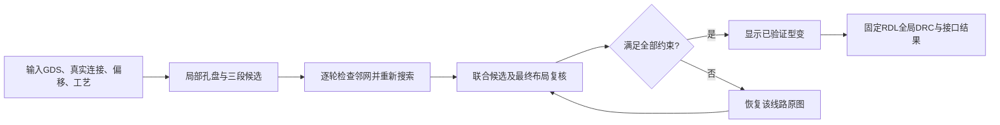
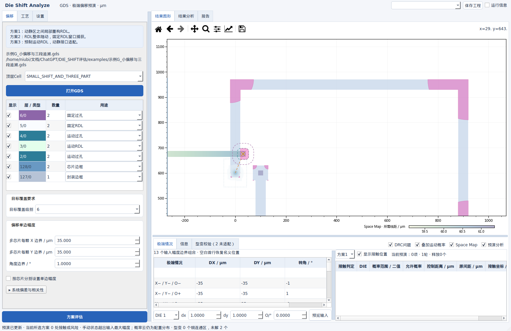

# Die Shift Analyze V13：型变回退、Windows恢复与缓存

日期：2026-09-28。长度单位统一为 μm。本版针对 e.txt、e2.txt 及两张截图反馈更新。只交付源码 ZIP，原始 GDS 不修改。

## 1. 修复结果与使用方式

| 问题 | V13处理 | 可见结果 |
|---|---|---|
| Windows缺少KLayout | `RUN.bat`建立专用`.venv`，检查并补装依赖；启动前执行原生DRC自检 | 不再到预演中途才发现缺失模块；安装失败给出解释器及修复命令 |
| 概率叠加报`KeyError: deformation` | 型变初始化成功后才提交配置状态；失败保留可重试状态 | 同条件重新启用可正常恢复 |
| 再次选择相同预演反复计算 | 以输入、规则、层序、状态及算法配置组成缓存键 | 回切参数、开关及已运行的动画可以复用 |
| 型变线路违反约束仍显示 | 局部孔盘、三段追溯、邻线联合候选迭代后再复核；不合格者恢复原图 | 不显示未通过的型变；琥珀叉号提示未适配 |
| 部分线路未处理却无说明 | 每个实际接口输出结果；保留层号、源图形和原因 | “型变校验”显示未适配数量，选中行可定位 |
| DRC漏查固定RDL | 按网络检查最终可见的固定RDL，包含未型变原图 | 粉色标记对应实际显示几何，不检查已隐藏的旧候选 |

Windows解压后双击 `RUN.bat`。需要64位 Python 3.12或3.13；首次安装依赖需要网络。不要继续使用V12的启动脚本。`TEST_WINDOWS.bat`会输出`results/windows_source_smoke.json`与测试日志；`BUILD_WINDOWS.bat`在Windows生成EXE，并对生成的程序自检。源码启动环境与构建环境分别验证，避免误用全局Python。

e.txt中的Python3.13本身并非缺包原因。已核对并下载官方`klayout-0.30.8-cp313-cp313-win_amd64.whl`，包含dbcore、tlcore及配套DLL；现有PyInstaller配置显式收集这些模块与DLL。[官方版本文件](https://pypi.org/project/klayout/0.30.8/#files)

e2.txt发生在前一次型变初始化失败之后：旧版提前写入“已配置”键，下一次跳过初始化并读取不存在的型变结果。V13用“构建完成→提交状态”的顺序，回归测试模拟缺少KLayout后再次启用，验证能恢复。

## 2. 输入—公式—输出与回退规则

这里的回退复核只移除候选，因此终止；不是无限地在相同失败候选之间循环。搜索按孔盘过渡范围、直段位置/长度以及局部圆角尝试有限候选。邻线改变后，先复核已有候选，仍不满足才重搜，减少重复工作。联合尝试使需要同时移动的邻线有机会通过。

令 $j$ 表示固定RDL上的一个源铜连通区，$G_j^0$为原图，$\widehat G_j$为候选，$S_t$为第$t$轮仍保留的候选集合。实际可见几何与回退更新为：

$$G_j(S_t)=\begin{cases}\widehat G_j,&j\in S_t,\\G_j^0,&j\notin S_t,\end{cases}
\qquad S_{t+1}=\{j\in S_t:C_j(G(S_t))=1\}.$$

$G(S_t)$表示该轮所有图形组成的完整布局；$C_j$为候选$j$的约束判据，通过取1，否则0。初始$S_0$来自搜索与联合候选，更新直到$S_{t+1}=S_t$。每个非终止回退轮至少移除一个候选，最多移除$|S_0|$个。

| 约束输入 | 计算过程与判据 | 输出 |
|---|---|---|
| 最小线宽$w$ | 原生边对测量非相邻且夹角≤5°的边间距离，要求不小于$w$ | 线宽违规区域或通过 |
| 固定线距$s$、其他网络$F$ | 原生近似平行边对线距；候选另算$d=\min_{x\in\widehat G_j,y\in F}\|x-y\|$，要求$d+0.01\delta\ge s$ | 实际相邻异网净距；失败候选不显示 |
| 运动过孔$V_i$、包围量$a$ | 对位移后的完整孔实体计算$V_i'=T_i(V_i)$；要求孔实体被铜覆盖且$d(V_i',\partial\widehat G_j)+0.01\delta\ge a$ | 孔盘是否满足最小包围 |
| 固定过孔/端点$A_j$ | 每个实际固定连接图形必须被$\widehat G_j$覆盖 | 固定端覆盖判定 |
| 最小铜内角$\beta$ | 从相邻轮廓向量计算内角；数据库离散容差0.2° | 不满足时继续有限圆角搜索，仍失败则回退 |
| 封装$B$与禁布区$K$ | 候选不得超出$B$，不得与$K$相交 | 封装/禁布违规区域 |
| 源拓扑 | 候选需保持单连通区、孔洞数与有效轮廓 | 不合法则保留源图 |

$\delta$为GDS数据库网格，单位μm；$\partial G$表示铜图形边界；$T_i$为所属DIE的刚体平移/旋转，公式见主报告。$w,s,a$来自当前工艺参数，不取截图猜测值。网络由名义几何连通推定，GDS原本已接触的导体不能在没有网表时反推为两个独立网络。

内角的具体计算为：对外轮廓逆时针、孔洞顺时针排序的顶点 $P_i$，取 $u_i=P_i-P_{i-1}$、$v_i=P_{i+1}-P_i$（索引循环），

$$\alpha_i=180^\circ-\frac{180^\circ}{\pi}\operatorname{atan2}(u_{i,x}v_{i,y}-u_{i,y}v_{i,x},u_i\cdot v_i),\qquad \alpha_i\ge\beta-0.2^\circ.$$

$\alpha_i$是第$i$个顶点处铜区域的内角；$\operatorname{atan2}$由叉积和点积计算有符号转角，结果为rad。边对的锐夹角由方向向量 $e,f$ 计算为 $\arccos(|e\cdot f|/(\|e\|\|f\|))$；这里只检查不共享相邻端点、锐夹角不大于5°的边。

最小包围的显示缓冲采用32段/象限圆弧，半径$a/\cos(\pi/128)$避免内接多边形低估；原始孔盘生长另加$2\delta$的离散保护。验收同时使用实际实体边界距离。C1/C2约束作用于连续位移场，输出铜轮廓仍是按GDS网格离散的多边形。

**未适配不等于已证明无解。** 表格区分当前有限候选搜索未通过、源图形问题、固定端限制及最终布局回退。原图本身可能违反当前工艺；恢复原图不能消除已有违规，粉色DRC应继续显示。

上图为故意采用179°最小内角的回退测试。预演后的孔位置有琥珀叉号，RDL仍为原始浅色；粉色对应原图的真实违规位置。新增示例H保存了这一设置，可独立复现。

## 3. DRC范围与完整性

检查所有参与的固定RDL平面。同一物理layer号的datatype一起分析，按几何网络分别合并；不同网络始终保留身份，因此型变导致的短接不会被合并消除。原图被候选替换后只检查候选，恢复后只检查原图。

边对规则保留用户要求的≤5°夹角和非相邻边过滤，并关闭原生`shielded`选项，避免被中间边挡住的违规边对漏查。实际异网重叠、点接触与边接触不受夹角过滤限制。邻接过孔包围只在真实接口检查。候选还受真实最小异网净距限制，严格于仅按平行边显示的线距规则。[KLayout Region接口说明](https://www.klayout.org/downloads/master/doc-qt4/code/class_Region.html)

回归案例包括四条同属固定层的独立网络：三处5 μm间隙在10 μm线距要求下全部检出；替换其中一条线路后，DRC检查新重叠区域。测试也保留相邻边排除、点接触、孔洞、不同角度、小偏移与三段连接覆盖。

## 4. 缓存与性能

缓存键由GDS校验值、顶层Cell、用途/手动层序、工艺/偏移、计算方法与精度、具体DIE状态以及完整/交互质量组成。颜色、透明度、图层显隐使用已有几何重新绘制，不触发数值重算。整包Space Map额外包含可见层和网格分辨率。

缓存内容包括状态图形、接触位置、DRC、型变、默认状态代表预演、整孔概率、Space Map和实际已产生的动画帧。每个结果缓存最多保留32 MiB内存，溢出项写入私有临时目录，切回时读取；不加载外部pickle。固定RDL基础DRC按几何内容复用，孔盘源形、真实走线切分模板和当前孔控制区域也复用。

点击“方案评估”、换GDS或关闭窗口会取消旧任务，等旧任务结束后删除其会话缓存。重新评估保留只读GDS解析索引作为输入；旧的预演结果和几何运算缓存清除。覆盖级别自动刷新使用新的键，切回先前条件可复用。

| 数据 | 首次型变帧计算 | 同状态缓存访问中位数（10次） | 已适配 / 保留原图连通区 |
|---|---:|---:|---:|
| 示例G：小位移与折返线路 | 0.047 s | 0.0021 ms | 2 / 0 |
| 附件GD55：指定组合状态 | 87.012 s | 0.0061 ms | 46 / 72 |

附件有158个实际运动接口、118个参与型变的固定铜连通区。验证输入为三颗DIE均DX=−25 μm、DY=25 μm、θ=1°，固定线宽20 μm、线距20 μm、包围量10 μm；这是明确的复测设置，截图未提供的工艺值不是工厂校准数据。最终显示的46个型变连通区全部通过独立复核；72个未适配连通区恢复原图并给出原因。缓存重复访问没有再次调用候选搜索。

同输入的本轮线程基线首次计算为122.456 s；最终版本为87.012 s，约减少28.9%。这是同机单次对照，桌面负载有波动，并非统计性能保证。型变搜索改用串行以减少细粒度调用争用；概率、大批原图DRC及坐标变换继续使用各自的并行策略。[线程基线原始记录](../results/threaded_baseline_V13.json)。

性能原始记录：[固定输入、逐接口结果与审计](../results/performance_V13.json)。首次求解与重复缓存访问是不同指标；缓存时间不含Matplotlib完整重绘、磁盘溢出读取和窗口系统开销。不同图纸与硬件不能直接外推。首次复杂图纸搜索仍可能较长，提供进度与取消；不声称所有全图型变达到30 FPS。

## 5. 验证与交付边界

- 核心回归：Windows缺包前置提示、失败重试、超过旧容量的8种状态回切、DRC全量配对、最终回退、逐接口结果、临时磁盘溢出及清理。
- Qt界面：概率/Space Map完成计算后反复开关与参数回切不重算；已执行动画复用、目标姿态一致；重新评估及退出删除缓存；表格与日志滚动及鼠标交互保留。
- 源码自检：原生KLayout DRC、两条真实型变、开关恢复、Sobol资源、完整过孔概率面积、Space Map和报告公式。
- 附件图纸按已确认层用途与连接顺序验证；芯片外扇出仍按真实网络归属。
- 源码ZIP独立解压执行完整回归、六组Qt测试、入口自检与八个Jobs工程；详细结果以[打包验证记录](package_verification.json)为准。

本机验证环境为Linux、Python3.12、KLayout0.30.8。Windows代码路径、官方3.13轮子与DLL清单已检查，**Windows实机运行及Windows打包程序尚未在本机验收**。没有构建Linux EXE。连续全概率适配认证、厂家完整规则集和任意拓扑全局最优布线仍不在本次验证范围。
