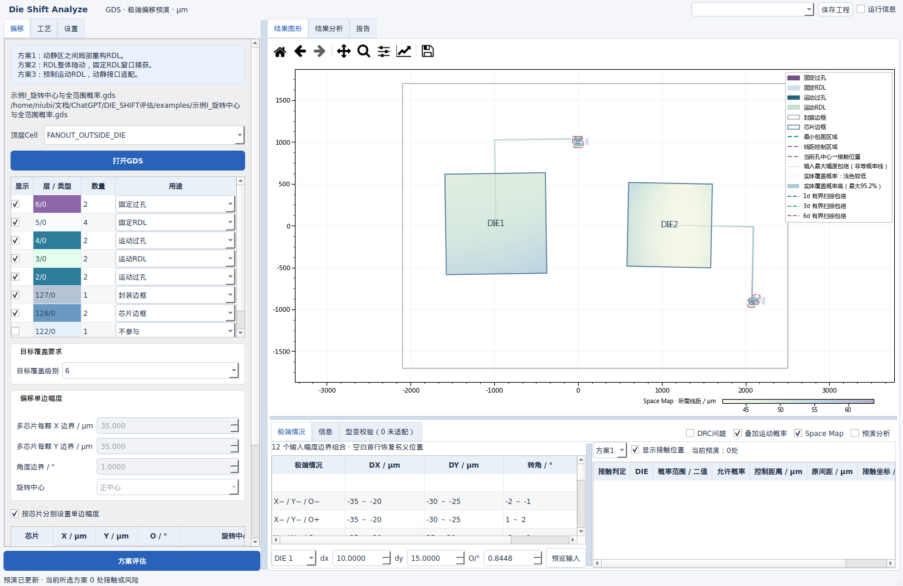
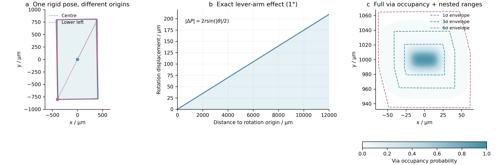
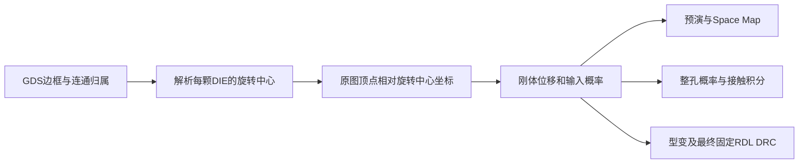
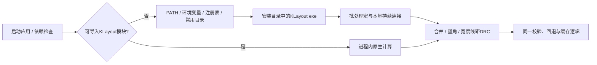
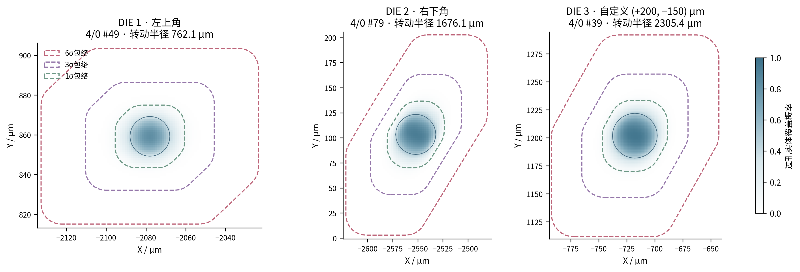
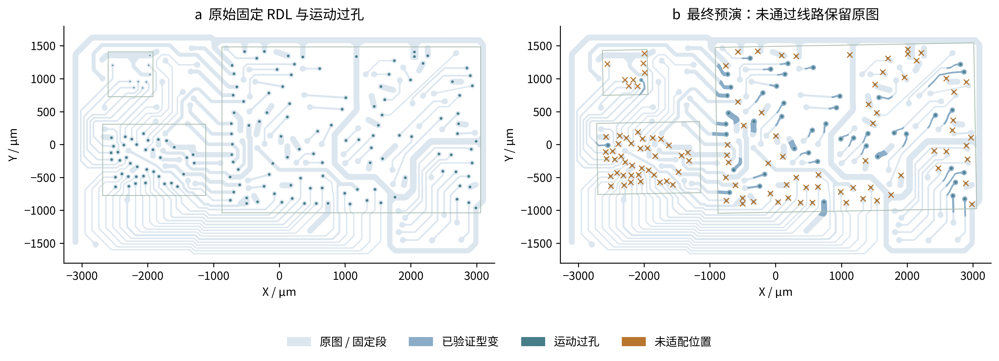

# Die Shift Analyze V14：旋转中心、全范围概率与离线 KLayout

2026-09-28。源 GDS 只读，长度全部为 μm。本说明替代 V13 的启动与依赖补装操作；本版启动、测试和构建脚本均不联网、不执行 pip。

## 1. 本版界面与操作



图1｜示例I：DIE1绕左上角，DIE2绕自定义中心旋转。运动过孔在DIE外，由下层连接追溯归属。Space Map覆盖DIE及扇出金属；整孔概率与1、3、6σ包络显示在真实接口位置。此图为实际Qt界面。

| 位置 | 操作 | 含义与默认值 |
|---|---|---|
| 图片中按M | 选择DIE后右键拖动，普通滚轮旋转，Ctrl+滚轮缩放 | 每格0.1°；ESC退出；普通模式仍为滚轮缩放 |
| 偏移单边幅度 | “旋转中心”下拉 | 正中心、左上、右上、左下、右下、自定义；默认正中心 |
| 按芯片分别设置表 | 新“旋转中心”列；自定义显示X/Y输入 | 勾选逐芯片模式后，各DIE独立使用幅度及旋转中心；未勾选使用共用输入 |
| 设置→接触标记 | 颜色、直径、图纸绝对大小 | 接触圆默认5 pt，未适配叉号7 pt；默认按屏幕尺寸显示；绝对大小改用μm |
| 目标覆盖要求 | 仅下拉选择0～12或∞ | 0保留最近有限非零级别的分布；∞仅当前位置二值判断 |
| 设置→过孔实体覆盖概率 | “显示目标覆盖级别范围” | 默认不勾选；勾选后绘制0级整孔概率云和当前级别虚线 |
| 同上→附加范围 | 多选1～12σ并逐级选择颜色 | 与当前级别共用同一分布；若级别重复，以当前级别颜色为准 |

X/Y自定义值均**相对于名义芯片中心**，沿图纸X/Y轴输入μm；不是相对于封装原点。四个角是芯片最小外接矩形的实际顶点，按图纸Y排序分上下两点，再按X排序分左右。旋转芯片仍取真实角点，不使用轴对齐包围盒的虚假角点。



图2｜800×1600 μm芯片满足通常尺寸范围；旋转半径图外扩至12000 μm。右侧是实际实体面积卷积结果，虚线为同一分布下的保守扫掠包络，**不是等概率密度线或精确联合置信轮廓**。PNG为300 dpi；同名SVG保留矢量曲线与文本。

## 2. 旋转中心：输入→公式→输出



设 $C_{die,d}$ 为第d颗芯片名义边框矩形中心，$c_d$ 为所选旋转中心相对它的向量。中心模式$c_d=(0,0)$；角点模式$c_d=v_d-C_{die,d}$，$v_d$为所选顶点；自定义直接输入$c_d=(c_{x,d},c_{y,d})$。输出实际旋转中心与刚体坐标：

$$C_d=C_{die,d}+c_d,\qquad A=P-C_d,$$
$$R(\theta)=\begin{bmatrix}\cos\theta&-\sin\theta\\\sin\theta&\cos\theta\end{bmatrix},\qquad P'=C_d+R(\theta)A+D.$$

P为名义顶点，P′为运动后顶点，D=(DX,DY)为界面平移，θ为角度输入乘π/180后的弧度。P、P′、C、A、D均为μm。实际位移是$U=P'-P$，其与D不同之处来自旋转；因此非中心旋转时，DIE中心字样也必须绕所选中心移动。

旋转中心属于源图的参考状态：每帧都从原始P和同一个C计算，不对上一帧反复旋转累积。接触圆连接线、未适配叉号、选择命中、屏幕裁剪、芯片边框、过孔、线路、概率云、Space Map、候选型变均共用该原点。后台计算期间旧帧保留自己的旋转中心快照，防止参数先改而图形尚未更新时标记错位。

## 3. 0级及多级范围：输入→公式→输出

令B=(Bx,By,Bθ)为最大随机半幅，其中Bθ=BOπ/180；μ为系统均值。尺度除数κ的来源为：当前k为1～12时κ=k；当前k=0时，κ取最近一次有限非零级别，首次默认6，并写入工程文件。

$$\sigma_x=\frac{B_x}{\kappa},\quad\sigma_y=\frac{B_y}{\kappa},\quad\sigma_\theta=\frac{B_O\pi}{180\kappa}.$$

这些是截断前母正态尺度。母协方差Σ的对角为三个σ的平方，XY项为ρσxσy，角度与XY独立。实际概率为：

$$\mathcal H=\{z:|z_j-\mu_j|\le B_j\},\qquad
Z=\int_{\mathcal H}f_N(z;\mu,\Sigma)\,dz,\qquad
f_T(z)=\frac{f_N(z;\mu,\Sigma)\mathbf1_{\mathcal H}(z)}{Z}.$$

j枚举X/Y/θ，fN是母正态密度，Z是截断盒的母概率质量，fT为实际归一化密度。0不改变H、Σ或fT，只取消级别筛选。默认行的允许接触阈值α为：k>0时α=2Φ(−k)，k=0时α=0。Φ为标准正态CDF。0级从完整有限支持盒积分，不省略尾部；正体积接触状态盒提供非零概率证据，即使CDF浮点乘积下溢也不判无风险；取得正体积接触证据或正概率下界时判不足；证明上界=0才通过，预算不足显示待细化。几何证明的正概率即使数值下界下溢为0仍报不足，不伪造其概率数值。具体预演及∞仍按真实当前几何是否接触判断。

对于整孔实体V与空间位置q，概率云显示

$$p_V(q)=\int_{\mathcal H}\mathbf1\{q\in T_z(V)\}f_T(z)\,dz.$$

Tz是上节刚体变换；0≤pV≤1。空间面积积分应近似等于V面积，不能把所有像素值强行归一化到1。范围开关开启时，概率云一律按0级计算，但沿用同一个κ。

附加级别h的每轴限制为$\,b_j(h)=\min(B_j,h\sigma_j)\,$。虚线包络由该盒内整孔刚体扫掠的凸包产生；角度离散还外扩最大弓高$r[1-\cos(\Delta\theta/2)]$，r为孔顶点相对旋转中心的最大半径，Δθ为相邻计算角度间距。该保守包络包括孔面积；包络内部不保证处处可达或存在可见色值。h≥κ时包络受B限制不再扩大。0显示全部输入包络，∞显示名义孔轮廓。

标记在屏幕模式下的直径为d pt；图纸模式下输入d μm，并用当前变换换算：

$$d_{pt}=d_{\mu m}\frac{W_{px}}{x_{max}-x_{min}}\frac{72}{\mathrm{DPI}}.$$

Wpx为绘图区像素宽度，xmax−xmin为当前X视野μm跨度，DPI为画布每英寸像素。X/Y保持等比例，圆形不会变成椭圆。控件中的“尺寸”表示标记路径直径，描边保留屏幕宽度以便识别。

## 4. 离线Windows后端



程序通过`-b -r`运行包内受信任宏，`-rd`传入连接配置路径；同一KLayout后台进程持续处理几何请求，避免每次边对检查都重启。采用带随机令牌的本机回环连接，仅交换JSON整数DBU坐标与运算结果，不执行GDS携带文本。运行数据保存在私有临时目录，结束后清理。[KLayout官方命令行说明](https://www.klayout.de/command_args.html)

探测优先支持`DIE_SHIFT_KLAYOUT`、`KLAYOUT_EXE`、`KLAYOUT_BIN`、`KLAYOUT_INSTALL_DIR`，随后PATH与常用安装位置。Windows支持`klayout_app.exe`/`klayout.exe`及注册表App Paths。冻结EXE启动外部KLayout时恢复它自己的DLL/Qt/Python搜索环境。只有源应用的KLayout模块可以由桌面程序代替；NumPy、SciPy、Qt等应用依赖仍必须已有，程序不会联网补装。

- 源码启动：双击`RUN.bat`。已有`.venv`优先，也可用`DIE_SHIFT_PYTHON`指定完整解释器路径。
- 离线验证：双击`TEST_WINDOWS.bat`，输出默认与强制桌面后端的JSON以及测试日志。
- 离线构建：已有PyInstaller环境中双击`BUILD_WINDOWS.bat`。宏脚本显式收进EXE；KLayout模块存在时也收集其DLL，缺少模块时走已安装桌面后端。
- 明确指定程序示例：`set "DIE_SHIFT_KLAYOUT=C:\Program Files\KLayout\klayout_app.exe"`。

## 5. 验证、缓存及性能边界

本地核心回归135项全部通过，包含本次提供的GD55附件回归。V13保存的结果属于历史证据；本版另行执行GD55验证，结果见下节。V14新增测试覆盖：所有旋转中心、倾斜边框角点、芯片外连接归属、整孔面积守恒、零级分布一致性、接触积分、范围嵌套、不同后端的宽度/线距/圆角/孔洞结果一致、带空格及中文安装路径探测。

实际Qt测试验证Ctrl滚轮与普通滚轮互不串用、芯片标签随真实旋转中心运动、图纸标记随缩放变化、屏幕标记不变、层显隐同时控制概率虚线、0级保留最近尺度以及工程保存恢复。完整桌面后端启动自检通过：64张概率图、2张Space Map、2条型变线路、DRC和报告公式。[桌面后端记录](../results/desktop_backend_V14.json)；[界面回归记录](../results/gui_V14.json)。

| 示例G：2条实际线路 | 模块后端 | 已安装桌面后端 |
|---|---:|---:|
| 首次当前帧（不含启动、绘制） | 0.397 s | 0.379 s |
| 同状态缓存访问中位数（10次） | 0.024 ms | 0.027 ms |
| 原生后端首次启动 | 0.495 s | 9.584 s |
| 通过全部约束并显示的型变 | 2条 | 2条 |

这是有其他任务运行时的Linux单次实测，不与V13不同负载的时间直接比较，也不代表Windows或超大GDS速度。桌面启动成本只在建立后端时发生；后续用持续连接和原生几何缓存。详见[可复跑性能记录](../results/performance_V14.json)。

旋转中心、逐芯片设置、保留尺度、计算精度均进入数值缓存条件。新增级别颜色与标记样式只影响绘制；多级包络本身也缓存。重复预演及已完成动画继续复用结果。主动方案评估、换GDS或退出时清除旧会话结果及原生几何缓存。

本次只输出源码ZIP，没有构建Linux冻结程序，也没有声称完成Windows实机/EXE验收。Linux真实桌面后端已测试，Windows脚本、探测分支与打包资源已检查；目标机器验收由包内`TEST_WINDOWS.bat`执行。最终ZIP独立解压、哈希及启动验证见[交付验证记录](package_verification.json)。

## 6. GD55 附件实图验证（V14 本次重跑）

本次读取用户提供的`GD55_9-21.gds`，文件SHA256为`a18c984b5a30a7590ddcf9881268eed95b5881711a54fe00bd1e57bd23cbdfae`，读取前后相同。采用用户确认用途：127/0封装、128/0芯片、3/0运动RDL、4/0运动过孔、5/0固定RDL、6/0固定过孔；金属上→下顺序为6/0、5/0、4/0、3/0。这些用途不是根据层号猜测。

| 检查 | V14实测结果 |
|---|---|
| 5/0原缺失图形 | 源索引45（从0计数）恢复；保留4个孔洞，分解为5个平面片；不改源文件 |
| 5/0合并面积 | 7,001,062.038066 μm²，与既有KLayout参考相差小于0.01 μm² |
| 实际运动孔—固定RDL接口 | 158个；DIE1/2/3分别9/40/109个，无归属不明 |
| 非中心旋转 | 左上角、右下角、自定义(+200, −150) μm；逐顶点显式公式最大差2.28×10⁻¹³ μm |
| 13个代表状态 | 每颗DIE的DX/DY/O均未超出其独立输入最大半幅 |
| 整孔概率 | 158张完整覆盖率图；面积积分最大相对误差2.44×10⁻⁹；边缘最大残值2.81×10⁻¹⁶ |
| 边界与多级范围 | 每孔8种XY/O角点的整个实体均在栅格内；1/3/6/12σ包络嵌套，达到最大幅度后停止扩大 |
| 0级一致性 | 范围开关云与显式0级云逐像素相同；各DIE母协方差未改变 |
| 确定性积分 | 另取每颗DIE最远转动半径孔，25点角度积分的3张图均通过面积守恒 |
| Space Map | 3颗DIE及其运动金属域；封装模式与层显隐检查通过 |

概率测试的独立半幅分别为(35,25,1°)、(20,30,2°)、(35,35,1°)，目标6σ、Sobol样本4096、种子510，基础固定线距20 μm；这是覆盖不同参数路径的测试输入。158张概率图首次计算约0.676 s（不含绘制）。这份附件的158个接口都在所属DIE内，不能用它声称验证了芯片外接口；芯片外扇出由示例I及专项回归验证。



图3｜每颗DIE取转动半径最大的一个实际接口。色值是整孔实体覆盖概率，细实线是名义孔边界，彩色虚线为1/3/6σ保守扫掠包络。低概率尾部可能肉眼不可见；虚线包络与图像边界共同证明未把合法极端实体裁掉，不用“有颜色的范围”冒充全部概率支持。

型变复核单独使用便于和历史结果比较的条件：三颗DIE都绕正中心，以(DX,DY,O)=(-25,+25,+1°)预演；固定线宽/线距20/20 μm，最小包围10 μm，C2、贝塞尔方式、最小铜内角90°。**这些是测试工艺假设，不是从GDS自动提取的工厂规则，也不是该图纸的量产合格判定。**



图4｜最终显示118个相关固定RDL连通图形中的46个已验证型变，72个未适配者保留原图；按接口计为47个已适配、111个未适配。图形数和接口数口径不同，不能混加。未适配标记覆盖全部接口，详细理由保存在JSON及软件型变校验表。原图自身的规则问题不会因为回退而消失。

在搜索返回后，另行检查每个最终候选：有效拓扑、20 μm线宽、内部线距、90°最小铜内角，以及与最终可见异网图形的真实净距；全部通过，违规候选显示数为0。全局DRC输出150个问题分组，包含仍保留的原始图形问题，分组数量不等于独立物理违规点数量。窗口迭代两轮，首轮新增5处充足窗口，次轮无新增；有限搜索未找到解不等于已证明物理无解。

首次整图求解114.391 s；同状态10次缓存访问中位数0.006 ms、最慢0.036 ms，开关DRC回切复用缓存，额外搜索次数为0。这些时间不包含界面绘制，首次仍明显耗时，不能称为整图实时型变或30 FPS验收；不与不同机器负载的历史数字直接比较。

完整输入、源文件哈希、逐接口状态、误差与计时见[GD55 V14验证记录](../results/attachment_GD55_V14.json)及[最终候选独立审计](../results/audit_GD55_V14.json)。可复跑：

```bash
python3 tools/validate_gd55_v14.py --gds /path/to/GD55_9-21.gds
# 只运行几何、旋转、概率与Space Map检查：加 --numerical-only
```

核心附件回归支持环境变量`DIE_SHIFT_TEST_GDS`指定路径，亦识别当前用户桌面/下载目录。没有外部图纸时该项明确跳过；通用源码包不包含原始附件。本次独立解压验证使用本机用户提供的原图，不修改其内容。
