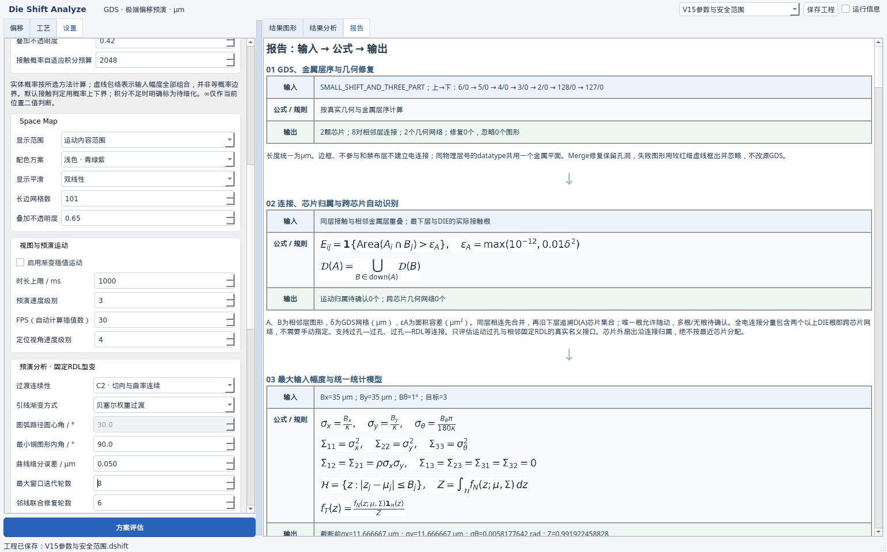
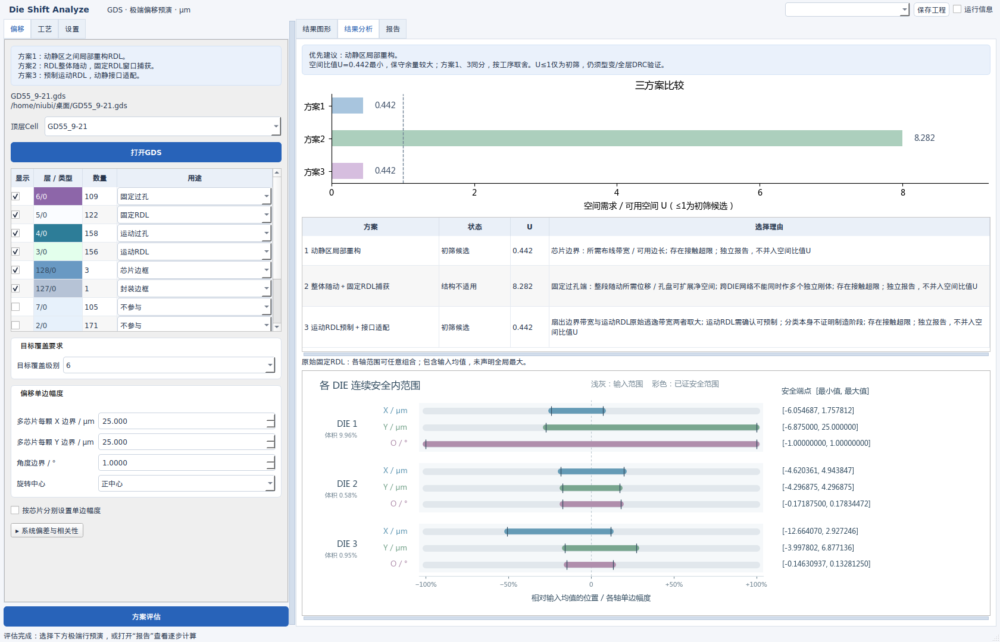
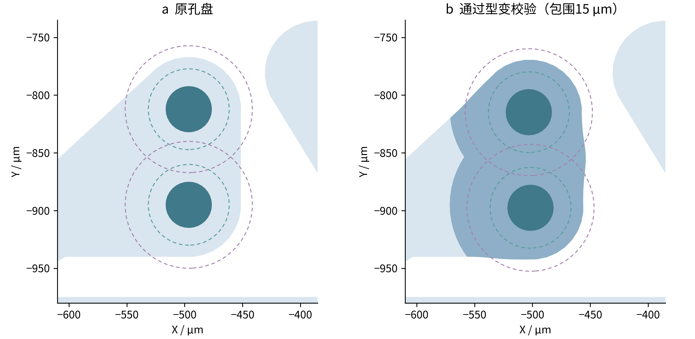
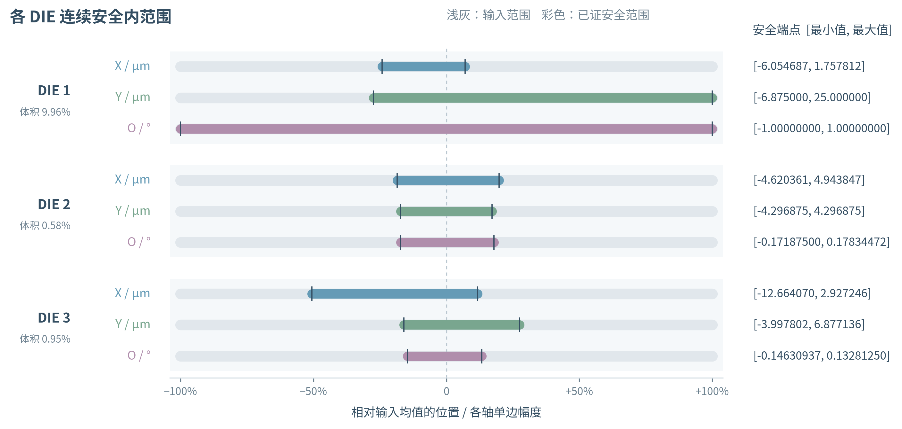
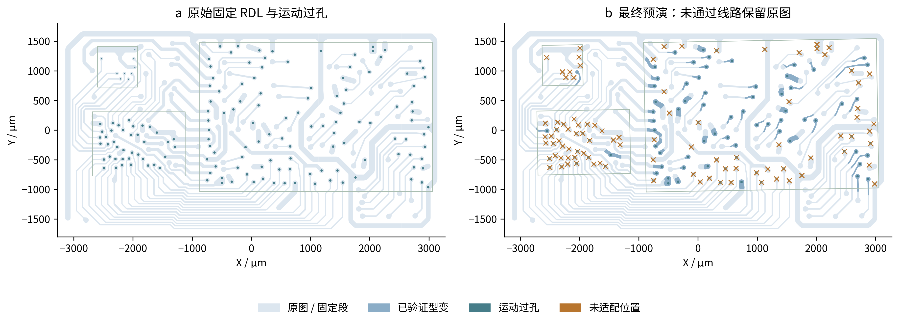
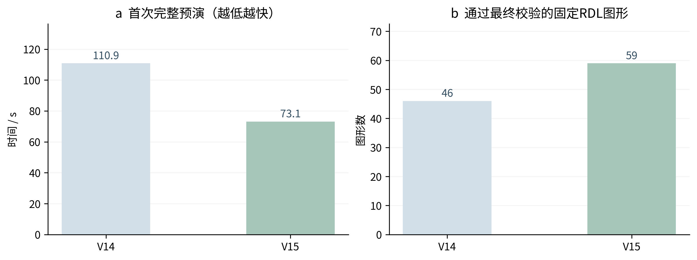

# Die Shift Analyze V15：操作、算法与验证

2026-09-28。仅源码ZIP，不生成Linux可执行文件。研究公式详见[研究报告](../DIE_SHIFT评估报告.md)。本版按用户确认的GD55工艺复现，不将合成例或缓存速度当成整图生产性能。

## 本版变化

- 修正位移场无折叠上界：保留平移与旋转在实际过孔位置的抵消，不再把两项绝对值粗略相加导致小位移被拒绝。
- 三段搜索除原有长直线对边外，加入完整投影截面，覆盖宽孔盘、弯曲及分支。所有端口与固定锚点、孔洞/连通拓扑和最终DRC仍是接受条件；候选失败保留原图。
- 独立候选可用spawn多进程，结果按原顺序合并并复查新邻线。主进程保留最终接受权；后台错误会记录并回退到串行复算。
- 三方案以无量纲U＝空间需求／可用空间初筛；原始接触概率独立显示。
- “结果分析”增加每DIE的DX、DY、O安全内范围；闭区间内所有连续组合都经过保守几何证明，不依靠抽样命中率。



## 设置及使用

| 设置 | 默认 | 实际作用 |
|---|---:|---|
| 最大窗口迭代轮数 | 6 | 接受一轮型变后，重查邻线空间并尝试未适配线路；到预算时明确报告，不放宽DRC |
| 邻线联合修复轮数 | 6 | 同时试探待处理邻线，剔除违规候选；最终回退仍必须到稳定 |
| 孔盘搜索级数／跨度倍率 | 6／1.6 | 基准跨度乘倍率的0～5次方，另复用历史成功跨度 |
| 启用三段追溯／弯曲及分支截面 | 开／开 | 孔盘调整不通过后查来源铜的运动段—适配段—固定段 |
| 三段候选预算 | 32／线路 | 长直段和通用截面分配搜索预算；非全局最优布线证明 |
| 最短适配长度／拐角预留 | 3倍／0.5倍线宽 | 排除过短过渡；直段拐角预留还考虑实际段宽 |
| 搜索并行模式／数量上限 | 自动／0 | 0按硬件限额；支持单线程、多线程、多进程；大任务默认最多4进程 |
| 安全盒端点分辨率 | 单边幅度的0.01 | ±25 μm、±1°时搜索步长上限0.25 μm、0.01°；不是全局最优误差 |
| 每候选连续验证预算 | 512状态子盒 | 不能在预算内证明安全的候选拒绝，绝不输出假安全 |
| 安全盒起点数／体积交换轮数 | 3／2 | 不同端点扩张次序；交换一轴空间以扩大其他轴；保留更大体积已证结果 |

改预演参数立即应用到预演，切回相同配置复用会话缓存；新一轮“方案评估”清空旧会话缓存。安全盒仅依赖几何与硬幅度，改变目标σ可复用既有几何证书。缓存读取不等于屏幕绘制帧率。



合并区间图替换安全范围表：每颗DIE的X、Y、O用三种浅色区分，灰色底线代表输入全范围，横轴按各轴单边幅度归一化，0表示输入均值。右侧保留六位小数的μm端点和八位小数的角度端点，避免混用位移和角度单位；体积比例显示在DIE旁。图形随窗口宽度调整，多DIE可纵向滚动，分析区域可拖动分隔条调整高度；无预演时先完整显示安全图，选定预演后首次展开下方位移统计。

图中输出包含输入均值的安全内盒，允许各轴正负边界不同。均值已接触或归属不完整时不给出伪安全数值。它只证明原始固定RDL上真实接口控制区对其他网络无接触，不包括型变后的连续空间、运动金属间DRC或芯片机械碰撞。

## GD55复现

源文件SHA256：`a18c984b5a30a7590ddcf9881268eed95b5881711a54fe00bd1e57bd23cbdfae`。只读，未改源图。

层序由上到下：6/0固定过孔 → 5/0固定RDL → 4/0运动过孔 → 3/0运动RDL。127/0封装边框，128/0芯片边框。3颗DIE，158个真实接口，118个相关固定RDL连通区。

用户指定：X/Y单边±25 μm，角度±1°；固定线宽20 μm、线距20 μm、最小包围15 μm。整图预演状态为各DIE同时(-25,+25,+1°)。运动规则沿当前参数默认；本次型变检查固定RDL。



红圈对应5/0软件导入后图形序号94（代码索引93），4/0过孔序号116、117，归属DIE3。该工况孔盘局部过渡跨度40 μm即通过验证。连续轮廓、20 μm线宽/线距、15 μm包围和固定锚点均复核。8种角点姿态分别检查，其他7种在原始邻线条件下仍有未通过约束，逐项见[双孔盘状态记录](../results/detail_GD55_V15.json)；未伪装为全部角度/偏移都已适配。

### 连续安全内范围



| DIE | DX / μm | DY / μm | O / ° | 占输入盒体积 |
|---|---|---|---|---|
| 1 | [-6.054687, 1.757812] | [-6.875000, 25.000000] | [-1.00000000, 1.00000000] | 9.9609% |
| 2 | [-4.620361, 4.943847] | [-4.296875, 4.296875] | [-0.17187500, 0.17834472] | 0.5757% |
| 3 | [-12.664070, 2.927246] | [-3.997802, 6.877136] | [-0.14630937, 0.13281250] | 0.9465% |

这些端点已向安全盒内部取整，**各列可以在同一行内任意组合，三颗DIE之间也可以独立组合**；仅在上述原始固定RDL接口范围内保证。多起点坐标扩张得到较大体积内解，没有全局最大体积证明。另用独立重建的三份连续证书复核，并对500组多DIE随机组合做补充回归；随机回归不是安全证明来源。

方案1 U=0.441508，方案2 U=8.282410，方案3 U=0.441508。当前接口瓶颈使方案1/3同分，取方案1减少额外工序；方案2还存在跨DIE公共网络结构限制。该建议不代表原图接触概率已经合格，也不代表全范围型变都已布通。

### 性能与最终可见图形





| 同一GD55工况 | V14原始源码包 | V15 |
|---|---:|---:|
| 首次完整预演 / s | 110.857 | 73.148 |
| 通过最终校验的图形 | 46 | 59 |
| 未适配、保留原图 | 72 | 59 |
| V15三段适配通过 | — | 7 |

本次首次求解缩短约34.0%；是本机Linux CPU的单工况测量，不是跨机器保证。原版从V14源码ZIP重新解压、按同样15 μm包围量跑出的对照，不能与早期10 μm包围量记录直接混比。V15使用4个spawn工作进程；最终宽度、同网内凹间距、异网最短净距、内角均独立复核。**没有显示未通过的型变**；保留原图仍可有原始DRC或未适配接触问题，软件继续标记。

相同状态缓存读取中位数约0.0066 ms；不包含Matplotlib绘制，也不保证首次状态切换或复杂动画30 FPS。原图结果、已完成状态、概率图、Space Map和插值帧沿用会话缓存。候选相交测试复用几何缓存；只让廉价几何约束通过者进入较昂贵的原生边对DRC。

本机为Intel Iris Xe集成显卡，未安装CuPy/CUDA运行时。保留自动CPU回退及支持环境中的概率FFT加速；GEOS/KLayout多边形布尔和DRC本版采用CPU，不虚报GPU加速。

## 复算与验证范围

```bash
python3 -m unittest discover -s tests -p 'test_*.py' -v
QT_QPA_PLATFORM=offscreen python3 tests/gui_v15.py
DIE_SHIFT_NATIVE_BACKEND=desktop python3 -m unittest discover -s tests -p 'test_v15.py' -v
python3 tools/validate_gd55_v15.py --gds /path/to/GD55_9-21.gds
python3 tools/benchmark_v15.py --gds /path/to/GD55_9-21.gds --mode auto
python3 tools/v15_figures.py
python3 tools/package_release.py
```

已验证Linux上的单线程、多线程、spawn多进程得到相同合格输出；切换目标级别复用安全证书；参数保存/读取、合并区间图数值和完整公式渲染。离线桌面后端用实际安装的KLayout进程复测通过。Windows保留`freeze_support`和spawn方式、PATH/环境变量/注册表定位已安装KLayout；`TEST_WINDOWS.bat`新增V15离线用例。**未执行Windows实机或Windows EXE验证**，没有联网补装依赖。

发行记录以[源码包独立解压验证](package_verification.json)为准；原始附件GDS不打入通用源码包。测试基准、范围证书及各接口状态见[本次评估](../results/assessment_GD55_V15.json)、[V14对照](../results/baseline_GD55_V15.json)、[V15性能](../results/performance_auto_V15.json)。

KLayout的Region提供宽度、间距、内部凹槽及独立图形间距检查API；本版保留实际短接检查，不因边角过滤忽略相交。[KLayout Region官方文档](https://www.klayout.de/staging/doc-qt5/code/class_Region.html)
