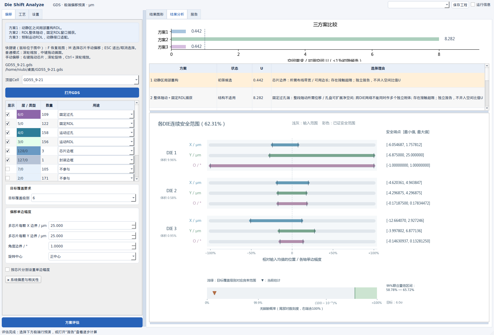
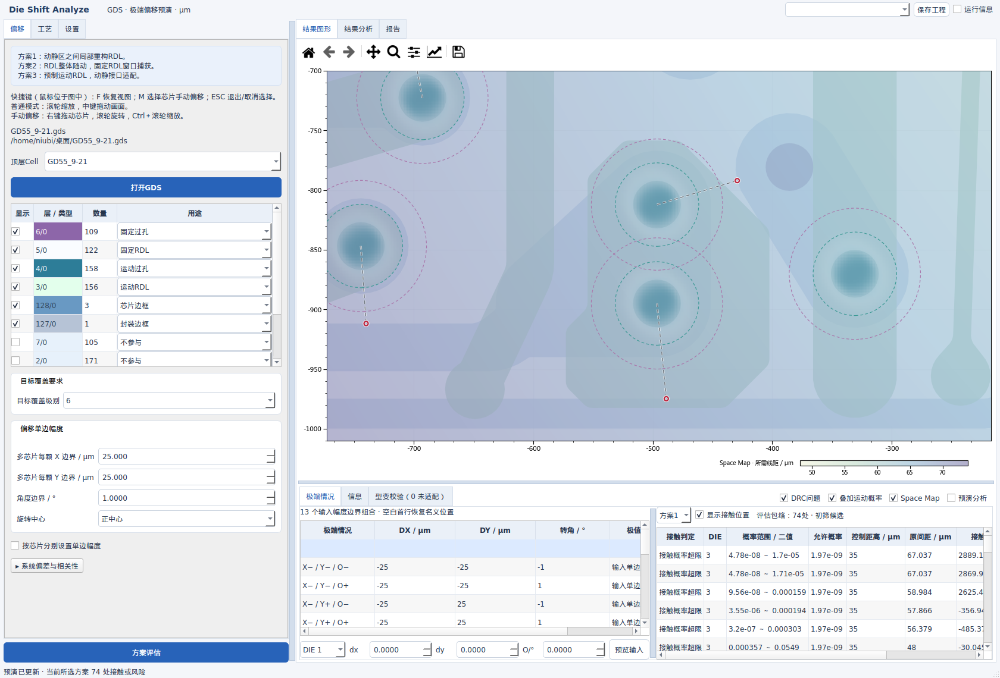
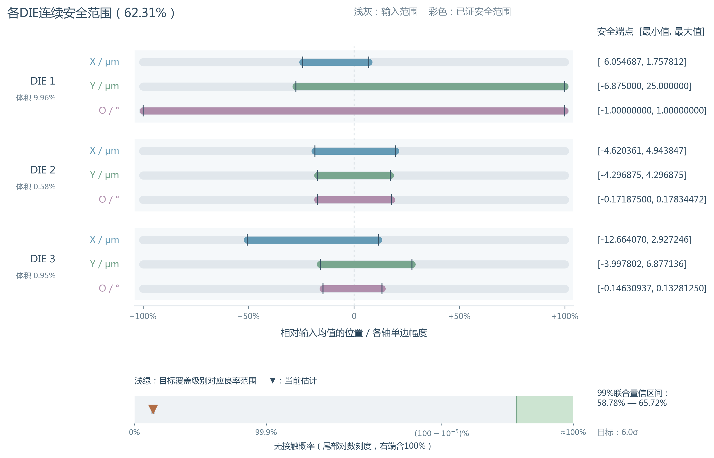

# Die Shift Analyze V16：显示同步与全输入无接触概率

2026-10-08。源码交付，长度单位 μm，界面旋转角度为 °。

V16修复了仅查看GDS时触发评估层数校验而中断绘制的问题。新图纸所有层默认“不参与”，不识别或指定封装/芯片边框；用户仍能随时勾选任意层查看图形。工程中已经保存的用途、层序和可见性按原设置恢复。

## 操作变化

- 图层显隐始终由对应checkbox控制；不要求先设置用途。方案评估仍要求完整的封装、DIE及金属层定义。
- “结果分析”去掉两处文字标签；推荐方案行显示浅橙色背景。三个上下区域的分隔条可调整，切换预演/页面不重置用户尺寸。
- 偏移页的方案说明下显示F、M、ESC、中键、滚轮及Ctrl+滚轮操作方法。鼠标需位于图中，才能触发图形快捷键。
- 极端行只有完成接口接触、三方案几何失效与固定RDL DRC检查且全部通过，才显示浅绿色。尚未检查、检查失败或预演未适配均不标绿。当前型变最终结果可更新当前行状态；有限代表行不证明连续空间全部通过。
- 同一输入下概率、预演和图层缓存继续复用；重新点击“方案评估”清理上次会话计算缓存。

## 概率云如何阅读

颜色和透明度随**整孔实体覆盖概率**变化，图形不再默认描画输入最大幅度的凸包外框。网格保留覆盖全部硬输入状态及孔实体的计算边距，用零延拓卷积；不以圆角矩形或椭圆蒙版裁剪数值。可选的目标级别虚线仍在设置中启用，含义是保守扫掠包络，不能当成等概率线。

最大偏移幅度依然是用户指定的物理支持边界。独立有界XY偏移与有限面积孔卷积后，实际支持范围可能带直边或圆角；不能为了画成椭圆而改动这个分布。显示平滑与浅色透明尾部不改变接触概率判定。保存的覆盖概率网格、边缘概率及面积守恒检查可用于复算。

## 全输入模型良率与安全盒的区别

标题百分比和倒三角表示：在用户**整个输入范围**内，每颗DIE的所有真实运动过孔接口都未接触相邻固定RDL其他网络的概率。它包含安全内盒之外的无接触状态。彩色X/Y/O条仍表示经过连续验证、任意组合无接触的安全内盒。

同一DIE各过孔共享同一个位移和转角；不同DIE的随机状态假设独立。因此只乘各DIE的联合无接触概率，不把每个孔当作独立事件。固定RDL使用评估时原始图形，百分比不包含型变后的动态布线、其他工序缺陷或全套制造DRC，不能直接替代实测生产良率。

设 $z=(D_X,D_Y,\theta)$，$\mathcal H_d$ 是第 $d$ 颗DIE围绕输入均值的三维最大偏移盒，$f_{T,d}$ 是该盒内归一化的截断正态密度。$D$ 为DIE数，$\mathcal I_d$ 为该DIE的全部真实接口，$V_i$ 为第 $i$ 个孔实体，$T_z$ 为绕用户指定中心的刚体变换，$F_{\ne i}$ 为其相邻固定RDL的其他网络，$a$ 为最小包围量、$s$ 为固定层线距；$\operatorname{dist}$ 是实体最短距离。则：

$$Y_d=\int_{\mathcal H_d} f_{T,d}(z)\prod_{i\in\mathcal I_d}\mathbf1\!\left[\operatorname{dist}(T_z(V_i),F_{\ne i})>a+s\right] dz,\qquad Y=\prod_{d=1}^D Y_d.$$

### 默认：独立蒙特卡洛与99%联合置信区间

“设置 → 全输入无接触模型良率”可选计算方法、每DIE样本数指数。默认每DIE取 $N_d=2^{12}=4096$ 个独立截断正态样本；种子沿用概率设置，各DIE加不同偏移种子。$x_d$ 为全部接口同时无接触的样本数：

$$\widehat Y_d=\frac{x_d}{N_d},\qquad\widehat Y=\prod_d\widehat Y_d.$$

令每DIE的失覆盖预算为 $\eta=0.01/D$。以 $B_{u,v}^{-1}$ 表示Beta分布（形状参数 $u,v$）的逆累积分布函数：

$$L_d=B_{x_d,N_d-x_d+1}^{-1}\!\left(\frac\eta2\right),\qquad U_d=B_{x_d+1,N_d-x_d}^{-1}\!\left(1-\frac\eta2\right).$$

$x_d=0$ 时 $L_d=0$；$x_d=N_d$ 时 $U_d=1$。Bonferroni保护使所有DIE区间同时覆盖的概率至少99%，整包区间为 $[\prod_d L_d,\prod_d U_d]$。这个区间是随机计算精度，不是输入σ级别。零失效样本不能证明100%或6σ达标；只有整个输入域通过几何证明，才可直接输出确定的100%。

### 可选：不随机采样的确定性积分

分别设置每DIE状态盒预算和区间宽度目标。将完整输入盒二分，优先处理未定概率质量最大的盒。每个子盒 $B=[l,h]$ 的中点为 $m=(l+h)/2$，半宽为 $e=(h-l)/2$。$R_i$ 为孔全部顶点到其DIE真实旋转中心的最大半径：

$$\delta_i(e)=\sqrt{e_x^2+e_y^2}+2R_i\sin\left(\frac{\min(\pi,e_\theta)}2\right).$$

若所有孔满足 $\operatorname{dist}(T_m(V_i),F_{\ne i})>a+s+\delta_i$，整盒安全；若至少一个孔满足 $\operatorname{dist}(T_m(V_i),F_{\ne i})+\delta_i\le a+s$，整盒必接触。其余按位移变化最大轴继续细分。$e_x,e_y,R_i,a,s$ 单位为μm，$e_\theta$ 为rad。

设 $\mathcal S_d,\mathcal C_d$ 分别是已经证明安全/接触的互斥子盒。$P_N(B)$ 是母正态在该盒中的质量；相关XY用条件正态CDF积分，角度独立，乘其CDF差。$Z_d=P_N(\mathcal H_d)$ 为归一化常数，$\epsilon_B,\epsilon_Z$ 是数值积分误差保护：

$$\underline P(B)=\max\!\left(0,\frac{P_N(B)-\epsilon_B}{Z_d+\epsilon_Z}\right),\quad L_d=\sum_{B\in\mathcal S_d}\underline P(B),\quad U_d=1-\sum_{B\in\mathcal C_d}\underline P(B).$$

整包上下界仍逐DIE相乘，标题取区间中点估计。预算耗尽时保留所有未定质量，不把它判定为安全。确定性区间可能较宽，可增加预算；这不是随机置信区间，也不声明全局最优或解析穷举完成。

### 图中目标色带

有限非零目标 $k$ 的参考范围为 $[1-2\Phi(-k),1]$，$\Phi$ 是标准正态CDF；0级参考100%，分布尺度沿用最近有限级别。∞按名义状态二值判断，不计算随机良率。色带只作同一数轴上的目标参考；每接口满足目标并不自动保证整包达到该数值。高σ端使用尾部对数刻度 $-\log_{10}(1-Y)$，右端压缩极小尾部并包括100%，防止目标范围完全不可见。数值估计与区间完整写在图旁、提示及“报告”内。

## 性能与验证范围

- 图层未赋用途可绘制，真正评估才执行RDL层数要求；导入与checkbox不再因校验异常中断。
- 分析页复用直方图柱与坐标轴；隐藏的GDS画面暂停重绘，返回图形页一次性同步最新状态；分隔条调整不触发隐藏画面的路径/叠加图计算。
- 固定图形及热图保留分层渲染缓存；型变图形按对象/可见子集复用Path，视口边界留有冗余，避免平移时漏画。
- 良率距离计算仅截取整个硬输入域可能接触的局部异网图形。裁切域包含孔在所有输入状态下的实体与线距控制扩展，因此远端RDL不会影响该域的事件。所有接口最终仍以真实实体最短距离计算。
- GD55原文件只读，SHA256为 `a18c984b5a30a7590ddcf9881268eed95b5881711a54fe00bd1e57bd23cbdfae`。用途由用户确认：127/0封装、128/0芯片、3/0运动RDL、4/0运动孔、5/0固定RDL、6/0固定孔；工况±25 μm、±1°，固定线宽/线距20/20 μm、包围15 μm。

实测数据见 [GD55界面与计算记录](../results/gui_GD55_V16.json)、[完整方案结果](../results/assessment_GD55_V16.json)。以下为本机离屏Qt实测，包含渲染的测量不等于用户电脑的屏幕FPS；未宣称复杂型变达到30 FPS。图纸原附件不包含在源码包中。

| 检查项目 | GD55实测 |
|---|---|
| 全输入无接触模型估计 | 62.3060% |
| 99%联合置信区间 | 58.7835% – 65.7212% |
| 完整评估含13个代表状态检查 | 7.128 s |
| 当前细节视图缓存叠加重绘中位数 | 22.740 ms |
| 隐藏GDS状态更新中位数 | 0.054 ms |
| 分析页分隔条真实改变尺寸中位数 | 12.213 ms |
| 158个整孔概率图最大边缘概率 | 3.116e-16 |
| 最大卷积面积质量误差 | 4.547e-13 |

硬件：8逻辑CPU、约15.3 GiB内存；离屏Qt 1680×1140。时长是本机运行结果；软件会话、系统负载及视口会影响数值。GD55这13个原图极端均存在已检查的问题，因此本图不出现浅绿色行；随包示例G的小幅度回归另验证无失效时确实标绿。

源码包在独立目录解压后执行全部数值回归、九组Qt回归、源码启动和安装版KLayout后端验证，详见 [交付验证记录](package_verification.json)。本机为Linux；Windows保留离线调用已安装KLayout的路径及 `TEST_WINDOWS.bat`，本轮没有Windows实机验收，也没有制作Linux可执行文件。
