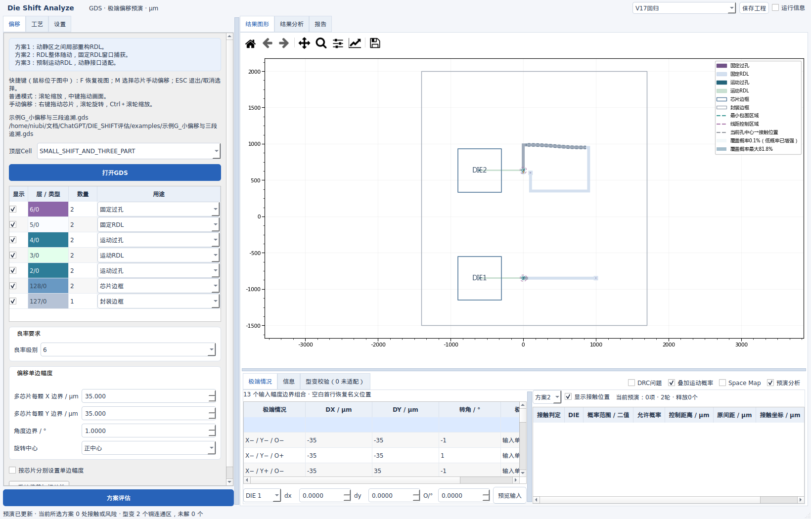
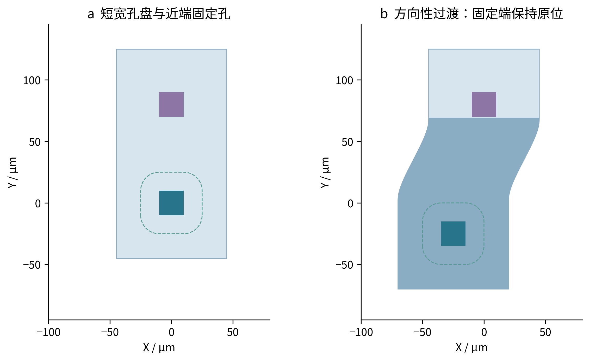
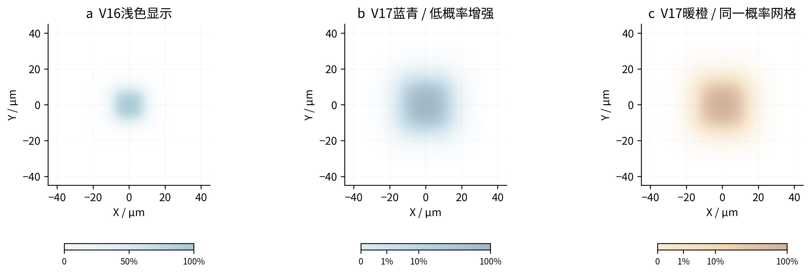
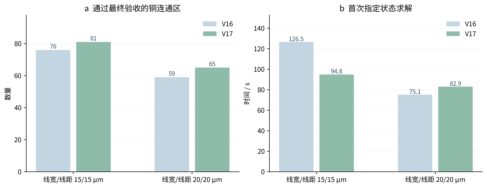

# Die Shift Analyze V17：预演动画、方向性适配与DRC容差

2026-10-08。长度单位 μm，界面角度为 °。本版仅交付源码ZIP。

V17把型变帧的计算时间与动画播放时间分开，修复首次计算和缓存重播直接跳到终点的问题。短宽孔盘新增方向性过渡，仍经过同样的最终几何验收；未通过的线路保留原图，并明确标记。

## 界面与默认值

| 项目 | V17行为 |
|---|---|
| 图例与DIE编号 | 共用原DIE编号的显隐条件；只平移、未放大时同步显示，放大后同步隐藏；隐藏芯片边框层也同步隐藏 |
| 工艺默认值 | 固定与运动线宽、线距均为15 μm；最小包围量15 μm |
| 渐变插值运动 | 新图纸默认开启；已有工程保留其明确保存的设置 |
| 名称 | “目标覆盖要求”改为“良率要求”，“目标覆盖级别”改为“良率级别”；0、1–12、∞的数学口径不变 |
| 概率配色 | 增加青绿、暖橙、玫紫、紫橙、深紫暖白、高对比多色；共11种配色 |
| 低概率增强 | 新增γ控制，默认0.35，范围0.1–1；数值越小，低概率尾部越明显 |
| DRC容差 | “设置 → DRC检查”，带符号输入，默认0 μm，线宽和线距共用 |

原有工程、层序、鼠标快捷键和输入最大偏移边界保持原定义；新默认值不会覆盖工程中明确保存的工艺参数。

## 动画：计算慢也不消耗播放时长

“设置 → 视图与预演运动”新增两种型变动画方式：

1. **算完连续播放（默认）**：后台计算并检查各中间状态，进度条显示准备进度；准备完成后按配置时长播放。相同条件再次播放直接读取缓存。
2. **边算边显示**：每计算出一帧即提交显示；慢帧继续推进，不再因为超过播放时长而跳到终点。缓存帧按播放节奏提交；渲染繁忙时保留最新状态。

播放时长上限限制**播放阶段**，不限制求解所需时间。每个中间状态都重新检查实际铜图形、当前孔控制区和最终DRC；失败候选恢复原图并带诊断。程序不会直接混合两幅铜图，生成未经检查的中间形状。当前芯片状态表随显示帧更新。

缓存包括起止姿态、参数、层序、型变规则、容差和动画分段。改变条件分别缓存，重复条件不重新求解。动画准备按图形大小与可用内存限制帧数，避免高FPS和超大图纸占满内存；实际显示帧数还受渲染耗时影响。重新方案评估或关闭软件清理缓存并释放旧播放引用。

实际Qt回归验证首次、缓存和流式播放均显示多帧；缓存重播期间通过禁止调用型变求解器，确认没有隐式重算。具体帧数与条件见[界面验证记录](../results/gui_V17.json)。

## 方向性孔盘：修复有空间却被圆形支撑区排除的情况

图1｜随包**合成示例J**，500×600 μm芯片。运动孔偏移(−25,−25,0°)，固定端保持原位。径向支撑区会到达近处固定端；方向性过渡利用两端之间的实际间隙完成适配。深色表示发生型变的区域。图中孔盘是布局几何，不是力学仿真。

候选依次尝试已有合格结构、局部径向场、方向性孔盘和三段追溯。方向性候选把**补足包围量后的整个孔盘**作为运动端约束，避免仅按裸孔寻找切面。三段追溯仍使用用户设置的长度、角部预留与候选预算。

“附近没有接触标记”不保证整条线路可适配：源固定段线宽、远端锚点、其他运动孔、型变后的异网线距或拓扑也可能限制它。所有有位移的实际接口都会得到适配或未适配结果；不会因为统计风险把某个孔永久跳过。有限搜索未找到解不等于数学上不存在解。

### 方向性映射与无折叠检查

设原图点为 $P$，过渡起点为 $b$，指向固定端的单位向量为 $u$，法向量 $n=(-u_y,u_x)$，长度为 $L$。局部坐标为 $q_1=(P-b)\cdot u$、$q_2=(P-b)\cdot n$，$t=\min(1,\max(0,q_1/L))$。$T(P)$ 是绕用户指定DIE旋转中心的实际刚体变换，$\Delta(P)=T(P)-P$：

$$\Psi(P)=P+w(t)\Delta(P).$$

运动端 $w=1$，固定端 $w=0$；通常采用既有C1三次或C2五次权重。令 $c=\cos\theta$、$s_\theta=\sin\theta$，$\delta_u=u\cdot\Delta$、$\delta_v=n\cdot\Delta$，$w'=dw/dq_1$。雅可比矩阵 $J_{ij}=\partial\Psi_i/\partial q_j$ 在 $(u,n)$ 坐标中为：

$$J=\begin{pmatrix}
1+w(c-1)+w'\delta_u & -w s_\theta\\
w s_\theta+w'\delta_v & 1+w(c-1)
\end{pmatrix}.$$

代码在**覆盖整个源铜区域的矩形**上证明 $J_{11},J_{22},\det J$ 均为正，采用矩形域上的P矩阵全局单射充分条件。[Gale与Nikaido，1965原论文](https://fig.if.usp.br/~marchett/fluidos/jacobian-matrix-global-univalence-mapping_gale-nikaido.pdf)。以下边界公式为本程序对所用位移场的推导：

取源铜及补足孔盘所有顶点在 $n$ 方向上的最小/最大投影 $v_{min},v_{max}$。过渡矩形的四角为 $P_r=b+u\xi+n\nu$，其中 $\xi\in\{0,L\}$、$\nu\in\{v_{min},v_{max}\}$。令 $g=\max|dw/dt|$：标准C1为1.5、标准C2为1.875。

$$J_{11}\ge c-\frac gL\max(0,\max_r\delta_u(P_r)),\qquad J_{22}\ge c,$$

$$\det J\ge\cos^2\left(\frac\theta2\right)-\frac gL\max\!\left(0,\max_r\delta_u(P_r),\max_r[c\delta_u(P_r)+s_\theta\delta_v(P_r)]\right).$$

由于 $\Delta$ 对位置为仿射函数、$0\le w\le1$，四角及权重端点给出上述保守界。过渡区外是刚体变换或恒等变换。仅当三个下界都大于0.02时使用该证书；否则仍按失败处理。该方法适用于这里的全截面贝塞尔位移场，不向任意型变场推广。一般径向场仍使用位移梯度充分界，但只累加可能在同一点相交的支撑区，避免把远处互不影响的孔重复累加。

### 峰值斜率较小的C2权重

标准权重无法证明无折叠时，方向性场可继续尝试分段C2权重。设端部比例 $\eta=0.2$，$G=1/(1-\eta)=1.25$，$F=1-w$：

$$F(t)=\begin{cases}
G\eta[(t/\eta)^3-\tfrac12(t/\eta)^4],&0\le t<\eta,\\
G(t-\eta/2),&\eta\le t\le1-\eta,\\
1-G\eta[((1-t)/\eta)^3-\tfrac12((1-t)/\eta)^4],&1-\eta<t\le1.
\end{cases}$$

$F$、一阶和二阶导数在拼接处连续，端点的一、二阶导数为0，最大斜率为1.25。仍须通过同一解析证书及全部最终DRC。无折叠证明不会豁免线宽、线距、包围或固定端要求；DBU离散后的多边形也不声称是数学上的严格C2曲线。

## 正负DRC容差的明确含义

设工艺固定线宽为 $w$、固定线距为 $s$，共同容差为 $\tau$，全部单位为μm：

$$w_{DRC}=w-\tau,\qquad s_{DRC}=s-\tau.$$

例如工艺15/15：$\tau=+0.3$ 时检查14.7/14.7，$\tau=-0.3$ 时检查15.3/15.3。有效门槛必须大于0，否则提示输入无效。检查时向上取整到GDS的DBU；不再另加隐藏放宽量。

容差同时作用于固定RDL全局DRC与型变候选验收。不改变最小包围量、其他运动孔控制区、接触概率、Space Map或三方案空间初筛。**异网短接始终报错。** 因此正容差下可能出现DRC线距通过、但按原工艺控制区仍接触的情况，两种检查含义不同。

报告记录评估时的工艺值、容差及有效门槛；若随后修改容差，当前预演另列输入快照，不篡改先前统计结果。旧容差得到的极端行绿色标记不会继续当作当前检查结论。

合成示例J右侧有一条独立的14.8 μm铜条：15 μm规则下报告线宽不足，容差+0.3时可通过；负值则收紧。该铜条不连接运动孔，用于独立验证全局DRC。

## 低概率区域增强

图2｜三幅图使用同一整孔实体覆盖概率数组，只改变显示映射。左为V16显示，右两幅为V17的蓝青、暖橙。低概率增强不会扩展物理支持范围或改变任何数值判定。

空间点 $q$ 的真实覆盖概率仍为 $p_V(q)$。显示色阶为 $c(q)=p_V(q)^\gamma$，默认 $\gamma=0.35$，颜色按 $c$ 查表，透明度为用户叠加不透明度乘 $\sqrt c$。0概率保持透明；配色和γ变化复用原概率数组。图例标注真实概率百分比，不用增强后的色阶值冒充概率。

## 性能与实际GD55验证

图3｜同一GD55、三颗DIE均为(−25,+25,+1°)，包围量15 μm，容差0。时间为本机单次指定状态求解，含候选与最终DRC，**不含导入、界面绘制及随后动画帧准备**。共享主机上的耗时会随负载变化；本图不代表Windows性能或所有图纸的加速倍数。

| 线宽/线距/包围量 μm | V16通过 | V17通过 | V16首次 | V17首次 | V17缓存数值帧中位数 |
|---|---:|---:|---:|---:|---:|
| 15/15/15 | 76/118 | 81/118 | 126.52 s | 94.84 s | 0.0075 ms |
| 20/20/15 | 59/118 | 65/118 | 75.07 s | 82.92 s | 0.0073 ms |

V17保留上述两种工艺下原来已通过的全部线路。15 μm默认工艺增加5个通过铜连通区；20 μm工艺增加6个，但该次首次求解耗时略增。增加候选覆盖面与求解速度之间有权衡，不能宣称所有工况都更快。通过与否均由独立的最终布局宽度、内部线距、异网净距和内角复核决定。

主要优化：复用已验证型变结构，缓存候选自身DRC；只细分受型变影响的边；复用已变换的孔实体；异网距离检查去掉超过检查半径与保护边距的远端图形。远端裁切边位于检查距离之外，不作为新的近邻边。大任务按CPU和内存使用进程，已启动的工作进程也可处理动画帧；停止播放释放旧回调引用，缓存仍按会话管理。

证据：[15 μm基线](../results/baseline_GD55_15_V17.json)、[15 μm本版](../results/performance_GD55_15_V17.json)、[20 μm基线](../results/baseline_GD55_V17.json)、[20 μm本版](../results/performance_GD55_20_V17.json)、[界面回归](../results/gui_V17.json)。GD55原始文件只读，通用包不包含该附件；合成示例J随包提供。

源码包独立解压后的完整检查见[交付验证记录](package_verification.json)。本机执行Linux验证及已安装KLayout的离线后端调用，未执行Windows实机验收。本版不生成Linux可执行文件。
