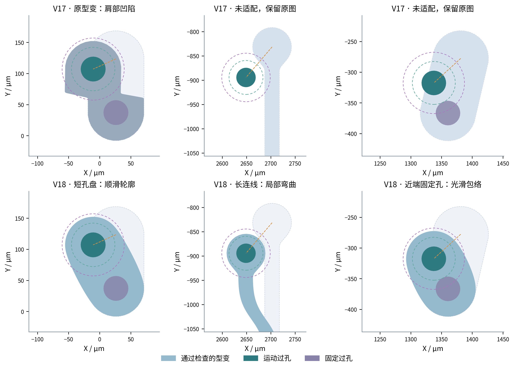
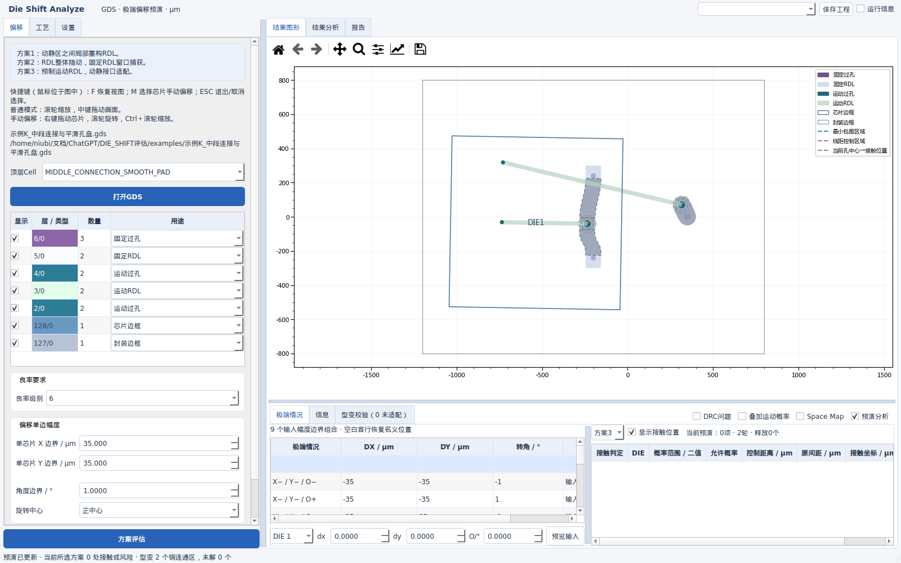
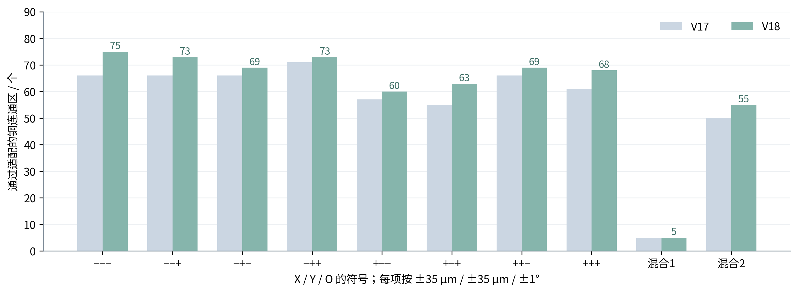

# Die Shift Analyze V18：平滑孔盘、中段连接与预演性能

2026-10-09。长度单位统一为 μm，界面转角单位为 °。本版仅交付源码ZIP。

在用户指定的GD55状态 **DX=−35、DY=−35、O=−1°** 下，线宽、线距、最小包围量均为15 μm、DRC容差为0，最终通过适配的铜连通区由V17的 **66/118增加到75/118**，该状态原先通过的66个全部保留。短孔盘不再依靠压缩圆形影响区产生肩部凹陷；新增整截面过渡支持孔位于连线中段、两侧固定连接保持不动。



图1｜同一GDS、同一偏移和规则。每列上下使用相同坐标范围；浅色虚线背景仅用于本报告对照原始位置，软件实际预演隐藏被替换的原铜。第一列对应5/0内部索引22，第二列104，第三列110（索引从0开始）。绿色/紫色虚线分别为孔实体扩大15/30 μm，橙色虚线连接名义与实际孔中心；这些控制圈不等于线路外轮廓。上排第二、三列为未适配时保留的源铜，下排为通过最终检查的型变。

## 本版如何处理这三类问题

| 问题 | 原因与处理 | 接受条件 |
|---|---|---|
| 短宽孔盘边缘凹陷 | 径向权重在两侧产生不同收缩；对合格短孔盘改用光滑凸包络重建轮廓 | 真实孔包围、固定孔覆盖、拓扑和全层DRC全部通过 |
| 连接点在图形中段 | 单向运动→固定过渡不能表达两侧固定；新增可交替的固定0／运动1平台 | 两侧连接分别保持固定，整截面采用同一权重，检查无折叠及最终铜图形 |
| 有空间却搜索失败 | 大圆形刚性孔盘靠近固定端时，无折叠充分条件可能过严 | 短岛直接生成有效凸轮廓；长线仍用连续位移场、局部与三段候选，失败保留原图 |
| 重复迭代慢 | 邻线改变后反复生成相同轮廓、细分曲线和归整DBU | 缓存轮廓和适配段；邻线环境改变时仍重新检查外部约束 |

新增便携工程 **示例K_中段连接与平滑孔盘**：1000×1000 μm单DIE，左侧运动孔位于固定RDL中段，上下两个固定过孔都须保持连接；右侧为短孔盘。可在Jobs下拉中直接打开，选择−35/−35/−1°预演。它是合成验证样例，不含GD55附件几何。



V17的正负DRC共用容差、默认15 μm规则、缓存动画、鼠标操作和概率显示继续保留，定义见[V17说明](V17_操作与验证说明.md)。本版没有增加需要用户猜测的形状分类输入，候选类型由源几何和连接自动选择。

## 中段连接的计算过程

**输入。** 源铜点为 (P)，源铜顶点均值为 (o)，候选轴单位向量为 (u)，所属DIE的实际刚体变换为 (T(P))。所有位置单位为μm；(T) 使用已保存的旋转中心及当前DX、DY、O。

1. 对原孔实体加最小包围量形成运动约束区；固定约束来自同一连通铜上的固定过孔和当前不动的接口。
2. 将各约束顶点投影到轴 (u)：(s=(P-o)cdot u)。每个投影区间标为运动平台1或固定平台0；同类相邻区间可合并，异类重叠则拒绝该轴。
3. 在相邻异类平台间的空隙 ([a,b]) 建立过渡。(a,b) 是实际投影区间端点，(L=b-a>0)，不使用猜测的连接方向。方向来自源边、主轴和连接端连线；还会尝试缩短过渡、保留更多固定部分。

令平台值为 (w_a,w_bin{0,1})，归一化位置 (t=min(1,max(0,(s-a)/L)))：

$$w(s)=w_a+(w_b-w_a)[1-w_{Ck}(t)],$$

$$w_{C1}(t)=1-3t^2+2t^3,\qquad
w_{C2}(t)=1-10t^3+15t^4-6t^5,$$

$$\Psi(P)=P+w(s)[T(P)-P].$$

**输出。** 同一横截面采用同一 (w)，运动平台完整随DIE刚体运动，固定平台保持原位；中段孔可以同时连接两侧过渡。C1/C2指连续位移场在平台交界处的一阶/二阶连续性；离散GDS多边形本身仍为线段。贝塞尔与圆弧选项沿用原定义，适配段增加虚线描边。

不能仅靠采样点“看起来不折叠”。对于贝塞尔权重，令 (	heta) 为当前旋转弧度、(c=\cos\theta)、(s_\theta=\sin\theta)、(n=(-u_y,u_x))、(Delta=T(P)-P)，(delta_u=u\cdot\Delta,delta_v=n\cdot\Delta)。每个过渡区以两个端点及源铜在 (n) 上的最小/最大投影组成四角 (P_r)。权重导数符号 (eta=\operatorname{sign}(w_b-w_a))，峰值 (g=1.5)（C1）或1.875（C2）：

$$J_{11}\ge c+\frac gL\min(0,\min_r\eta\delta_u(P_r)),\qquad J_{22}\ge c,$$

$$\det J\ge \cos^2\!\left(\frac\theta2\right)+\frac gL
\min\!\left(0,\min_r\eta\delta_u(P_r),\min_r\eta[c\delta_u(P_r)+s_\theta\delta_v(P_r)]\right).$$

三个下界都须大于0.02，使用V17已说明的矩形域P矩阵单射充分条件；圆弧分支使用位移梯度范数界。证明不足的候选继续寻找其他方案，不能据此宣称物理上无解。

## 短孔盘的平滑轮廓

此候选仅用于：单个运动孔、单个固定连接端、源铜无孔洞、源铜面积/凸包面积不低于0.97，且长宽尺度比不超过8。多分支、孔洞和长绕线不通过该入口直接填成凸包。

**输入半径如何计算。** 对运动孔，取原孔中心到源铜边界的最短距离 (r_{old,m})，以及孔顶点到孔中心的最大距离 (r_{via,m})；固定孔同样得到 (r_{old,f},r_{via,f})。设包围量为 (a)，DBU为 (delta)，设置中的曲线误差为 (arepsilon_c)（这不是DRC容差）：

$$\varepsilon_g=\max(4\delta,2\varepsilon_c),$$
$$r_m=\max(r_{old,m},r_{via,m}+a)+\varepsilon_g,\qquad
r_f=\max(r_{old,f},r_{via,f})+\varepsilon_g.$$

(c_m) 为运动后的孔中心，(c_f) 为保持不动的固定孔中心。原轮廓与固定孔都作为最终检查输入，不能用新半径替代验收。

**轮廓公式。** 设法线方向为 (arphi)，(n=(\cos\varphi,\sin\varphi))、(t=(-\sin\varphi,\cos\varphi))。每个圆盘 (i\in\{m,f\}) 的支持函数为 (h_i=c_i\cdot n+r_i)。平滑量 (delta_s) 依次取 (max(0.2w,8\delta))、(max(0.05w,8\delta))，其中 (w) 为工艺固定线宽，(eta=\log 2/\delta_s)：

$$h(\varphi)=\frac1\beta\log\sum_i e^{\beta h_i(\varphi)},\qquad
P(\varphi)=h(\varphi)n+h'(\varphi)t.$$

实际代码减去最大指数后计算，防止数值溢出。令 (
ho_i=e^{\beta h_i}/\sum_j e^{\beta h_j})，则：

$$h'=\sum_i\rho_i(c_i\cdot t),$$

$$h+h''=\sum_i\rho_i r_i-\frac{\sum_i\rho_i\log\rho_i}{\beta}
+\beta\operatorname{Var}_{\rho}(c_i\cdot t)>0.$$

因此连续轮廓严格凸且光滑，没有径向挤压造成的两侧凹陷。(\operatorname{Var}_{\rho}(v)=\sum_i\rho_i(v_i-\sum_j\rho_jv_j)^2)。此式为本实现的解析推导，不是有限采样观察得到的结论。

**验收。** 自适应细分后归整到DBU，再检查：同一铜连通区、孔洞数、实际运动孔的包围量、固定孔覆盖、封装/禁布约束、其他网络线距、其他运动孔控制区、最小线宽/内部线距和内角。邻线共同型变后再做全层复核；不通过的线路恢复源铜并保留诊断。平滑轮廓重建不声称是原材料点一一对应的弹性形变，也不借此放宽任何DRC。

## 速度、缓存与显卡

轮廓与适配段缓存按源铜、参与接口、姿态、场类型和全部几何参数区分；内存限制32 MiB/求解器、最多2048项，线程并发使用锁。邻线变化时可以复用轮廓，但外部净距及最后全层验收重新计算。完整状态与动画继续使用会话缓存，重新方案评估、换GDS或关闭程序后释放。

可用的CuPy/CUDA环境可以加速整截面和三段位移场的大批量坐标计算。自动模式在单批不少于65536点时才尝试GPU；小批次和多进程工作器使用CPU，避免传输开销和多个CUDA上下文争抢显存。显存预算、自检及抽查失败时回退CPU，**几何布尔、拓扑和最终DRC始终在CPU执行**。沿用“显卡加速”下拉，没有新增依赖安装行为。

本机检测为Intel Iris Xe集显，没有CuPy/CUDA；已验证CPU数值、GPU调用路径的模拟一致性和错误回退，**没有CUDA实机速度测量**。不能把整段预演称为GPU重构。

## GD55验证结果与边界



图2｜固定层5/0有118个铜连通区。前三个符号依次代表X、Y、角度，每颗DIE同取±35 μm、±35 μm、±1°；混合1为DIE1负负负、DIE2正正正、DIE3不动，混合2为DIE1不动、DIE2负正负、DIE3正负正。

| 状态 | V17通过 | V18通过 | V17求解/s | V18求解/s |
|---|---:|---:|---:|---:|
| − − −（用户指定） | 66 | 75 | 17.00 | 13.68 |
| − − + | 66 | 73 | 32.88 | 14.27 |
| − + − | 66 | 69 | 29.27 | 11.25 |
| − + + | 71 | 73 | 44.47 | 21.61 |
| + − − | 57 | 60 | 30.76 | 28.67 |
| + − + | 55 | 63 | 13.97 | 23.98 |
| + + − | 66 | 69 | 22.43 | 13.37 |
| + + + | 61 | 68 | 28.55 | 14.20 |
| 混合1 | 5 | 5 | 17.92 | 8.81 |
| 混合2 | 50 | 55 | 21.23 | 15.69 |

时间为共享Linux主机单次顺序切换测量，包含候选、迭代和最终验收，排除导入、绘图与动画准备；会受系统负载、已有结构缓存和不同候选影响。**+−+状态本次更慢**，不能保证所有状态提速。八个同向极端的944个“铜连通区×状态”组合中，通过数由508增加到550；这个计数不是生产良率。

用户指定状态新增5/0内部索引38、66、71、94、96、101、104、110、112，共9个；其66个旧通过项均保留。其他状态并非逐线单调改善：−++的索引99，以及+−−的索引54、77、78，是旧版通过、本版未通过，尽管对应状态总通过数增加。有限候选和邻线联合搜索不证明全局最优；这些位置继续保留原图与未适配标记，不能隐藏这项限制。

每个通过图形另行检查实际宽度、内部线距、异网净距、内角、所有孔包围和固定孔覆盖。此处检查8个同步极端及2个混合状态，不代表512个跨DIE极端组合，更不构成连续概率或所有任意形状的适配证明。

数据与复算：[V17对照](../results/baseline_sweep_V18.json)、[V18十状态审计](../results/gd55_sweep_V18.json)、[实际Qt界面检查](../results/gui_V18.json)。源GDS SHA256为 `a18c984b5a30a7590ddcf9881268eed95b5881711a54fe00bd1e57bd23cbdfae`，只读使用，未包含在通用源码包中。

```bash
python3 -m unittest discover -s tests -p 'test_*.py' -v
QT_QPA_PLATFORM=offscreen python3 tests/gui_v18.py
python3 tools/validate_gd55_v18.py --gds /path/to/GD55_9-21.gds
python3 tools/package_release.py
```

源码ZIP的独立解压检查记录见[交付验证记录](package_verification.json)。Windows沿用离线已安装KLayout后端，未完成Windows实机验收。本次不生成Linux可执行文件。
