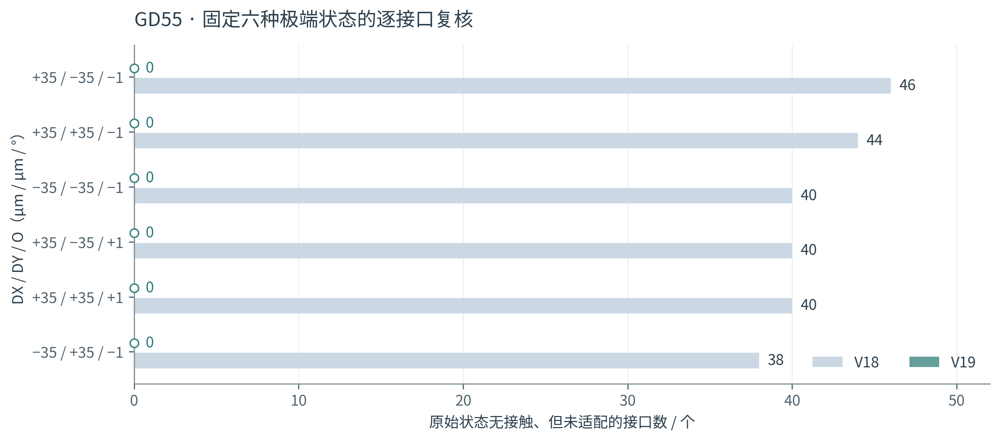
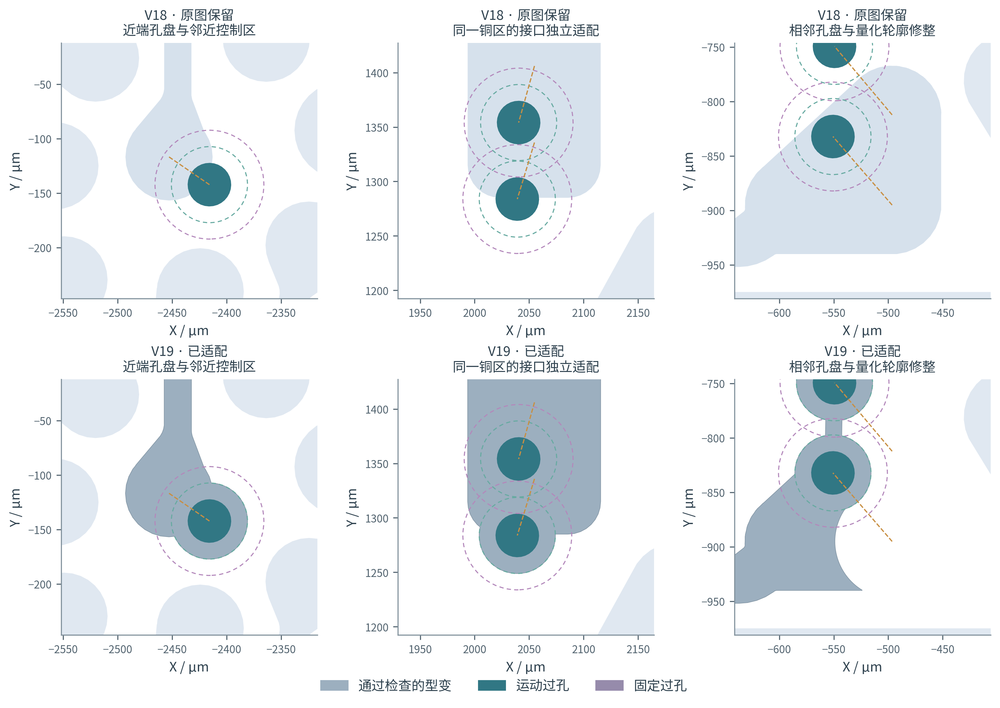
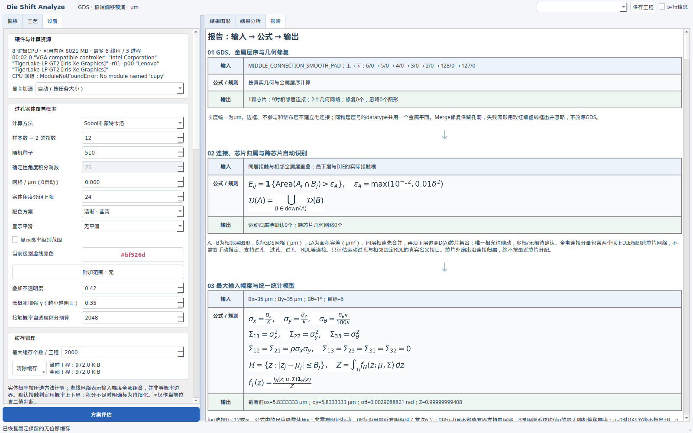

# Die Shift Analyze V19：缓存与逐接口适配复核

2026-10-09 · 长度统一为 μm · 源码版

GD55按约定固定选择6种极端状态，逐一核对每种状态的158个运动过孔—固定RDL接口，共948个接口—状态组合。其中原图无接触的 **635个组合全部完成适配**；V18在同一集合中有248个未适配。这个计数是六种指定工况的几何验证结果，不是量产良率，也不是连续偏移域或所有跨芯片组合的证明。原本有接触的接口仍单独显示，未把它们删除或当成通过。



## 1. 冻结输入与逐点结果

输入为GD55_9-21.gds，SHA256：`a18c984b5a30a7590ddcf9881268eed95b5881711a54fe00bd1e57bd23cbdfae`。三个DIE在每种状态中使用同一组正负号，平移±35 μm、转角±1°；固定线宽15、固定线距15、包围15 μm，共用DRC容差0，最小铜内角90°，曲线误差0.05 μm，源DBU为0.001 μm。图层为127/0封装、128/0芯片、3/0运动RDL、4/0运动过孔、5/0固定RDL、6/0固定过孔，上→下金属顺序为6/0→5/0→4/0→3/0。

选择规则：先在V18上遍历8种同步正负叠加组合，按“原图无接触但未适配”接口数降序取6种；本版改善后不重新挑选较容易的状态。

| DX / DY / O（μm / μm / °） | 原本无接触接口 | V18未适配 | V19未适配 | 完整几何复核 |
|---|---:|---:|---:|---|
| +35 / −35 / −1 | 105 | 46 | 0 | 通过 |
| +35 / +35 / −1 | 110 | 44 | 0 | 通过 |
| −35 / −35 / −1 | 112 | 40 | 0 | 通过 |
| +35 / −35 / +1 | 98 | 40 | 0 | 通过 |
| +35 / +35 / +1 | 107 | 40 | 0 | 通过 |
| −35 / +35 / −1 | 103 | 38 | 0 | 通过 |


所有948项状态保存在[完整审计JSON](../results/gd55_interfaces_V19.json)；原来遗漏的248项及其名义位置、原失败原因和当前结果见[逐点复核清单](V19_逐点复核.md)。[V18冻结基线](../results/baseline_interfaces_V19.json)保留原选择依据。



三列从左到右分别对应(+35,−35,−1°)的5/0索引24、(−35,−35,−1°)的索引44–48共享铜区、(−35,+35,−1°)的索引93；索引从0开始。上排是这些原来未适配接口处保留的源铜；下排是实际通过检查的V19候选。灰蓝色为型变铜，深青为运动过孔，紫色为固定过孔；青绿/紫色虚线分别为包围/线距控制区。每列均在原始位置和实际偏移位置检查，不用示意曲线代替真实GDS轮廓。

## 2. 修复原因与实现

| 原因 | V19处理 | 验收约束 |
|---|---|---|
| 同一铜区的某接口接触，导致其他接口也被整块冻结 | 按接口选择适配子集；未选接口的名义铜保持为锚 | 已选接口满足实际包围；固定端和未选名义端保持覆盖 |
| 局部孔盘变形的圆滑肩部侵入邻近控制区 | 重建局部孔盘、保留来线分支；直线受阻时搜索可见路径 | 全部候选重新检查完整铜宽、异网净距、内角和新接触 |
| 远端原有接触误伤整条共享网络 | 保留旧失败标记，只禁止新增接触及超出源网格精度的侵入扩张 | 无原接触的接口不获得任何豁免 |
| 5/0同一连通区有两个小于曲线误差的微孔 | 仅闭合横纵尺寸均不超过误差的微孔；记录修整 | 两个较大的原孔仍保留，不改写源GDS |
| 并行候选完成后，部分接口未在最终邻域再搜索 | 在剩余联合修复预算内补全仍无接触的接口 | 只接受适配接口集合增加、既有合格接口不丢失的更新，之后再做全图DRC |

GD55微孔位于导入后5/0索引44–48构成的共享铜区，尺寸约0.039×0.047和0.003×0.003 μm，面积约0.00145及0.0000085 μm²。修整阈值取用户曲线误差；按横纵尺寸判断，不按面积判断，因此长窄槽不会因面积小而被填掉。具体孔轮廓范围保存在审计JSON的`source_microhole_repairs`。它是预演候选的有界几何修整，不声称保持这些微孔的原拓扑。

裁去旧孔盘后，面积不超过有效连接宽度平方、完全位于局部编辑区内且不含固定/未选接口锚的小残片不再接回，避免出现无端点的死支线。新候选顺序优先采用较短的局部重建，再尝试长距离三段追溯；既有轴向平台、短孔盘平滑包络、圆弧位移场及三段方式继续保留。局部重建使用贝塞尔方式；选择圆弧时继续走原有圆弧候选。失败候选不显示，原图及失败定位保持可见。

## 3. 输入 → 公式 → 输出


### 3.1 接口子集与候选铜

设R为本轮选取的适配接口集合，Vi为第i个名义过孔实体，Ti为由该过孔实际DIE归属和旋转中心得到的刚体变换，a为最小包围量，Br为半径r圆盘，⊕为Minkowski和。Li为所需运动孔盘：

$$L_i=T_i(V_i)\oplus B_a.$$

固定锚A来自相接固定过孔；没有选入R的名义过孔也作为锚，得到：

$$A_R=A\cup\bigcup_{i\notin R}V_i.$$

G为源铜，K为旧孔盘附近允许移除且避开锚的局部区域，γj为连接剩余铜分量的第j条路径，we为工艺线宽与带容差有效线宽的较大值。候选铜按下面的集合关系构建，再进行圆滑和裁边：

$$G_c=(G\setminus K)\cup\bigcup_{i\in R}L_i\cup\bigcup_j\left(\gamma_j\oplus B_{\frac{w_e}{2}+2\delta}\right).$$

δ为源GDS网格。实际离散孔盘使用半径`a/cos(π/128)+2δ`补偿内接弦和量化；代码还尝试不同局部裁切宽度以及保留原孔盘的生长候选。上述Gc是搜索候选，不是未经检查的输出。必须满足完整锚覆盖、运动孔实际包围、全铜宽/线距、封装、禁布区、内角和拓扑规则。

### 3.2 保留原有失败，但不制造新失败

Cj为其他网络运动过孔的当前控制区，半径扩张量为a+s；s是原工艺线距。Gδ为源铜按原DBU归一化后的几何，Ij为源铜已有侵入区域：

$$I_j=G_\delta\cap C_j,\qquad\Delta_j=(G_c\cap C_j)\setminus(I_j\oplus B_\delta).$$

要求Δj为空。一个DBU边界只处理多边形交点再次落网格的量化误差；Ij为空时其膨胀仍为空，没有已有接触豁免。同时以最终全图重新计算接触接口集合，禁止引入此前无接触的新接口。原接触仍以红色显示；铜的有效最小线宽/线距仍严格按工艺值减用户容差验收，不因本规则放宽。

### 3.3 局部平滑

对于待圆滑的凹角或局部新尖角P，u/v为入边和出边单位方向，ℓ1/ℓ2为相邻边长，切角距离取`c=min(we/2,0.42ℓ1,0.42ℓ2)`，h=0.35c。令P0=P−cu、P1=P+cv，六个控制点依次为P0、P0+hu、P0+2hu、P1−2hv、P1−hv、P1。曲线为：

$$\gamma(t)=\sum_{j=0}^5\binom{5}{j}(1-t)^{5-j}t^jQ_j,\quad0\le t\le1.$$

Qj是上述第j个控制点。端点切向与原直边一致、端点二阶导数为零；离散后仍按曲线误差和源网格处理并完整复核，不将离散多边形说成严格数学C2曲线。绕障路径先对按铜半宽及保护量内缩的自由域建立可见图，以欧氏线段长度为边权求最短路，再作小范围平滑，最终验收仍以实际输出铜为准。

## 4. 缓存操作与寿命



- “设置 → 缓存管理”增加最大缓存个数，默认每工程2000个普通条目；普通条目超过上限时淘汰最久未使用项。无位移帧及无位移全局摘要固定保留，不占普通额度。
- 缓存按GDS内容、工程身份、层用途/顺序、工艺、真实偏移与计算设置匹配；同内容参数不因Python对象组织方式不同而失效，正负零也统一。
- 状态、DRC、概率、Space Map和验证过的动画均复用；取消的动画保存已完成帧，下次补齐。中间交互帧采用有界RAM缓存，完成动画单独成包，避免大量中间帧挤掉正式状态。
- 工程A→B→A保留本次运行缓存；新工程首次保存名称后沿用已有结果。返回空白行先恢复零位移画面，首次全局摘要仍可在后台完成。
- 清理菜单提供当前工程/所有工程；每0.5秒更新当前与全部缓存文件大小。清理保留当前画面，后续操作按需重算；旧后台任务不能往新缓存写回。
- 延续已有寿命约定：主动重新方案评估清当前工程，退出清本次运行所有缓存。这里“全部工程”指本次运行中打开过的工程，不宣称跨重启保存。达到数量上限或主动清理后，普通结果会重新计算。

## 5. 性能与验证边界

| 测量 | 当前Linux实测 | 计时范围 |
|---|---:|---|
| GD55六状态首次完整求解 | 25.02–60.42 s / 状态 | 不含导入、引擎初始化、独立复核和界面绘制 |
| GD55相同六状态重复3轮 | 中位 0.0086 ms | 18次结果缓存查找，不含绘制；测试禁止重新调用搜索 |
| Qt案例六状态重复3轮 | 中位 27.5 ms | 包含预览请求及界面事件处理 |
| Qt返回无位移 | 15.3 ms | 恢复画面，不等待首次全局统计 |
| 全部工程清理 | 0 B | 当前与其他工程的缓存文件均已清理 |

并行候选使用现有硬件检测及spawn进程池，最终布局复核留在主进程。此机器为8逻辑CPU，默认最多6线程/3工作进程；GPU路径保留已有实现，本机无CUDA设备，本版没有宣称新的GPU实测加速。冷计算仍需要几十秒，缓存命中不代表首次运算或所有复杂图纸达到实时帧率。以上是固定工作负载单次运行测量，不是跨硬件性能保证。

独立几何复核逐一检查最终候选铜的合法性、线宽、内部线距、异网净距、铜内角、所选运动孔包围、固定端及未选名义端覆盖、原有大孔洞保留和新增接触集合；同时核验原GDS文件哈希未变。核心回归176项通过，实际Qt测试覆盖动画首播/重播、18次状态复用、跨工程缓存、无位移恢复及清全部缓存。源码ZIP使用Store方式、显式文件类型和UTF-8文件名，另对PNG像素、CRC、文件哈希及7-Zip/unzip解压作验证；详见[源码包验证记录](package_verification.json)。Windows离线桌面KLayout接口继续保留；本次未在Windows实机执行。

新增[示例L工程](../Jobs/示例L_同网部分适配与既有接触.dshift.json)：DIE1设为(0,35,0°)，DIE2设为(−200,0,0°)，观察共享铜区左端独立适配、右侧既有接触保留。该示例是专门构造的回归案例，不冒充GD55。

复算：

```bash
python3 -m unittest discover -s tests -p 'test_*.py'
QT_QPA_PLATFORM=offscreen python3 tests/gui_v19.py
python3 tools/validate_gd55_v19.py --gds /path/to/GD55_9-21.gds --out results/gd55_interfaces_V19.json --dump /tmp/v19-frames
python3 tools/v19_figures.py --gds /path/to/GD55_9-21.gds --frames /tmp/v19-frames
python3 tools/package_release.py
```
