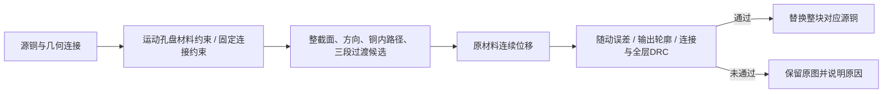
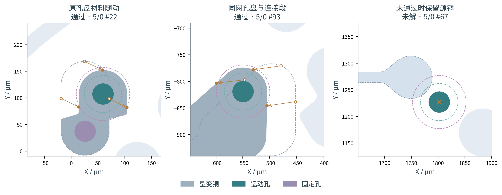
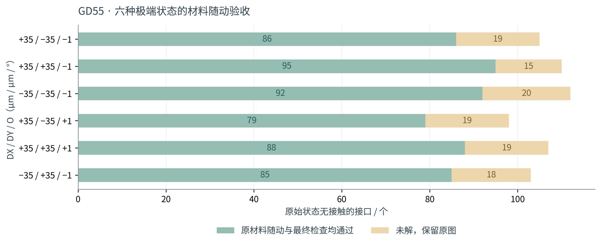

# Die Shift Analyze V20：原铜随动、预演缓存与负载调度

本版将“原始孔盘及连接材料发生型变”作为接受条件。新增一个位移后的孔盘、再与不动的原铜拼接，不能作为成功适配。通过检查的型变显示灰色；未求得合格候选的接口保留源图形并显示原因。源GDS只读。

**源码ZIP不含图片。** 本报告及插图在源码包外提供；程序仍会在运行时绘制图形、概率云和公式。使用方法见[使用说明](V20_使用说明.md)。

## 1. 原材料如何移动



以贝塞尔权重方式为例：

\[
T_i(P)=C_i+R(\theta_i)(P-C_i)+\begin{bmatrix}D_{x,i}\\D_{y,i}\end{bmatrix},
\qquad
\Psi(P)=P+w(P)[T_i(P)-P],
\qquad G'=\Psi(G).
\]

- (P)：原铜中的二维坐标，单位 μm；(G)：参与型变的来源铜。若名义孔盘包围量不足，先在名义位置补足包围量再作同一位移映射。
- (C_i)：DIE (i) 实际设置的旋转中心，单位 μm；(D_{x,i},D_{y,i})：当前预演的平移，单位 μm；(	heta_i)：旋转角，计算时用 rad；(R) 是二维旋转矩阵。
- (T_i)：该DIE的完整刚体变换；(w)：无量纲权重，运动段为1，固定段为0，适配段在两者之间连续变化。
- (Psi)：原材料到最终材料的位置映射；(G')：映射并经数据库网格量化后的铜。不会在保留旧孔盘的同时另叠加新孔盘作为结果。

常规C2过渡为 (w(t)=1-10t^3+15t^4-6t^5)，其中 (t=(s-a)/(b-a))，在区间外截断到0或1；(s) 是沿候选方向或铜内路径的距离，(a,b) 是两端平台之间的距离端点，均为 μm。短距离压缩时另试端部平滑、中央接近线性的积分权重，端部占比 (r) 依次为0.2、0.08、0.025，最大斜率为 (1/(1-r))，两端一、二阶导数为0。

整截面候选让同一截面的两侧接收相同权重，减少径向衰减造成的两侧凹陷。复杂分支的补充候选沿来源铜约束网格追溯；网格内方向分段变化，不宣称整个内部曲面处处C2。C1/C2描述适配与运动/固定平台接合处的位移连续性；最终图形仍是受曲线误差控制的多边形近似。

三段追溯使用的孔盘约束会裁回实际源铜。这样不会因为约束凸包伸到铜外而误排除真实存在的适配段。

## 2. 增加材料与最终轮廓验收

\[
e_{\mathrm{move}}=\max_{P\in\mathcal L}\|\Psi(P)-T_i(P)\|,
\qquad
e_{\mathrm{edge}}=\max_{P\in\mathcal L\cap\partial G}
 d\!\left(\Psi(P),\partial G'\right).
\]

(mathcal L) 是原孔盘边缘及附近连接弧的材料采样集合，采样间距不大于固定线宽的1/4；(partial G) 是源铜边界；(d) 是点到最终边界的最短距离。短共享岛中靠近固定孔的连接颈允许渐变，只将明确属于运动端的源弧设为刚体约束。材料核验是带间距的几何核验，不是连续体力学仿真。

接受条件包括：

1. (e_{\mathrm{move}}\le\max(2\delta,0.1\varepsilon))，其中 (delta) 为GDS数据库网格大小，(arepsilon) 为设置中的曲线误差，均为 μm。
2. 最终边界误差及映射材料超出最终铜的距离均不超过 (arepsilon+2\delta)。GD55本次采用 (delta=0.001) μm、(arepsilon=0.05) μm，即材料刚体误差限0.005 μm、最终几何误差限0.052 μm。
3. 固定连接端仍覆盖；所选运动过孔满足最小包围量；孔洞和连通拓扑保留。仅对原有、两个方向尺寸均在曲线误差以内的微小孔洞作有记录的修整。
4. 最终组合布局通过线宽、内部线距、异网线距、最小内角、封装和其他网络控制区复核。失败结果回退，不显示不合格的灰色候选。



三幅局部分别使用（+35, −35, −1°）、（−35, −35, −1°）、（+35, −35, −1°）状态，前两项单位为 μm。橙色箭头连接同一个源材料点和映射后的点；蓝灰虚线表示原轮廓，深灰为已验收的实际型变铜。图中局部坐标均为 μm。未适配示例保留原铜与琥珀色标记，不能将其记为通过。

## 3. GD55六状态审计

工艺：固定线宽/线距/最小包围量均为15 μm，DRC共用容差0，最小内角90°。三个DIE采用同步的 (pm35) μm、(pm35) μm、(pm1^circ) 组合。六状态按此前已冻结的最差六项选取，覆盖每个状态的全部158个运动孔—固定RDL接口。**六个同步状态不等于多芯片所有独立组合，也不证明连续良率。**

| DX / DY / O（μm / μm / °） | 原始无接触接口 | 材料随动通过 | 未解并保留 | 首次求解 / s |
|---|---:|---:|---:|---:|
| +35 / -35 / -1 | 105 | 86 | 19 | 95.0 |
| +35 / +35 / -1 | 110 | 95 | 15 | 94.2 |
| -35 / -35 / -1 | 112 | 92 | 20 | 53.1 |
| +35 / -35 / +1 | 98 | 79 | 19 | 159.9 |
| +35 / +35 / +1 | 107 | 88 | 19 | 144.4 |
| -35 / +35 / -1 | 103 | 85 | 18 | 50.0 |

六状态共948项接口状态，其中635项原始无接触，525项通过材料随动验收，**110项仍未解**（同一接口在不同状态重复计数）。所有已接受图形均通过独立最终几何复核，没有新增接触接口；原GDS哈希未改变。首次求解耗时为本机实测，包含约束搜索和全图复核，不作为跨电脑性能保证。



本版判据比V19的孔盘覆盖检查更严格，不能沿用旧版“全部适配”的统计。仍未解决的位置逐接口列在[审计数据](../results/gd55_material_V20.json)中；“未解”表示当前有限候选搜索没有通过全部约束，不表示已证明没有几何解。

## 4. 缓存与后台调度

状态缓存按GDS内容、层序/用途、偏移、工艺和计算设置区分；多个独立计算引擎共享已完成的帧，工作数组互不共享。无位移状态固定保留。A→B与B→A使用同一组已验证动画帧，反向播放时反转顺序。新路径首次仍需要计算中间帧，已缓存路径无需进入求解。

同一概率叠加请求并发到达时只计算一次。迭代搜索也记录相同邻域的成功或失败结果；邻居铜形状、当前状态、接口选择或约束改变后重新检查。清理当前/全部工程、重新方案评估或退出软件后的清理规则保持不变。

后台不阻塞等待CPU采样。至少6逻辑CPU、可用内存至少2 GiB并满足任务余量、CPU使用率低于80%时，可并行两项预演；其余情况排队。每项任务的内部线程/进程预算预留另一任务的份额。最新请求决定画面，较早请求完成后只保留缓存；尚未启动的过时预览请求合并为最新选择。

| 验证 | 结果 |
|---|---|
| GD55六状态回访18次 | 求解缓存取回中位数 0.012 ms；无新搜索，不包含绘制 |
| 开启动画，六状态循环回访18次 | 禁止求解入口仍成功；总显示中位数 697.5 ms（含动画） |
| 无位移状态恢复 | 53.3 ms（Qt独立解压验证） |
| 高负载 / 低负载 | 排队 / 两个独立引擎并行，旧结果不覆盖新选择 |
| 清理全部工程 | 缓存文件占用归零 |
| 独立源码包 | 185项核心测试、4组Qt交互、两种后端启动及12个工程CLI通过 |

播放耗时包含计划的动画时间，不能把它当成几何重算耗时，也不能据此宣称复杂GD55画面恒定30 FPS。首次完整求解仍明显慢于缓存切换，复杂拓扑与最终DRC仍是主要开销。CUDA只用于已有适用的坐标/卷积批次，未将几何和DRC检查替换为近似GPU判定；本机未作CUDA实测。

## 5. 发布与复现

```bash
python3 -m unittest discover -s tests -p 'test_*.py' -v
QT_QPA_PLATFORM=offscreen python3 tests/gui_v20.py
QT_QPA_PLATFORM=offscreen python3 tests/gui_scheduler_v20.py
python3 tools/validate_gd55_v20.py --gds /path/to/GD55_9-21.gds --out results/gd55_material_V20.json
```

源码包使用标准ZIP Store格式，明确设置目录和普通文件类型；独立解压检查CRC和逐文件SHA-256，并运行核心测试、Qt交互、模块/真实KLayout桌面启动及内置工程CLI。图片、截图和历史报告图表不进入源码ZIP，附件GD55也不进入通用源码包。

验证环境为本机Linux与既有Python依赖。Windows保持离线发现并调用已有KLayout桌面程序的路径；缺少约束网格功能时跳过该候选族并继续其他候选，不要求补装依赖。**尚未执行Windows实机验收。**
