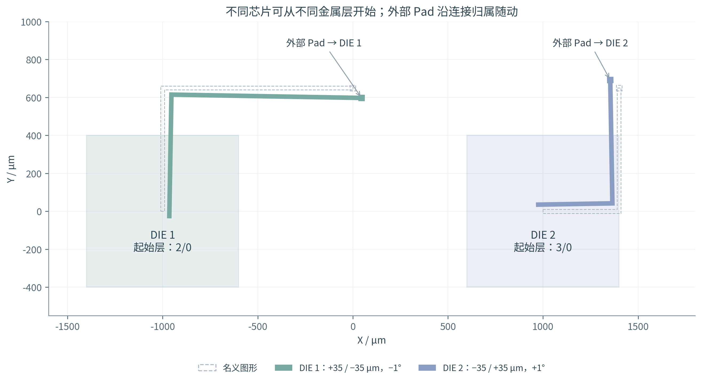
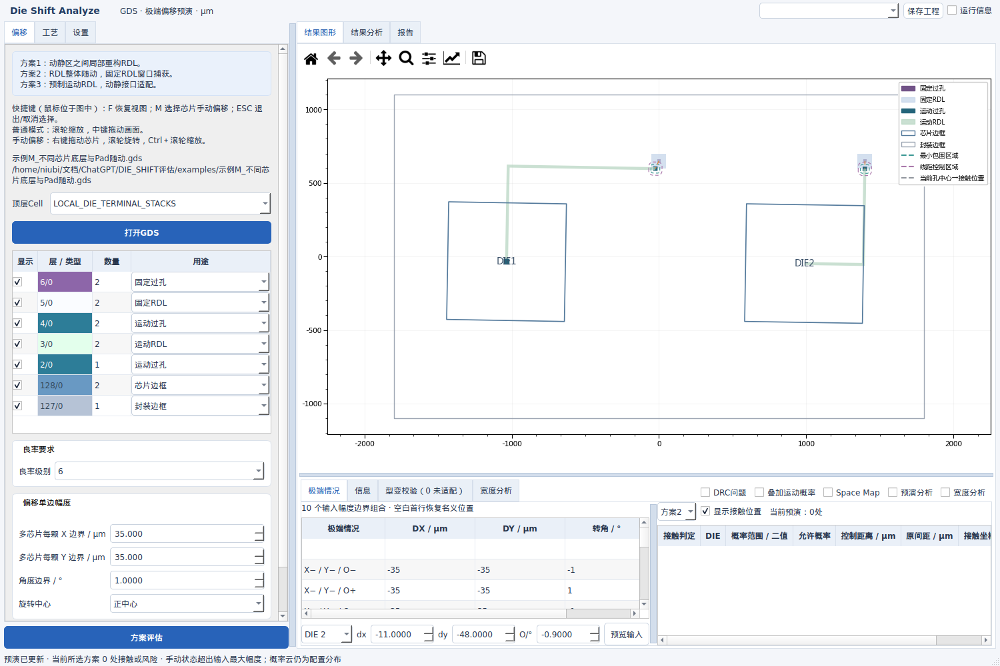
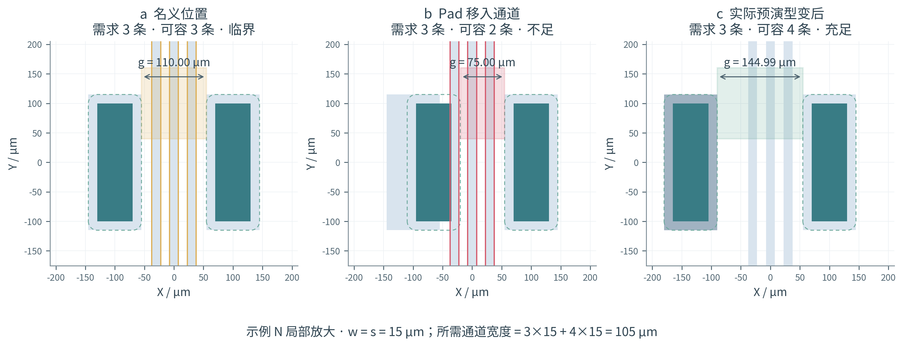
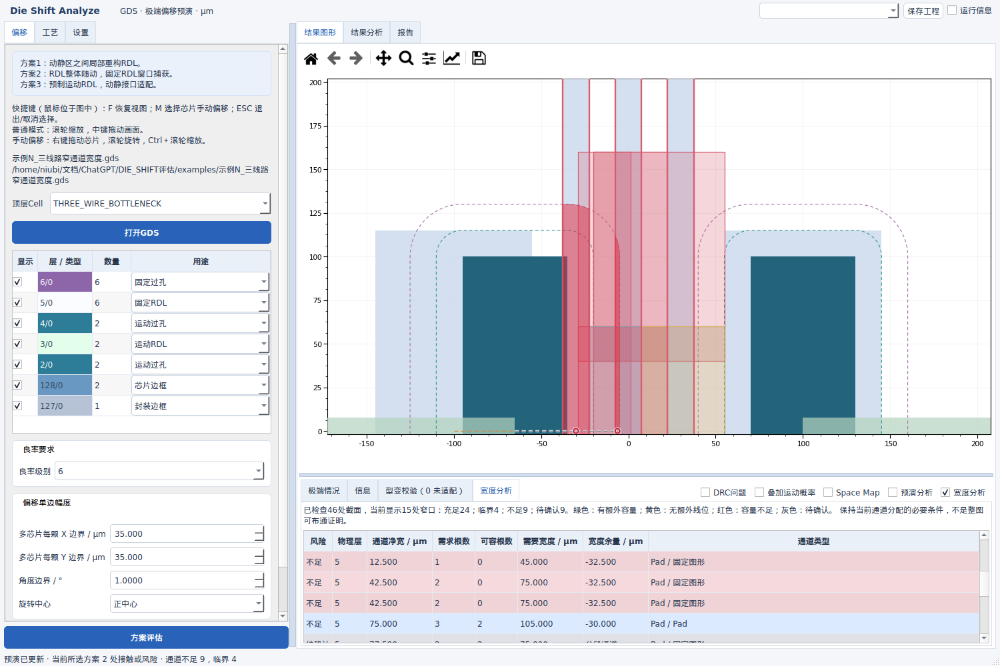

# V21：Pad 随动修复与局部宽度分析

2026-10-26。长度统一为 μm，角度输入为 °、计算为 rad。验证数据来自两个明确标记的合成工程和用户提供的 GD55 图纸；源码压缩包不包含任何图片。

## 1. Pad 不随动的复现与修复

合成示例M包含两个800×800 μm DIE。DIE1的实际起始接触在2/0，DIE2在3/0；两个4/0 Pad均通过运动RDL扇出到芯片外。V20只在全局最下金属平面设芯片根，DIE2因此得不到归属，Pad保留原位。[前后独立复现记录](../results/pad_regression_V21.json)显示：输入DX=35 μm时，DIE2外部Pad的V20实际移动为0，V21为35 μm。

V21按每颗DIE分别寻找最深末端接触。每一段追溯只使用用户定义的相邻参与金属平面之间的真实面积交叠；即使中间参与层在某颗DIE上没有图形，也不跨过它补造连接。空层不打断追溯，非金属图形不参与。带下层连接的线经过另一颗DIE时仍保留原归属。无根、多根仍明确列为待确认，不能以“最近芯片”代替连接关系。

图1｜浅色DIE边框仅作名义位置参考，虚线为名义线路/Pad，实心为独立运动后的线路/Pad；位移按真实比例显示。左DIE为(+35,−35,−1°)，右DIE为(−35,+35,+1°)。两颗DIE使用不同的根层，外部Pad随各自芯片移动。旋转中心选择在同一计算路径生效。

图2｜Qt界面回归：极端情况及M键右键平移/滚轮旋转均检查实际Pad坐标；多根、无根、经过别的DIE、局部连接缺失、空层、过孔—过孔连接另有负例/正例覆盖。

这仍是无网表情况下的**几何推定**。正确用途和层序是前提；存在实际绝缘层但几何无法表达时，不能凭重叠推断工艺上的电连接。

## 2. 宽度分析如何计算

入口是“预演分析”右侧的“宽度分析”，默认不勾选。完整状态检查所有参与RDL物理平面。端点候选包含相邻过孔的包围区、固定RDL图形、禁布区和封装边缘；逐对检查可见的最短截面，涉及固定图形时增加代表点轴截面，剔除名义上被第三硬障碍阻断的截面。具体姿态重新发现新通道，同时保留原名义通道，避免Pad压住一根线后需求被错误减小。包围区、实际端部铜区和接受的型变铜共同决定可用空间。

无邻接过孔连接、且内缩1.5倍有效线宽后仍非空的固定铜区按硬障碍处理；这是区分大块固定铜与细线路的几何启发式。其他固定铜既可成为截面边界，也可作为穿越线路。缺少网表或端子信息时，不能据此证明任意宽电源铜区的全局通行需求。

### 2.1 输入、公式和符号

$$w=w_0-\tau,\quad s=s_0-\tau,\qquad w>0,\ s>0.$$

| 符号 | 含义及取得方式 |
|---|---|
| $w_0,s_0$ | 当前RDL平面的工艺线宽、线距，μm；运动/固定分别读取。若同一物理层混用两套规则，分别取较大值作保守检查 |
| $\tau$ | 用户设置的共用DRC容差，μm；正值放宽，负值收紧，不改变最小包围量 |
| $w,s$ | 减容差后实际用于容量计算的有效线宽、线距，μm |
| $a$ | 工艺最小包围量，μm；Pad实体外扩 $a$ 形成占位边界 |
| $g$ | 两端边界间的可用截面长度，μm；扣除与端点实际相连的铜区，较大的原始孔盘不能被当成空白空间 |
| $n_j^{(0)},n_j^{(t)}$ | 第 $j$ 个同层铜连通区穿过名义/当前截面的独立内部段数；切触、端点铜及不穿越的段不计 |
| $N$ | 必须保留的线路需求根数；同网的蛇形线、多次穿越也分别计数 |
| $W_{need}$ | 放下 $N$ 条线并保留两侧线距所需的总宽度，μm |
| $N_{cap}$ | 当前通道最多可容的根数，整数；按等有效线宽/线距平行排布的局部模型计算 |
| $M$ | 宽度余量，μm；净宽减去所需宽度 |

$$N=\sum_j\max(n_j^{(0)},n_j^{(t)}),\qquad W_{need}=Nw+(N+1)s.$$

$$N_{cap}=\max\left(0,\left\lfloor\frac{g-s}{w+s}\right\rfloor\right),\qquad M=g-W_{need}.$$

推导：$N$条线占$Nw$，内部有$N-1$个间隙，两边还各需要一个$s$，共$(N+1)s$。由$Nw+(N+1)s\le g$，得到$N\le(g-s)/(w+s)$，向下取整。负容量置零，恰好等于要求时计为能通过但无额外线位。

第三Pad或固定大块进入既有通道时，将余下空隙分成 $g_1,\ldots,g_m$，分别计算容量再相加；总容量不足标红，总容量够但线路如何分配到各空隙未经证明则标灰，不能用总宽度之和冒充一个连续通道。

### 2.2 颜色与显示

| 颜色 | 数值条件 | 含义 |
|---|---|---|
| 浅绿 | $N_{cap}>N$ | 还有至少一个额外线位 |
| 浅黄 | $N_{cap}=N$ | 可容当前根数，无额外线位 |
| 浅红 | $N_{cap}<N$ | 当前通道分配的容量不足 |
| 灰 | 归属或分段分配未确认 | 不能判为通过 |

彩色矩形表示窄口所在区间，风险线路边缘同色高亮；原GDS不被修改。悬停给出数值和条件，下方表格可单击/上下键定位。只绘制容量至多比需求多2根的近临界截面及明确风险，所有发现的截面仍参与数值检查。关闭相关RDL或边界图层时，对应叠加隐藏。多组截面可以描述同一个物理窄口，不能将截面数解释为独立失效数。

图3｜示例N：三条15 μm线、15 μm线距需要105 μm。110 μm通道可容3条；DIE1 DX=35 μm后只剩75 μm，容量降为2。DX=−35 μm但未型变时旧孔盘仍占位；实际预演接受型变后净宽约144.993 μm，容量升为4。三图采用相同坐标尺度，均为局部放大。

该合成工程的恰好15 μm包围边界会触发保守缓冲离散化的约0.005 μm边缘提示；测试核对型变没有新增该类违规，不把“宽度充足”宣称为完整DRC通过。

图4｜真实界面中的窄口标记与定位表；黄色/红色对应不同截面需求。图层隐藏、当前姿态、预演后的实际铜图形均进入显示判断。

### 2.3 物理意义和适用边界

本项是**保持现有通道分配的局部宽度必要条件**，不是自动布线器。若通道不可绕行且容量不足，这组线路不能在该通道按给定规则通过。若允许绕到障碍另一侧，电气连接可能保持不变而通道分配改变；这需要另一个全局布线求解，红色不能直接证明所有全局方案均不可能。

最短/代表轴截面覆盖常见Pad间、固定图形间和边缘瓶颈，但有限截面并不穷尽任意凹形边界的所有局部极小值。绿色也不证明整图连通、长度匹配、转角、完整DRC或生产良率。本功能独立于原三方案U值、接触概率和安全盒计算，不用宽度颜色改写这些结论。

## 3. 性能、缓存与动画

- 一次性构建每层连通区、空间索引和名义通道。成批计算线段交集、穿越方向和探针，避免逐条线路反复调用几何引擎。
- 使用硬障碍专用索引，普通线路仍作为穿越需求，避免把全部软线路都做遮挡检查。不同RDL平面按CPU/内存预算并行，工作数组与拓扑缓存相互独立。新宽度几何检查使用CPU；未声称GPU加速该项。
- 首次完整姿态后台全检，有进度；相同姿态和实际型变几何使用缓存，宽度计算的缓存键包含姿态、工艺/容差和接受的型变几何。
- 动画中按当前几何跟踪最近完整状态的窄口；状态明确标为局部跟踪，不作为全图通过。终态重新发现并检查完整截面集合。已完成动画仍缓存重播。
- 屏幕外标记不绘制，保留视窗冗余；完整数值检查不受视窗裁切。大图首次全检仍可能耗时数十秒，未宣称首次计算30 FPS。

本机为8逻辑CPU、约15.3 GiB内存。GD55采用15/15/15 μm工艺，未开启型变，扫描88507组边界对；三个结果均为原始固定RDL下的当前姿态检查。

| 姿态（全部DIE） | 发现截面 | 容量不足截面 | 初次完整检查 / s | 同条件缓存取值 / ms |
|---|---:|---:|---:|---:|
| 0 / 0 / 0 | 19995 | 0 | 25.34 | 0.272 |
| −35 / −35 / −1° | 24563 | 21 | 29.72 | 0.397 |
| +35 / +35 / +1° | 24217 | 10 | 28.33 | 0.356 |

最后一条路径的局部动画跟踪检查596处截面，计算约0.31 s/帧；这一数字不是播放FPS，也不是全量分析耗时。GD55八种刚体姿态共逐顶点核对，最大绝对差为0.0 μm，未发现运动归属未解图形。

性能及GD55核对结果见[机器可读记录](../results/width_V21.json)，界面证据见[Qt测试记录](../results/gui_V21.json)。缓存读取计时仅指计算层取值，不含Qt绘制和动画时长。不同电脑负载下耗时会变化。

## 4. 验证范围

新增核心回归覆盖：两侧间距公式边界、不同DIE底层、外部扇出、局部连接缺失、不能跨越中间参与层、空层、无归属、逐DIE旋转中心、同网多次穿越、Pad覆盖线路后需求不丢失、新出现通道、实际接受型变、工艺容差和缓存。

Qt回归覆盖极端预演和M键手动偏移、图层显隐、宽度表定位、公式报告、缓存正反动画和回到无位移状态。GD55检查8种±35 μm/±1°组合的逐顶点刚体坐标，并完整测量名义及两个相反角点状态的宽度结果。**未将三个状态的宽度检查扩展解释为连续输入范围均已验证。**

本版不修改预演型变求解器的候选搜索，不声称解决V20所有未适配点。Linux检查、源码包隔离解压复核和Windows运行兼容代码是不同层次：本次没有Windows实机验收，也没有输出Linux可执行包。

发布前从最终源码ZIP独立解压，198项核心测试、5组Qt界面回归、14个示例工程CLI以及模块/已安装KLayout桌面两种后端均通过。源码205项有效载荷文件均逐一比对SHA-256；另含文件清单与验证记录，合计207个文件。ZIP采用Store格式，7-Zip、unzip及CRC检查通过，图片文件数为0。验证环境是Linux既有依赖；完整记录见[源码包验证记录](package_verification.json)。
